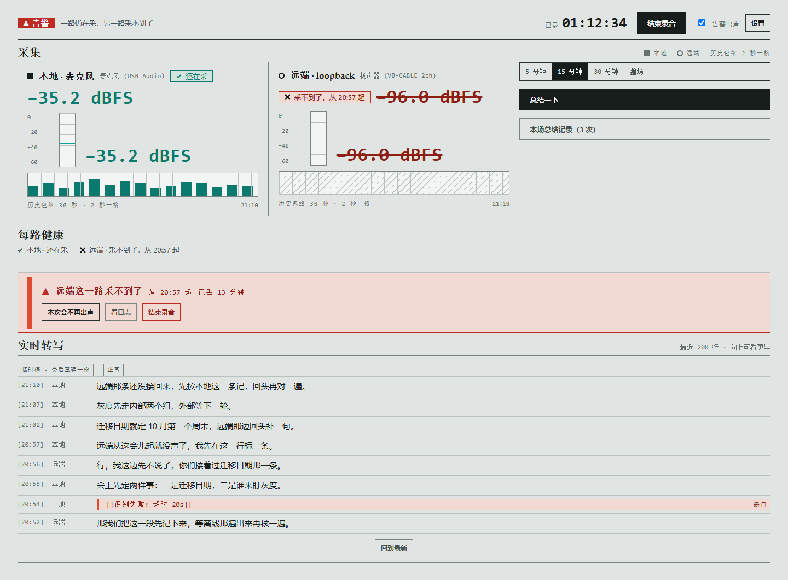
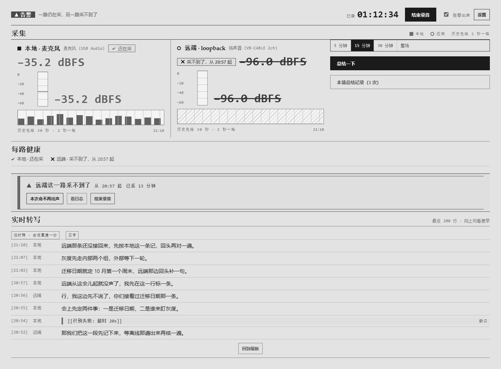
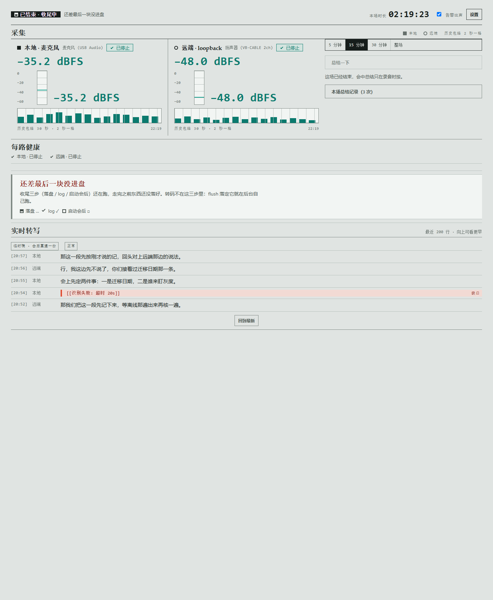
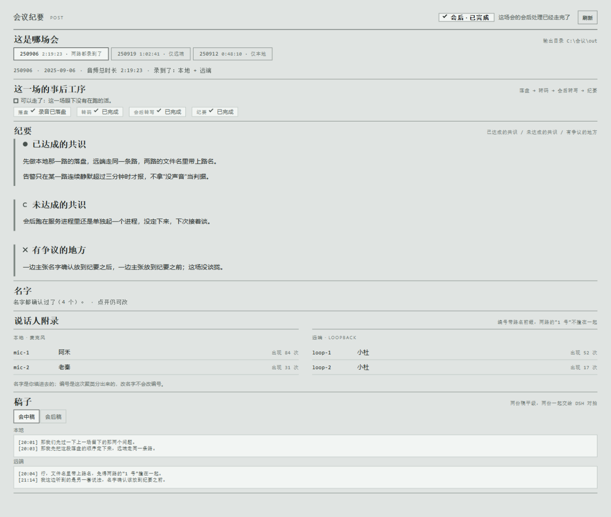

# meeting · 会中与会后界面设计

> 这份文档是 `meeting` V2 界面设计的**唯一说明权威**。设计稿（`docs/ui/`）只是它的渲染载体。
>
> 上游依据：`docs/requirements.md`（需求锚 R1–R17）。
>
> **本节点是纯设计节点**：产物是设计稿、状态截图、这份文档，**不写任何应用代码**。真正的界面由后续节点用 React 实现；`docs/ui/` 不进任何构建、不被服务引用、不引入任何依赖。
>
> 读者有两种：睡一觉醒来复核的用户（他不写代码，要判断"要不要推翻重来"），和拿这份文档去定事件契约的下游工程师（章节里的字段名与操作含义要能直接照着写契约）。

## 章节目录

| 章 | 标题 |
|---|---|
| 0 | 结论速览 |
| 1 | 需求对应表 |
| 2 | 信息架构·会中视图 |
| 3 | 信息架构·会后视图 |
| 4 | 状态机与迁移 |
| 5 | 交互清单 |
| 6 | 多开·关闭·刷新时的行为 |
| 7 | 设计 token |
| 8 | 视觉与可读性硬门槛（11 条门槛汇总成一张表） |
| 9 | 实现偏差（实现与稿子的差别只记这一处） |

---

## 0. 结论速览

这一章写给睡醒复核的人：**只读这一章，就能决定"要不要推翻重来"**。11 条视觉硬门槛的汇总在章 8，取舍理由与三个可推翻点在本章 0.3。

### 0.1 做成了是什么样（三句话）

1. **开会时那个网页一直开着，他瞄一眼就知道两路还在采**：状态、时长、两路电平、每路健康都在 1440×900 的第一屏里，录音中的圆点在走、时长在走、两根电平在动——采集是唯一不可再生的东西，所以主视图的主位只留给它。
2. **真有一路死了，他不用去找**：出事那一路的电平塌成直线、床面压上斜纹、徽标打叉、整行写着"远端 · 采不到了，从 20:57 起"，而另一路还在同一屏里照常跑，告警横幅插在两块表之外。
3. **会后他把机器放在那儿去睡觉，醒来先看到"能不能关机"，再看到"达成了什么共识"**：会中说清"收尾中"还是"已完成"，会后说清跑到哪一步，纪要主位只写共识 / 未达成 / 争议，谁说的不进这三格。

**一句话结论**：这套稿子在 1440×900 下站得住，在 390 宽下也站得住——1440 下主位那六样（状态 / 时长 / 两路电平 / 每路健康 / 告警 / 总结入口）在会中 19 个状态里全部落在第一屏（底边最远 791，是收尾失败那一档的收尾带；`heartbeat-lost` 的每路健康 634 排第二），窄屏把告警带排到了采集带之前，"远端这一路采不到了 · 从 20:57 起 · 已丢 13 分钟"落在第一屏 378 像素处，"一眼能看出哪一路死了"这句话在两种宽度下都有界面上的答案。窄屏还欠着的一半是"出事那条通道的图形"，要往下滚一段才看得全，这正是下面第 3 条可推翻点的由来。

### 0.2 五张关键截图

按"没出事 / 出事了 / 去色 / 能不能关机 / 结果对不对"各取一张：


**`live-recording-1440.png` · 正常的样子。** 两路包络的形状不一样（本地底噪铺得又高又密，远端矮而稀），峰值保持线压在柱子上方——"刚才有声音"画在静态形状里，不靠动画中间帧。



**`live-lost-one-1440.png` · 出事的样子。** 同一屏里：远端 `−96.0 dBFS`、15 根柱全落到零位线、床面压斜纹、徽标 ✘、整行 `远端 · 采不到了，从 20:57 起`；本地照旧 `−35.2 dBFS`、包络照旧、时长还在走。**告警横幅插在采集带之外，没盖住任何一块表。**



**`live-lost-one-gray-1440.png` · 去色。** 全套证据里最要紧的一张：颜色全部拿掉之后，"哪一路死了"与"另一路还在跑"仍然读得出来。颜色在这套界面里始终是一条冗余通道。



**`live-ended-1440.png` · 能不能关机。** 时长冻在 `02:19:23`，落盘 / 转码 / log / 启动会后四项各自带状态，横幅只说"还差最后一块没进盘"。V1 的收尾最长 300 秒，这段时间里说成"录音已落盘"，人就会去关机、丢掉这场会。



**`post-done-1440.png` · 最后交出来的东西。** 纪要三格（共识 / 未达成 / 争议）占住可读排版的主位；附录里 `mic-1` / `mic-2` / `loop-1` / `loop-2` 四个编号都带着名字，两路的"1 号"不撞车；两条转写各占一块，标签写「会后稿」与「会中稿」，两份**平级**；名字都确认过，那一区收成一行。

> 截图只作排版留存，正文口径以 `post.html` 与这一章为准；重拍入口是 `post.html` 的 `?state=done` / `?state=running`。

剩下 10 张，以及每一个状态的复核入口，都在 `ui/index.html`：它给每个 `?state=` 一条可点链接。

### 0.3 三个可推翻点

每处标明改起来动到哪一层：

| # | 推翻什么 | 推翻之后长什么样 | 改动层级 |
|---|---|---|---|
| 1 | **会中主视图一屏装下换来的是"看不到转写正文"** | 章 2.2 与章 8 门槛 5 把 1440×900 的第一屏整屏留给了六样主位元素，实时转写排在它们下面——`recording` 那一档转写区从 y 499 起，第一屏里看不到一行正文。要它同屏，就得把页面改成"左边主位、右边转写"的两栏，或把转写折成一行"最近一句"，或把 30 秒历史包络压矮一档腾出高度，三条路都要动版式 | **动布局**（信息架构不动："主位六样 / 转写次位"这条分工归章 2.2 管，改的是它们怎么摆） |
| 2 | **签名元素的取值：15 根柱 / 2 秒一格** | 若判断"2 秒太粗、要看见更细的起伏"，就把一格缩到 1 秒、柱子翻到 30 根（横向宽度翻倍，或把 30 秒历史缩到 15 秒）；若反过来判断"历史包络太占地方"，就退成一条峰值保持指针——那等于放弃"底噪 vs 真在说话"的区分能力 | **动 token + 动布局**（`--size-envelope-bar` / `--size-envelope-bar-stride` / `--size-grid` 三个值连带改） |
| 3 | **390 下两块表仍要滚一段才看得全这件事** | 窄屏第一屏给的是"哪一路死了"那句话（告警带已排到采集带之前）；若要求 390 也首屏看到两路电平的图形加每路健康加总结入口，就得把两块竖直表压成共用一条刻度尺的横条，或把一块表换成水平条 | **动布局**（信息架构不动：还是"两路同屏同级、告警不侵入表"） |

**第 1 条是最该被复核的一条**：它直接决定"会中界面到底要不要让人看见转写正文"。复核时点 `ui/index.html` 上 `live.html?state=recording` 那条链接，看 1440×900 的第一屏里有没有转写正文。

---

## 1. 需求对应表

这张表只列**有界面落点**的需求。每条 R 都指出它落在界面上的哪一处——下游照着这一列去定字段和端点，不会漏。

| R | 界面上的哪一处 |
|---|---|
| **R1** 主体是采集加会后处理 | 会中视图以"状态 + 两路电平 + 每路健康"为骨，占主视图绝大部分位置；实时转写排在它下面的次级区，且不带任何"正式记录"的字样。会后视图里转写也是可展开的原始材料，不占主位 |
| **R2** 采集完整、不静默出事 | 三处合力：① 每路健康显式成文（不靠电平表猜）；② 致命级告警横幅写明哪一路、从何时起；③ 已结束·收尾中的子状态——落盘没走完就不说"录音已落盘"，人会因此不敢关机 |
| **R3** 录音状态一眼可见 | 状态区（四态，字 + 图形，不靠颜色单独承载）＋ 两路电平表（本地一块、远端一块，各自带 dBFS 刻度、峰值保持、历史包络）＋ 时长（分秒可见）。三样都在主视图第一屏 |
| **R4** 采不到就要响 | 致命级告警横幅（占满宽度、插在状态区与电平区之间）＋ 出声（告警开关打开时，单次短促一声）＋ 横幅上的"本次会不再出声"仅静音本场 |
| **R5** 存活判断走心跳 | 心跳迟到（弱提示，一行字）与心跳失联（全局横幅 + 出声）两级；心跳频率在设置抽屉里可配；界面按服务应答里的服务侧时间戳判迟到，不看"HTTP 通不通" |
| **R6** 实时转写是临时稿 | 转写区顶部的固定标注"临时稿 · 会后重建一份"，区里不出现保存/导出字样；总结按钮的可用性依赖转写健康位 |
| **R7** 会中一键总结 | 总结区四件套：主按钮 ＋ 四个窗口档位 ＋ 进行中表现 ＋ 结果面板，另加"本场总结记录"回看入口 |
| **R10** 说话人靠会后聚类 | 会后视图的"名字待确认"显式待办 ＋ 说话人附录（编号带路径前缀，两路的"1 号"分成 `mic-1` 与 `loop-1`） |
| **R11** 两条转写都留 | 会后视图里两条转写各占一个可展开区块，两份**平级**：标签写「会中稿」与「会后稿」（谁也不叫"权威"——实测并不保证哪一份更好，见 `docs/design-intent.md` 第 11 条） |
| **R13** 纪要关心共识与分歧 | 会后视图主位就是纪要，固定三格：已达成的共识 / 未达成的共识 / 有争议的地方。姓名与身份都不进这三格 |
| **R14** 三种场景都要成立 | 空闲态写"这场录哪几路"（两路 / 仅本地 / 仅远端）；会后视图的场次元信息写"实际录到了哪几路" |
| **R15** 命令行只要两个词 | 会后在界面上就是工作台里那一场的**两个按钮**（「生成会后精细稿」/「生成纪要」）；失败态里另给一段可复制的命令（`meeting post <场次目录>`）兜底 |
| **R16** 服务挂了必须留 log | 结束录音的失败格、会后失败态的下一步格，都写明**发生了什么** + **log 文件路径**（可复制），并给 `meeting post <场次目录>` |
| **R17** 同一时刻只录一场 | 主视图不出现第二个"开始"入口；开始录音的失败格专门写明"已经有一场在录"这条拒绝理由与去处 |
| 「做成功是什么样」 | 章 0 的结论速览用它的口气回答"做成了是什么样" |

**R8（会后时间宽裕）、R9（离线重跑）、R12（两条转写一起喂）不单独占行**：它们落在会后管线自己的行为上，界面通过"进度走到哪一步"与"手上有没有会后稿"体现出来，各自占一行没有意义。

**这张表同时是验收判据**：表里每条 R 都对到界面上的一处，R16、R17 不得漏。

---

## 2. 信息架构·会中视图

### 2.1 这个视图的活儿

让人**随时瞄一眼就能安心**，出事了第一眼知道是哪一路。采集是唯一不可再生的东西，所以界面的第一职责是把"采不到"这件事变得不可能被忽略。

### 2.2 界面上的区块，按优先级

| 序 | 区块 | 优先 | 理由 |
|---|---|---|---|
| 1 | 状态区 | 主 | 四态之一，字 + 图形双通道 |
| 2 | 两路电平区 | 主 | 采集还活着的直接证据 |
| 3 | 每路健康区 | 主 | 不用从电平表上猜 |
| 4 | 告警区 | 主（有告警时才显示） | 出事了第一眼要知道是哪一路 |
| 5 | 总结入口 | 主 | 用户偶尔跟丢时的救命稻草 |
| 6 | 时长 | 主 | "录音在推进"的第二个证据 |
| 7 | 实时转写区 | 次（可滚动） | 给人偶尔瞄一眼，不是产物 |
| 8 | 设置抽屉 | 次（默认收起） | 改一次就不再碰 |

**主视图一屏装下**：1440×900 不滚动就能看到状态、时长、两路电平、每路健康、告警区、总结入口。转写与设置各自占一个可滚动/可展开的区域。

### 2.3 每个区块长什么样

**状态区**（第一行左侧）

- 一个状态胶囊：图形标记 + 状态名。四态固定文案：`空闲` / `录音中` / `告警` / `已结束·收尾中` / `已结束·已完成`（后两个是同一顶层状态下落盘那一小段的两档，见章 4）。
- 图形标记承担"不靠颜色"那一半：空闲＝空心方框、录音中＝实心圆点、告警＝实心三角形、已结束·收尾中＝半实心方框、已结束·已完成＝实心方框打勾。
- 状态胶囊右侧跟一句**状态说明**，随状态变：空闲态"尚未开始"，录音中"两路都在采"，告警态"一路仍在采，另一路采不到了"，收尾中"还差最后一块没进盘"，已完成"录音已落盘"。

**时长区**（第一行右侧，与结束录音按钮同组）

- 录音中/告警：`已录 01:12:34`，秒在走。
- 收尾中/已完成：标签改成 `本场时长 02:19:23`，数字冻结。
- 空闲：`已录 00:00:00`，灰。
- 时长旁边是**结束录音**（主操作，录音中/告警态才出现）与**开始录音**（空闲态才出现）。同一位置只出现一个主按钮，界面永远不给第二个"开始"入口（R17）。

**两路电平区**（第二行，本地一块、远端一块，左右并列）

每块电平表的组成部分，从上到下：

| 部位 | 内容 |
|---|---|
| 路名 | `本地 · 麦克风` / `远端 · loopback`。路名前的图形标记：本地＝实心方框、远端＝空心圆圈——灰度下这两块靠它分辨 |
| 设备名 | 当前实际打开的设备名，一行小字，可截断 |
| 健康徽标 | `还在采` / `采不到了`。字 + 图形（勾 / 叉），不靠颜色 |
| 电平表 | 竖直或水平均可，但必须带 **dBFS 刻度**（标出 0 / −20 / −40 / −60 四条）与一根**峰值保持**指针 |
| 历史包络 | 最近约 30 秒的波形包络，从左向右推进。用 **2 秒一格** 的方块/竖条表示——所有归档素材的时间粒度只有分钟级，秒级的细腻曲线会给一个素材支撑不了的精度感 |
| 当前值 | 右侧一行 `-35.2 dBFS`，随信号变 |

- 设置抽屉里也有一个"告警开关"，它与主视图上的那个是**同一个设置**。主视图上保留它，是因为"采不到的时候界面要响"这件事要能在出事那一刻就地开关。

**每路健康区**（与电平区同一行的右上角，或紧贴电平区下方）

- 两块，分别对应本地与远端，每块一句话：`本地 · 还在采` / `远端 · 采不到了，从 20:57 起`。
- 这一区是**文字保证**：即使有人看不出电平图，读这一行也有答案。它永远与电平区同时可见，任何宽度下都不折叠（见 2.6）。

**告警区**（有告警时才出现，整行横幅）

- 致命级横幅：`远端这一路采不到了 · 从 20:57 起 · 已丢 13 分钟` + 右侧三个操作：`本次会不再出声` / `看日志` / `结束录音`。
- 提示级提示条（细，不占横幅位）：`实时转写落后了 · 约 2 分钟`。
- 条数上限与排序：提示级最多显示 3 条，同类的合成一条；致命级一次只显示一条（R17 决定了同一时刻只会有一场、每条路只有一种致命故障）。「本场曾中断」提示行不占这 3 条名额、也不参与同类合并——它不来自快照告警（偏1）。
- 本区另有一行「本场曾中断」提示条：实现与上面「有告警时才出现」不同，全貌记在偏1。

**总结区**（右侧，与告警区同一行域）

- 主按钮 `总结一下`；同组四个档位：`5 分钟` / `15 分钟`（默认）/ `30 分钟` / `整场`；缺省窗口 = 15 分钟。
- 进行中：按钮位换成 `正在总结刚才的 15 分钟…`，带一个不限时的进度指示（R7 说的是十到十五秒，界面不显示倒计时，也不提前宣布失败）。
- 结果面板：三小段——`刚才在讲什么` / `讲到哪儿了` / `丢掉了什么`；只有几条，右上角一个 `关闭`，**关掉即消失，不落文件**。
- 总结区底部一行入口 `本场总结记录（3 次）`，点开列出本场按过的每一次（时间 + 窗口 + 那几条），存在内存里，会话结束即失。

**实时转写区**（主视图下方，可滚动）

- 顶部固定标注：`临时稿 · 会后重建一份`。
- 行格式：`[HH:MM] 路径标签 · 正文`。路径标签取值 `本地` / `远端`（V1 归档里用的就是这两个词），**不带粗体人名**。
- 窗口内保留最近约 200 行，向上滚动可看更早；滚动时不自动跳回底部，底部给一个"回到最新"的钮。
- 识别失败的缺口按 B12 的占位符显示成缺口样式（`[[识别失败: 超时 20s]]` 单行着色 + "缺口"角标），**不让它看起来像正常文本**。
- 区里不出现"保存 / 导出 / 正式记录 / 生成纪要"这类字样。

**设置抽屉**（默认收起，右上角一个齿轮）

| 分组 | 内容 |
|---|---|
| 设备 | 本地（麦克风）设备、远端（loopback）设备，各一行"当前设备名 + 换一个"；会中（录音中 / 告警）这一格禁用并写明「开场前定下来」（契约第 7 章：会中换设备不做） |
| 告警 | 告警开关（与主视图同一个）、心跳频率（默认 10 秒，范围 1–60 秒，越界当场拒绝并写明「只能填 1 到 60 秒」） |
| 快速总结 | 默认窗口四档预选（5 分钟 / 15 分钟 / 30 分钟 / 全场），跟着 `settings.summary_default_window` 走；模型下拉（「不选预设（用平铺四键）」恒在第一档，其后按 `settings.summary_preset_names` 的次序列各套名字，当前选区随 `settings.summary_active_preset`），**会中可切**：换一套发 `settings_update` 写盘即生效，不必重启。预设的端点与密钥不进快照、不在这里回显，清单本身在配置文件 `summary.presets_json` 里配 |

**ASR 那五个参数不进这扇窗**（`docs/design-intent.md` 第 14 条：界面上不给入口，值也不许被界面改）。抽屉里那六行全是热读键（`docs/contract.md` 4.6）：改完写进 config、无需重启；换设备那一格选完紧跟着一次重新探测，探测结果由快照两路如实渲染。

### 2.4 会中视图**不承载**什么

| 不承载 | 为什么 |
|---|---|
| 待转写队列深度、识别失败次数的**数值** | 它们是提示级告警的输入，界面从它们身上只读出一件事——转写落后了。摆一个"待转写 N 段"的计数器，就是把 V1 TUI 的信息面板搬回来，与"会中界面保持薄"相反。数值留在服务日志里（R16） |
| 会中的音频源切换 | 要录哪几路在开始前定（`mode`）。会中给的是「关掉本场在采的那一路」与「把它重新打开」两个开关（`pause` / `resume` / `set_source` 三个动作，见 5.1），换一个设备进来这件事照旧不做 |
| 无标签段落、聚类编号、说话人身份 | 会中那一层不做说话人，聚类编号是会后的事（R10） |
| 总结结果之外的任何"产物" | 会中不产生产物，唯一的产物在会后（R1） |
| 模型名、显存、RTF、延迟曲线 | 界面不摆工程指标。唯一的例外是顶栏右上那一格「忙不忙」（R31，章 7.10 的 `gpucell`）：它只答忙 / 闲 —— 字（`忙碌` / `空闲`）+ 一颗图形，哪只模型开着写在一句悬停小注里，数值与百分比一个不摆 |
| 房间类型选择器 | 录哪几路由设备选择自然决定，不额外造一个开关 |

### 2.5 什么状态显示什么

| 元素 | 空闲 | 录音中 | 告警 | 已结束·收尾中 | 已结束·已完成 |
|---|---|---|---|---|---|
| 状态胶囊 | `空闲` | `录音中` | `告警` | `已结束 · 收尾中` | `已结束 · 已完成` |
| 主按钮 | `开始录音` | **收音四组合直切**（`两路都录 / 仅本地 / 仅远端 / 全停` 四档，一次只处在一档；`全停` 即暂停）+ `结束录音` | 同左 | 无（等收尾） | 无 |
| 时长 | 00:00:00 灰 | 走秒；暂停期间停在原地 | 走秒 | 冻结，改标签"本场时长" | 冻结 |
| 两路电平 | 未探测时显示占位刻度；就绪后停在静默底噪 | 实时；暂停期间照常实时（设备还开着） | 出事那一路的历史包络**塌成直线**并打叉；另一路照常实时 | 冻结在最后一帧 | 冻结 |
| 每路健康 | `未探测` / `已就绪` / `探测失败` | `还在采`；被关掉的那一路 `采集已停止`（开关在顶栏的四组合里，卡上无按钮） | 出事那一路 `采不到了，从 HH:MM 起`；另一路 `还在采` | `已停止` | `已停止` |
| 告警区 | 不出现 | 仅在提示级时出现（另有心跳侧「本场曾中断」提示条，见偏1）；**暂停中多一条整行横带「本场已暂停」**（与致命横幅同级，排在最前面） | 致命级横幅 | 若之前有告警，保留"已恢复/结束时的状态" | 不出现 |
| 总结区 | 禁用，旁注"开始录音后才能总结" | 可用 | 可用（转写健康位为"停"时禁用并旁注原因） | 禁用 | 禁用 |
| 转写区 | 空态文案 | 实时追加 | 照常（转写不因某一路死掉而停） | 停 | 停 |
| 设置抽屉 | 可开 | 可开 | 可开 | 可开 | 可开（改心跳频率仍生效） |

**这张表之上还有一层：心跳失联（章 4.5）。** 它盖在任何状态之上，因为它说的是"界面看不见服务了"。压住的时候，上面这张表里跟"服务现在还在采"有关的部分全部作废——两路电平冻结压灰、健康位写 `数据已停`、读数退成 `—`、包络时间戳停在最后一次应答，告警区那一块整块收掉（那条"某一路采不到了"的横幅在这个时刻属于另一件事，不能同屏）。剩下的骨架一格不动，屏幕顶端那条全屏横幅是唯一在说"出事了"的地方。同一层还有「采集已停止」那一档：服务在应答、但没有帧 —— 它压住的是同一批"还在采"的格子（健康位写 `采集已停止`），判据与横幅见章 4.5。

### 2.6 会中主视图的版面：仪表盘式

会中主视图只有一套版面，下面把它写到一个没读过 spec 的执行者能照着渲染出来。

**一句话**：两路电平像调音台的两条通道条一样左右并列在顶部一条采集带上，每路的电平、健康、设备名都在自己那一块里纵向排开，采集之外的东西一律排在下面。

**布局（1440×900）**

```
┌───────────────────────────────────────────────────────────────────────┐
│ ■ 录音中 · 两路都在采            已录 01:12:34        [ 结束录音 ]     │  ← 第一行：状态 + 时长 + 主按钮
├──────────────────────────────┬──────────────────────────────┬─────────┤
│ ■ 本地 · 麦克风              │ ○ 远端 · loopback            │ 总结    │  ← 第二行左三分之二：采集带
│   麦克风 (USB Audio)         │   扬声器 (VB-CABLE 2ch)      │ [总结一下]│
│   ✔ 还在采                   │   ✘ 采不到了，从 20:57 起    │ 窗口:   │
│   ┌──┐ 0 dBFS                │   ┌──┐ 0 dBFS                │ (5)(15) │
│   │▁▃│                      │   │  │                       │ (30)(整场)│
│   │▂▅│ ← 峰值保持            │   │  │ ← 保持后塌平          │         │
│   │▃▇│                      │   │▁ │                       │ 本场记录 │
│   └──┘ −60                  │   └──┘ −60                   │ （3 次） │
│   历史包络 30s  ▂▃▅▆▅▃▂      │   历史包络 30s  ▆▅▃▁______   │         │
│   −35.2 dBFS                 │   −96.0 dBFS（直线）         │         │
├──────────────────────────────┴──────────────────────────────┴─────────┤
│ ⚠ 远端这一路采不到了 · 从 20:57 起 · 已丢 13 分钟                      │  ← 告警横幅：整行插入
│   [本次会不再出声] [看日志] [结束录音]                                  │
├───────────────────────────────────────────────────────────────────────┤
│ 实时转写 · 临时稿 · 会后重建一份                                       │  ← 次级：可滚动
│ [20:57] 本地 · 那我们把这一段先记下来……                                 │
└───────────────────────────────────────────────────────────────────────┘
```

**特点**

- 两路永远同屏同级：告警横幅插在采集带与转写区之间，**不会盖住任何一块电平表**。
- 每块电平表自带路名、设备名、健康徽标、刻度、峰值保持、历史包络、当前 dBFS——**一块即一条完整通道**，眼睛不用在两处之间来回跳。
- 告警横幅是"插进来的一条横带"，其余各行位置不变，界面不重排。这一条直接决定了截图 5/6 的样子：出事的那块塌成直线、另一块照常动、横幅说清哪一路从何时起。
- 窄屏（390）的退化与区块次序见章 4.6。

**代价**

- 横向空间紧：1440 下采集带占左三分之二，右侧三分之一给总结区，转写区被压到下方一条。要让人一眼看到"最近在说什么"，得往下看一点。
- 两块的内部结构必须严格一致，任何不对称（比如远端多出一行恢复记录）都会破坏"两条通道"的整齐感。

**为什么是这个形状**：本设计的骨头是"**一眼能看出哪一路死了，同时一眼能看出另一路还活着**"。两路并列在一条带上，告警横幅插在带子之外——两块电平表同时保持可见，"告警期间录音仍在继续"这条澄清（章 4.2 一）在界面上只有这一个正确形状。

会中稿只有 `live.html` 一份，`?state=` 支持的状态与参数以章 4.5 为准。

---

## 3. 信息架构·会后视图

### 3.1 这个视图的活儿

会后是漫长的（几小时、挂机到第二天都行），所以这个视图要能被反复打开，也要能说明"它跑到哪了"。它要回答三个问题：**这是哪场会**、**跑到哪一步了**、**结果是什么**。

**两个按钮住在工作台里那一场的详情里**（`docs/requirements.md` R26 / R15，块类名 `wspane__post*`）。按「结束录音」之后会后一个动作都不自动跑，这一节的流程由人在工作台上按按钮起：

| 元素 | 契约 |
|---|---|
| 「生成会后精细稿」 | 用离线模型重新转写整段录音，产出带说话人编号的会后精细稿；耗时较长，占用显卡。按下发出的是 `post_offline`，带 `dir` = 界面上选中那一行 |
| 「生成纪要」 | 把该工作区现有的稿子交给 DSH 生成纪要；缺少会后精细稿时按现有档位处理。按下发出的是 `post_minutes`，同样带 `dir` |
| 那一格小字 | 按**选中那一行**的 `has_offline` 写两句之一：`会后精细稿：有` / `会后精细稿：无`。它说的与按钮跑的是同一场（动作收下 `dir`，服务按它指定的那一场跑，见 `docs/contract.md` 4.3）。**两句都是纯读数**：那一趟跑什么写在按钮自己的悬停小注里，正文不复述 |
| 按不动时（两档，逐字同 `web/src/home/post.ts`） | ① 目录不存在 → `目录不存在，无法运行会后任务`，那一格**不再复述**（`null`）：「跑不了」上面那句已经说完，且「目录不存在」是**目录那一格**的说法，不摆到这一格上；② 工作区 `state` 是 `recording`（这一行就是本进程此刻在录的活跃场次）→ `该工作区正在录音中`，那一格把两件事**并列**说（既不收起来、也不互相盖住）：`该工作区正在录音中；磁盘上的会后精细稿：有` / `…：无` —— 「磁盘上有没有」按名目读（`has_offline` 只看文件名）。**「收尾没落定」不再是按不动的一档**：工作区读数只表达「这场录音走到哪了」（`recording` / `ended` / 尚未开始三档口径，`docs/contract.md` 4.8），被强杀丢在收尾半路的那一场读数就是 `ended`、按钮照按。两档都只写在脸上，服务侧判据与界面同一行同源：① 按 `dir` 那一场的目录判读、按 `invalid_setting`(400) 拒；②「还在录音中」指的就是本进程此刻在录的那一场 —— 会后两按钮由运行时闸按 `draining`(409) 拦（那一档不会与工作台同屏）、`speaker_rename` 按 `invalid_setting`(400) 拒（`docs/contract.md` 4.3 / 4.11）；**盘上残档不拒**：被强杀丢在录音半路（盘上停在 `recording`）或收尾半路的那一场，读数就是 `ended`、按钮照按 |
| 拒跑与失败 | 409（还在录音中 / 有一趟在飞）与 404（这一层没接实现）都落进工作台的 `fail` 块；起成功只在块里写一句「这一趟已起。」 |

### 3.2 界面上的区块，按优先级

| 序 | 区块 | 优先 | 理由 |
|---|---|---|---|
| 1 | 场次元信息 | 主 | 先知道在看哪一场 |
| 2 | 进度 | 主 | "能不能去睡觉"的答案 |
| 3 | 纪要（共识 / 未达成 / 争议） | 主 | 唯一的最终产物 |
| 4 | 名字待确认 | 主 | 唯一需要用户动手的地方 |
| 5 | 说话人附录 | 次 | 纪要之后才看 |
| 6 | 两条转写 | 次（可展开） | 追溯用的原始材料，不抢主位 |

**为什么只有三样在主位**：纪要是唯一的最终产物，进度决定今晚能不能睡，待确认名单是唯一要动手的地方。转写是追溯材料。

### 3.3 每个区块长什么样

**顶部：会议选择器 + 场次元信息**

- 会议选择器：列出**工作区注册表**里登记的那几场（软件自己记的那份清单，住在服务侧配置目录；起点是用户挑过的目录，列表从登记来），默认选中的是**最近一次被打开/切换**的那一场。每项排两行——场次号一行，`时长 · 哪几路录到了` 一行；选中那一项带实心底，另有 `aria-pressed="true"`。演示数据里默认选中的是 `250906`，它那一项的两行是 `250906` / `2:19:23 · 两路都录到了`；后面两项是 `250919`（`1:02:41 · 仅远端`）与 `250912`（`0:48:10 · 仅本地`），演示数据里排在最前面的一项就是最近的那一场。
- 元信息一行：`250906 · 2025-09-06 · 音频总时长 2:19:23 · 录到了：本地 + 远端`（对齐 R14 三种场景：`两路` / `仅本地` / `仅远端`）。这一行始终跟着选择器里选中的那一场走，章 4.5 会后状态表里的 `running` / `done` / `empty` / `failed` 四档说的都是这一场。
- 右上角一个 `刷新`，重新向服务取这一场的状态。
- 没有任何场次时给空态：`这个目录里还没有会。先敲 meeting web 录一场。`

**进度区**

进度有**两层读数，各答各的问题**：五步是会后整链的粗阶段，逐块读数是「离线转写」这一步里面的细读数。

**粗阶段（五步）** —— 固定五个步骤，顺序即流程顺序，不可跳步展示：

| 步 | 名称 | 展示内容 |
|---|---|---|
| 1 | 离线转写 | 等待 / 进行中 / 已完成（含耗时）/ 失败 + 原因 |
| 2 | 说话人聚类 | 同上，已完成时写"聚出 4 个编号" |
| 3 | 纪要生成 | 同上 |
| 4 | 名字确认 | 有名字没确认时是"待你处理"，全确认后是"已完成" |
| 5 | 收尾 | 同上 |

- 每步四种状态，各有字与图形：`等待`（空心方框）、`进行中`（旋转方框 + 已跑时长）、`已完成`（勾 + 耗时）、`失败`（叉 + 原因）。
- **起点态**：按「结束录音」之后会后一个动作都不自动跑（`docs/design-intent.md` 第 10 条），
  会后那一套**要人在工作台上按按钮才起** —— 五个步骤全部停在 `等待`（设计稿把进度区标题写成
  `会后还没开始 · 等你在工作台上按按钮`；两个按钮是「生成会后精细稿」与「生成纪要」）。
  它与会中视图的「已结束·收尾中」对得上，让人看得出「这场会刚结束、后面等我说了算」。

**细读数（会后进度区）** —— 选中那一场的详情里摆一块**会后进度区**（类名 `wsprog`
族，章 7.10），读 `GET /api/sessions/{id}` 的原文（契约 4.9），口径：

- **可展开收缩**：头行是「会后进度」小标题 + 阶段行 + 停止入口（在飞时才有，见下）+
  一颗展开/收缩按钮（`aria-expanded`）。
  阶段行答「此刻在不在跑」：真在跑写 `正在运行：本地 第 2/5 块`（配旋转的 spinner）；盘上停着
  一版 `running` 而实际没东西在跑时按 `in_process` 分层如实写；盘上是 `interrupted`（被人停在
  块边界）自成一相，写 `已中断`（红叉标记——它没跑完，等的是人的决定）；
  终态**按盘上那四档各写各的**（`FINISHED_PHASE`，一句话一张脸）：`done` → `已完成`、
  `partial` → `部分完成`、`failed` → `失败`、`ledger` → `有逐块记录，尚未出结论`；
  没跑过写 `尚未运行`。
- **停止入口**（R28）：头行上一颗 `停止`（`wsprog__stop`），只在**这一场**的
  offline 那一趟在飞时出现（纪要那一趟是另一套机制，服务对它的停止请求如实拒，入口因此不摆）。
  按下发出 `post_stop`，受理即回——界面上写一句「停止已受理：当前块收尾之后停下」，
  随后照常靠轮询看到阶段行翻「已中断」。
- **「添加工作区」的确认**（R28）：会后在跑（顶层 `post_job` 非空）时按
  「添加工作区」、挑完目录，先弹一句「正在运行的会后任务将被中断，是否继续？」——确认 = 先打 `post_stop`
  再走原登记（受理即回，不等块边界）；取消就什么都不发。服务端对登记动作不设闸，拦与放都在
  这一只弹窗里。
- **每路一条进度条**：本地、远端各一条，分母**按路各算各的**（设计意图第 9 条：合成一个整场
  分母就是在造一个不存在的量）。读数只写 `--p` 这一个 CSS 变量（与会中电平 `--level` 同一
  手法），旁边给 `done/total`，分母读不着写 `done/?` —— 进度条不猜。
- **逐块行往下刷**：每跑完一块落一行，像 `本地 第 3/5 块 · 成功`、`远端 第 2/5 块 · 静音`；
  归属按两次读数的四档计数差值归档（成功 / 静音 / 失败 / 未判定），这一页
  打开之前已经跑过的块如实记「已处理」。重跑一场，逐块行**整段重播**（`started_at` 换新
  / 某路 `done` 回落即判重置）—— 旧行是上一趟的记录，新一趟不沿用。**已中断之后重按按钮照此
  重播**（新一趟的 `started_at` 换新，打断场上已有的那几行自然归位）。
- **轮询与收敛**：只在这一场有活动时轮询（被 `post_job` 联结命中，或读数说在跑）；按下会后
  按钮后最多一个心跳周期内自动起跳跟随；跑完自动停表并重取列表 —— 行翻「待处理」、全局
  那格「忙不忙」翻闲。**中断那一跳同样收敛**（`interrupted` 是盘上终态，`in_process`
  翻假即停表）。瞬态网络失败按心跳节奏自动重问；404（这一场不在清单里、或目录
  不存在）重试也是同一句，停表，错误行收起态也看得见。
- **列表行四态**（与这块进度区配套）：空白 / 录音中 / 会后任务运行中 / 待处理 —— 字与形状
  （glyph / spinner）双通道，颜色只是冗余通道（`wslist__state--post-running` / `--waiting`
  两档）。行 `state` 是三档口径（`docs/contract.md` 4.8）：`recording` → 录音中、`ended` →
  待处理（被强杀丢在收尾半路的那一场也在这一档 —— 收尾进度不进行状态，由上面那块进度区另答）、
  尚未开过会 → 空闲族；「目录不存在」（灰）照旧如实保留。
- 展开区的附注行给**四档合计**与这一步的已运行秒数：`已运行 38 秒 · 12 块 · 成功 9 · 静音 2 ·
  失败 1 · 未判定 0`。「块数是给人看的读数，不作判据」是设计意图第 6、7 条的话，**只留在本文档里，
  不摆到界面上**。
- 进行中的步骤给一个"可以关掉这个页面"的旁注：`关掉页面不影响，服务照跑。`

**纪要（主位）**

固定三格，不可为空、不可合并、顺序固定：

| 格 | 标题写法 | 为空时 |
|---|---|---|
| 1 | `已达成的共识` | `这一场没有记下明确的共识。` |
| 2 | `未达成的共识` | `没有悬而未决的议题。` |
| 3 | `有争议的地方` | `没有出现分歧。` |

- 每格标题带自己的图形标记（实心圆 / 半环 / 叉），颜色不是唯一通道。
- 每条一段短句，**不写是谁说的**（R13：纪要跟人没有关系）。
- 主位是"可读排版"：宽行距、单栏、字号明显大于其它区块。

**名字待确认**（紧接纪要，在附录之前）

- 一份显式待办清单，一行一个编号 + 首次出现的时间 + 一句上下文摘录 + 一个输入框 + `确认`。
- 每行右边一个 `跳过`，跳过之后仍留在清单里。
- 全部确认后这一区收成一行：`名字都确认过了（4 个）。`，点开仍可改。
- 它出现在进度步骤 4 里，也就是**写完纪要之后**才轮到这里（R10：名字放到会后推，名字是附录）。
- **实现偏差**：这一区的实现与上面的稿子不同，全貌记在偏2。

**说话人附录**

- 按路径分块，标题就是路径名：`本地 · 麦克风` / `远端 · loopback`。
- 每条：编号 + 已确认的名字（没确认就只写编号 + `待确认`）+ 出现次数。
- 编号带路径前缀，**两路的"1 号"不撞在一起**：`mic-1` / `mic-2` / `loop-1` / `loop-2`。
- **实现偏差**：附录眼下还没有界面版式，全貌记在偏3。

**两条转写**

- 两个可展开区块，各带标签（**平级**，谁也不叫"权威"）：
  - `会后稿`（会后离线模型整段重跑那条）
  - `会中稿`（会里边录边写那条）
- 默认都收起，展开后给行数、时间跨度、字数与正文（分钟级 `[HH:MM]` 时间戳）。
- 两条标签都用**字 + 图形**（实心圆 + 标签字），不靠颜色。

**空态**

- 真实存在：空态样本那一场（**250919**）的 `meeting_notes.md` 只有 **39 字节**（`docs/v1-lineage.md` 第 6 章的实测值），会中总结根本没产出。这一场也是**仅远端**那一路的样本——它会出现在两处：选择器里排第二项（`1:02:41 · 仅远端`），以及这一条空态说明里。
- **空态样本与默认选中那一场分属两场会**，稿子把这条关系摆明了：选择器默认选中最近一次被打开的那一场 `250906`，`250919` 是选择器里可以点过去的另一场。`post.html?state=empty` 切的就是 `250919` 那一副样子（场次有音频、会中总结为空），而 `?state=done` 这一档（`post-done-1440.png` 拍的）在看 `250906` 时，会中转写那一格照样摆着这条 39 字节的空态说明——一样东西在两场里的两张脸，点一下选择器就能看到另一场。
- 会中总结为空时，纪要与附录的位置上写：`这场没有会中总结。会后纪要不依赖它——两条转写都在下面。`
- 整场都没有产物时（会中断了、音频也没落全）写：`这场没有留下能出纪要的东西。音频在 <路径>，日志在 <log 路径>。`

**失败态**

- 写明**哪一步失败、什么原因、下一步怎么办**，下一步给一段可复制的命令：`meeting post 250906`。
- 一步失败不影响已完成的步骤：`离线转写` 失败时，进度条上它打叉，后面的步骤全部停在 `等待` 并注明"上一步失败，先修它"。

### 3.4 会后视图**不承载**什么

| 不承载 | 为什么 |
|---|---|
| 模型名、显存、耗时曲线 | 界面不摆工程指标。唯一的例外是工作台顶栏那一格「忙不忙」（R31，章 7.10 的 `gpucell`）：只答忙 / 闲（字 + 一颗图形），哪只模型开着的一句小注悬停可见，数值与百分比一个不摆 —— 忙/闲灯与模型名、显存那类工程指标是两回事 |
| 编辑纪要 | 纪要由模型产出，改它等于改产物；不满意就在工作台上再按一次那两个按钮 |
| 秒级 / 词级时间戳排版 | 全批归档只有分钟级 `[HH:MM]`，排版不为它留位 |
| 跨路的说话人身份合并 | R10 明确不做 |
| 会中的实时状态 | 会后视图不看录音中的那一场的实时电平，那是会中视图的事 |

### 3.5 什么状态显示什么

| 元素 | 会后还没开始 | 进行中 | 已完成 | 空态 | 失败态 |
|---|---|---|---|---|---|
| 进度区 | 五步全 `等待` + `会后还没开始 · 等这场会收尾` | 当前步骤 `进行中` + 已跑时长 | 五步全勾 + 各步耗时 | 与"进行中"一致（有人手动清了产物时会重跑） | 失败那一步打叉 + 原因，后续步骤停 `等待` |
| 纪要 | 位置留给进度，显示 `纪要还没生成` | 同上 | 三格齐 | 三格都在，各自给空文案 | 没到这一步就写 `纪要还没生成`；走到了才写失败 |
| 名字待确认 | 不出现 | 步骤 3 完成后出现 | 收成一行 `名字都确认过了（4 个）` | 有编号就出现，没有就不出现 | 没到这一步就不出现 |
| 附录 | 不出现 | 聚类完成后出现 | 完整 | 有编号就出，没有则 `这场没有分出说话人编号` | — |
| 两条转写 | 可展开（音频与实时稿在收尾后就已落盘） | 可展开 | 可展开 | 会中那条给 39 字节那类空态 | 可展开 |
| 失败提示 | 不出现 | 不出现 | 不出现 | 不出现 | 失败块 + 可复制命令 + log 路径 |

### 3.6 宽度

- 1440：单栏可读排版，纪要正文宽度收在约 68 个汉字，其余区块与它对齐。
- 390：同一顺序，不砍区块（原则见章 4.6）；纪要三格各占整宽；附录与两条转写默认收起；会议选择器占整宽、可滚动。

---

## 4. 状态机与迁移

**顶层状态就是四个**：`空闲` / `录音中` / `告警` / `已结束`。其余全部挂在它们下面，不新开顶层状态。

### 4.1 四态与迁移

| 状态 | 界面表现 | 进入条件 | 离开条件 |
|---|---|---|---|
| **空闲** | 开始前的准备态 | 服务起来了、这场还没开始 | 按下"开始录音" → 录音中 |
| **录音中** | 正常录制 | 录音已启动 | 一路或多路出事 → 告警；用户结束 → 已结束 |
| **告警** | 录音**仍在继续**，但某一路出事了 | 服务侧判定某一路采不到了，或报出其他采集异常 | 出事的那一路恢复 → 回录音中；用户结束 → 已结束 |
| **已结束** | 这场录完了 | 用户结束 / `Ctrl+C` | 子状态走完 → 已完成（终态） |

### 4.2 三条澄清（每条都是下游实现会踩的）

**一、进入"告警"时录音还在继续。**

没出事的那一路照常录，界面得**同时**说清"哪一路还在、哪一路没了"。把这套界面做成"整场进入告警页、正常的那一路看不见了"，就是本设计最严重的失败。落地要求：告警横幅是**插进来的一条带**，两路电平表、两路健康、时长、总结入口全部原地不动。

**二、"已结束"的落盘那一小段，如实说两句"能不能关机"。**

录音结束的那一刻，这场会就回到"当前没有进行中的会议"（`docs/design-intent.md` 第 10 条）：
回工作台、会后按钮能不能按，都**不等落盘四步**。落盘（收尾四步）只是"录音已结束"之下的
**一小段进度**，它在界面上只占一小块、不阻塞任何东西；"能不能关机"的两句话只活在
这一小段里：

| 落盘进度 | 界面说人话 |
|---|---|
| 收尾还在跑 | `还差最后一块没进盘` |
| 收尾落定 | `录音已落盘` |

- 落定判据：**收尾四步都落定**（前三步 `done` / `skipped`、`post` 那一格停在 `waiting`
  也算落定 —— 会后一个动作都不自动跑，那一格等的就是工作台上那两个按钮，见章 3.1）。
- 落盘**内部失败**（转码失败、落盘失败、log 写不下）时，这一小块给一个失败块：原因 +
  可复制的命令 + log 路径，并且绝不说"已落盘"。它不拦工作台、也不拦会后按钮
  —— 被强杀丢在半路的那一场，工作区读数就是"录音结束"（`docs/contract.md` 4.8 的三档口径）。
- **落盘失败这一档（`ended-drain-failed`）只留一条横幅**：收尾横幅 + 它下面的失败块。
  这时候录音早就结束了，两条通道写着"已停止"，再挂一条"某一路采不到了"的通道失效横幅，
  屏幕上就出现两处说"出事了"的横幅、两段几乎重复的明细（一处说"远端这条音频转不出来"，
  另一处说"远端这一路采不到了"）。那一档的答案由收尾横幅 + 四项明细给：明细里 `转码`
  那一步打着叉，失败块把原因、可复制的命令与 log 路径写全。通道失效横幅只在"录音还在跑、
  某一路没了"的告警态出现（章 4.5 会中状态表）。

**三、心跳失联归界面自己管，不进状态机。**

它可以盖在任何状态之上（包括空闲），因为它描述的是"界面看不见服务了"，跟服务自己在干什么无关。心跳**恢复后自动消失**，并留一条短记录（`已恢复，中断 42 秒`）。

### 4.3 挂在四态下面的子状态与字段

**顶层：空闲**

| 名字 | 取值 |
|---|---|
| `设备就绪`（每路一个，共两个） | `未探测` / `已就绪（挑到了端点）` / `探测失败（一个能打开的端点都没有）` |
| `场次路径` | 工作区目录，一行小字（目录名就是这一场会的名字，`docs/design-intent.md` 第 3 条） |

三个取值的界面文案：`未探测` / `已就绪 · 麦克风 (USB Audio)` / `探测失败 · 没有能打开的端点`。C2/C3/C4/C6 那批设备坑按「能不能打开」分两档落：**C2（COM 没初始化，试开当场抛）与 C3（同名候选一条都开不起来）开不了——这一路一个能打开的端点都没有，落"探测失败"**（C2 拖到运行期才发作的那一档落"采不到了"，不在这里），所以"探测失败"必须与"未探测"分开说；C4（虚拟声卡端点选错）与 C6（两路抓到同一路）能打开，"能打开但试开那零点几秒读回全零"仍算"已就绪"（房间当时安静、远端当时没在出声时读到的就是零，所选端点与峰值写在 `detail` 里）。

**顶层：录音中**

| 名字 | 取值 |
|---|---|
| `转写健康` | `正常` / `落后` / `停` |

**实时转写挂在"录音中"下面，是一个字段**——实时转写的健康位。理由是实时转写不会改变界面该让人做什么：它停了，录音照录、电平照动、告警照响，**变的只有"总结入口现在按不了"**。把这个字段做成一层状态页，会让人误以为"转写停了这场就完了"——那是 R6 明确否掉的立场。

| 取值 | 界面表现 | 对总结入口的影响 |
|---|---|---|
| `正常` | 转写区照常追加，无提示 | 可用 |
| `落后` | 提示级告警条：`实时转写落后了 · 约 2 分钟` | 可用（窗口可以取小一点） |
| `停` | 转写区顶部标注追加一句 `转写已停` + 最后一行时间 | **禁用**，按钮旁写原因：`转写停了，总结没有材料可读` |

**每路健康**（录音中 / 告警共用，每路一个）

| 取值 | 界面表现 |
|---|---|
| `还在采` | 勾 + `还在采`，电平实时 |
| `采不到了` | 叉 + `采不到了，从 HH:MM 起`，该路历史包络塌成直线并冻结 |
| `已恢复`（本场发生过又恢复） | 环形箭头 + `已恢复（20:57–21:10 丢过 13 分钟）`，电平恢复实时 |

**顶层：告警**

| 名字 | 取值 |
|---|---|
| `告警级别` | `提示级` / `致命级` |
| `哪一路` | `本地` / `远端` / `心跳`（心跳失联的横幅也走告警区，但状态归界面本地态，见 4.4） |
| `起始时刻` | 墙钟 `HH:MM` |
| `持续时长` | `已丢 13 分钟`，分钟级 |

**顶层：已结束**

| 名字 | 取值 |
|---|---|
| `收尾进度` | `收尾中` / `已完成` |
| `收尾明细` | 落盘 / 转码 / log / 启动会后，四项各自的 等待/完成/失败 |

### 4.4 告警分级、出声规则与门槛

**分级**（要写进文档，不能留给实现即兴）

| 级别 | 内容 | 界面 | 出声 |
|---|---|---|---|
| **提示级** | 队列积压、识别失败计数上涨、实时转写落后；另收一项心跳侧来源——「本场曾中断」（心跳侧的采集空洞留痕，见偏1） | 细提示条，最多 3 条，同类合并 | **不出声** |
| **致命级** | 某一路采不到了、心跳失联 | 整行横幅 + 全局横幅 | 出声（告警开关打开时） |

**静默门槛的输入——为什么是这个量级**

250906 的正常句间停顿里散着一批 **31–56 秒**的连续全零段（实测：20–70 秒那一档共 36 段，最长 56 秒），所以"一路没声音"**不能**当告警判据；判据必须是**连续性**——那两场真实事故是 **13.4 分钟**与 **30.5 分钟**（250906 的 loop 轨，逐样本全零，墙钟 20:57:00–21:10:23 与 21:56:55–22:27:21）。

**本设计给出的口径**（数值的最终定档由服务侧做，但界面的说法与量级依据归这里）：

- 静默门限：低于 −60 dBFS 视为"这一路在静默"。
- 连续性判据：一路**连续静默 ≥ 3 分钟**（180 秒）才报致命级告警。180 秒对 56 秒的实测停顿留了 3.2 倍余量；对 13.4 分钟的真实事故只延后 3 分钟就报出来——那时事故才走了 22%，还来得及救。
- **服务侧可用更大的值，不得用更小的值。**
- 恢复判据：该路**连续有信号 ≥ 10 秒**才算恢复（避免抖动式反复告警）。
- 复制"设备能打开但采到全零"这一类静默失败（C2/C3/C4）：判据一样走连续性，所以它在 3 分钟后同样会被报出来。这是**把全零与底噪分开看**的直接收益——mic 一路永远有底噪（250906 实测有信号秒均方根 −35.2 dBFS、逐样本零只占 0.4%），而 loopback 无人说话时写下的是一串精确的数字零（逐样本零占 79.4%）。

**出声规则**

- **形态**：单次短促一声，非连续、非循环。致命级事件**首发响一声**。
- **抑制窗口**：同一事件 **60 秒**内不重复出声。事件的身份 = 哪一路 + 故障类型；恢复后再次发生算新事件，重新响一声。（"一有风吹草动就响"的告警会让人关掉开关，那比没有告警更糟。）
- **用户控制有两层**：`告警开关` 是持久化设置（跨场次记住），`本次会不再出声` 是会话级（不改持久化开关）。
- **前端只触发声音，不判断告警**：响不响由服务推的字段决定，界面只负责"响一声"这个动作与抑制窗口。

### 4.5 界面本地态

心跳由**界面**按固定频率（默认 10 秒，可配 1–60 秒）向服务要一次应答。应答必须**带服务侧时间戳与录音存活字段**——只看"HTTP 通不通"会漏掉"服务还活着、录音线程已卡死"这一类。

| 名字 | 取值 | 判据 |
|---|---|---|
| `心跳状态` | `正常` / `迟到` / `失联` / `已恢复` | 按应答里的服务侧时间戳与本地时钟的时间差 |

- `正常`：时间差 < 1 个周期。不显示任何东西。
- `迟到`：时间差 ≥ 1 个周期且 < 2 个周期。弱提示，一行字：`心跳迟到 · 8 秒没收到应答`。不出声。
- `失联`：时间差 ≥ 2 个周期。全局横幅 + 出声（若开关打开）。

**心跳失联的横幅文案**（必须写清发生了什么与怎么办）

> **录音已中断**
> 10 秒一次的应答，连续 2 次没收到（最后一次应答 20:57:31）。
> 先别关这台机器，也别关这个页面。到服务那边看一眼：`Ctrl+C` 停掉再敲一次 `meeting web`；日志在 `~/.config/meeting/logs/meeting.log`。

- 失联时两路电平**冻结 + 压灰**，健康位写 `数据已停`，读数退成 `—`（估出来的那个数字不再顶着），包络时间戳停在服务最后一次应答的时刻 `20:57:31`，时长标签改 `最后读数`。**不把估出来的数据继续画成在动**——录音已经死掉时界面还在忽悠人，是本项目最不能犯的错。
- 失联横幅说的是"界面看不见服务、整场录音已经中断"，而 `远端这一路采不到了` 那条致命横幅说的是"服务还在、某一路没了"。两句话描述的是两件互相排斥的事，**不得同屏**：心跳失联下整块告警区（含那条致命横幅与它上面的三个按钮）不出现，屏幕上关于"出事了"的话只有全屏横幅这一处。心跳恢复后两条都不留残影。
- `已恢复`：横幅自动消失，状态区旁留一条短记录 30 秒：`已恢复，中断 42 秒`；两路读数与服务时间戳回到实时，转写区在中断那一格留一条 `[20:57–20:58] 数据已停` 的断口。

**心跳优先级**：失联横幅盖在任何状态之上，包括空闲与已结束。

**「采集已停止」横幅（服务在应答，但没有帧）**

另一件事与失联长得像：应答照常来（HTTP 通、服务侧时间戳也是新的），但应答里的 `recording_alive` 是 `false` —— 采集线程停了，两路的内容都记不下来。告警区给一条横幅，写清"已经多少秒没收到任何一路的音频帧、最后一次收到帧是几点"；电平冻结压灰那套处置与失联相同。

- 判停要**连续两次读数**都是 `false`（`CAPTURE_STOP_CONFIRMATIONS = 2`，即连续两拍）；单次 `false` 不弹横幅，任何一次不是 `false` 的读数（`true` / `null` / 失联）把计数清零。
- 开场那一拍服务报的是 `null`（**还没有第一帧**：开场窗口 `max(2.0s, 3 × frame_interval)` 自本场开始起算，窗口内一帧都没到按"还不知道"交出去）：`null` 不进计数、也不弹横幅 —— 刚按下开始的那几秒不会再误报「已停止」；窗口过了仍一帧没有，服务才如实报 `false`，两拍之后横幅照常出来，真的饿死报得出来。
- 它与致命级横幅（"某一路采不到了"）不同屏：致命级在场时这一条不出；也只看录音中 / 告警两态（`idle` / `ended` 服务给的 `recording_alive` 本来就是 `null`）。

**服务重启后状态自洽**：服务重启后，界面重新打开时向服务取状态；服务侧**没有**正在进行的会话，界面就停在 `空闲`。**启动不再去读任何别的场次目录**（"扫最近一场 → 空闲态顶部给一行 `服务重启过……` 提示"已随默认输出根一并退场，`docs/design-intent.md` 第 4 条；未收尾场次的寻址已由收编节点落在注册表里，界面经 `GET /api/sessions` 读，口径见 `docs/contract.md` 4.8）。界面不自己记状态、不从浏览器本地存储里恢复任何东西——客户端只持有服务推出来的状态。

**这一节定义的名字就是 `?state=` 能切出来的东西**。`live.html` 与 `post.html` 的 `?state=` 支持下面这张表的全部取值；`index.html` 给每个状态一个可点链接。

**底部那条复核用的导航条另有一个开关**：`.viewswitch`（`?state=` 切换器 + 跳另一版 + 跳会后）默认不显示，地址后面加 `?nav=1` 才出现，与 `?state=` 并存。它是给逐状态复核的人用的旁路，会中界面本身的区块清单（章 2.2）里没有它；默认收起来，门槛 5 的"1440×900 不滚动"才在事实上成立（章 8 门槛 5）。

#### 会中视图（`live.html`）

| `?state=` | 顶层状态 | 关键参数 |
|---|---|---|
| `idle` | 空闲 | 设备就绪：本地 `已就绪`、远端 `已就绪`；时长 00:00:00 |
| `idle-untouched` | 空闲 | 设备就绪：两路都 `未探测` |
| `idle-device-fail` | 空闲 | 设备就绪：远端 `探测失败 · 没有能打开的端点` |
| `recording` | 录音中 | 两路都在采；本地 −35.2 dBFS、远端 −48.0 dBFS；时长 01:12:34；转写健康 `正常` |
| `recording-transcript-behind` | 录音中 | 同上 + 提示级条 `实时转写落后了 · 约 2 分钟`；转写健康 `落后` |
| `lost-one` | 告警 | 远端 `采不到了，从 20:57 起`、历史包络塌成直线、−96.0 dBFS；本地照常 **−35.2 dBFS**；已丢 13 分钟；致命级横幅 |
| `lost-one-restored` | 录音中 | 远端 `已恢复（20:57–21:10 丢过 13 分钟）`；横幅收起，健康徽标保留倒查记录 |
| `heartbeat-late` | 录音中 | 心跳状态 `迟到`，一行字；**不出声、无横幅** |
| `heartbeat-lost` | 录音中 | 心跳状态 `失联`，全局横幅；两路电平冻结压灰、读数退成 `—`、健康位 `数据已停`；整块告警区不出现（见下） |
| `heartbeat-recovered` | 录音中 | 全局横幅已消失，状态区旁短记录 `已恢复，中断 42 秒`；两路读数与服务时间戳都回到实时 |
| `ended-draining` | 已结束·收尾中 | 时长冻结 02:19:23；收尾明细四项在跑；`还差最后一块没进盘` |
| `ended-done` | 已结束·已完成 | 收尾明细四项全勾；`可以关机` |
| `ended-drain-failed` | 已结束·收尾中 | 转码失败块：原因 + log 路径 + 可复制命令；**不说"录音已落盘"**；**通道失效横幅这一档不出现**（屏幕上说"出事了"的横幅只有收尾那一条，理由见 4.2 二） |
| `summary-running` | 录音中 | 总结区 `正在总结刚才的 15 分钟…`；其余照常 |
| `summary-result` | 录音中 | 结果面板展开：刚才在讲什么 / 讲到哪儿了 / 丢掉了什么；可关即消失 |
| `summary-log` | 录音中 | 本场总结记录展开：3 次（20:41 / 21:03 / 21:40），各带窗口与那几条——这一档展开的是**记录那一份**；两块内容共用一块面板，脚本按状态换标题与正文 |
| `settings-open` | 录音中 | 设置抽屉展开：设备 / 告警 / 心跳频率 / 快速总结默认窗口 / 快速总结模型（会中设备格禁用、模型格会中可切；**没有 ASR 参数**） |
| `start-failed` | 空闲 | 开始失败块：`远端这一路起不来：设备被别的程序占着` + log 路径 |
| `start-rejected` | 空闲 | 开始被拒块：`已经有一场在录（250906，已录 41 分钟）。同一时刻只录一场。打开那一场 →` |

#### 会后视图（`post.html`）

| `?state=` | 关键参数 |
|---|---|
| `running` | 步骤 1 `已完成（38 分）`、步骤 2 `已完成（聚出 4 个编号）`、步骤 3 `进行中 · 已跑 1 小时 12 分`、步骤 4/5 `等待`；整场已跑 1 小时 50 分 |
| `not-started` | 五步全 `等待` + `会后还没开始 · 等这场会收尾` |
| `done` | 五步全勾；纪要三格齐；附录 `mic-1`/`mic-2`/`loop-1`/`loop-2` 四个编号都带上名字；名字那一区收成一行 `名字都确认过了（4 个）。`；两条转写各可展开；含一格会中总结空态示例 |
| `empty` | 切到的就是空态样本那一场 **`250919`**（`1:02:41 · 仅远端`，只有 loopback 一路）：选择器的实心底、`aria-pressed` 与场次元信息行四段都跟着切到这一场；场次有音频但会中总结为空（39 字节那类）；纪要三格给空文案；待确认名单的编号是 `loop-1` / `loop-2`（这一场没有 mic 那一路）；附录空态与它上面那句说明同口径。**其余五档看的是 `250906`**——选择器默认选中最近一次被打开的那一场，元信息行、进度、纪要、附录、两条转写跟着它走 |
| `failed` | 步骤 1 `失败`：`meeting_audio_loop.mp3 读不出来（文件被截断）`；后面全部 `等待` + `上一步失败，先修它`；可复制命令 `meeting post 250906`；log 路径 |
| `no-meetings` | 注册表里一场都没有：工作台首页给空态（logo + `当前工作区为空` + 「添加工作区」的引导；`docs/design-intent.md` 第 4 条：按「添加工作区」挑一个已有的目录） |

窄屏一档统一定为 **390 宽**，常规一档统一定为 **1440×900**；两档都要对同一状态各截一张。

### 4.6 窄屏（390）取舍

**原则（会中与会后同一把尺）：砍"读的"、不砍"看的"。** 390 宽下保留状态、时长、两路电平（上下堆叠）、每路健康、告警、总结入口；采集相关的信息在任何宽度下都不砍。会后视图的窄屏摆法见 3.6。

| 区块 | 1440 | 390 |
|---|---|---|
| 状态 + 时长 + 主按钮 | 一行 | 三行堆叠，状态在最上 |
| 两路电平 | 左右并列 | 上下堆叠（本地在上、远端在下），每块保留刻度、峰值保持、包络 |
| 每路健康 | 贴电平表 | 保留，跟各自那块走 |
| 告警横幅 | 整行 | 整行，操作按钮竖排 |
| 总结区 | 右侧三分之一 | 整宽，档位折成一行四个小档 |
| 实时转写 | 多行可滚动 | **折成一行"最近一句"**，点一下展开成整屏可滚动 |
| 本场总结记录 | 就地一行 | 收进抽屉 |
| 设置 | 抽屉 | 抽屉（整屏） |

---

## 5. 交互清单

每个可点的东西都有三格：**按下后（界面）** / **服务侧含义** / **失败时显示**。中间那格是给定契约用的——"这一下要让服务做什么"。

**清单里的「暂停」与「关掉某一路」收成了顶栏一组四组合直切** —— `两路都录 / 仅本地 / 仅远端 / 全停`，一次只处在四档之一，切换即到位；映射表在 `web/src/live/combo.ts`（全停 → `pause`；其余三档用 `set_source` 摆路，暂停中先摆路再 `resume`）。**会中的音频源切换照旧不做**：要录哪几路在开始前定；会中能做的只有「关掉本场在采的那一路」与「把它重新打开」。

### 5.1 会中

| 操作 | 触发方式 | 按下后（界面） | 服务侧含义 | 失败时显示 |
|---|---|---|---|---|
| **收音四组合直切** | 顶栏那一组四档（录音中 / 告警态才有） | 按下即亮在那一档（受理反馈不等快照；快照回来落到同一档才算落地）；`全停` 那一档按下后告警区顶上多出一条整行横带「本场已暂停」（与「哪一路死了」同级）、时长读数停在原地、两路电平照常动（设备还开着）；切回其余三档横带即收 | 映射表差几步发几步：`全停` → `pause`；`仅本地` → `set_source` 把 loopback 关、mic 开；`仅远端` 反之；`两路都录` 把关掉的重新打开；暂停中切三档录制先摆路再 `resume`。重按当前档不发任何请求 | 逐条按次序发、中途失败即停：打不开时说出原因（`mic 这一路打不开：设备被别的程序占着`，高亮退回快照说的那一档）；本场没采这一路时：`这一场采的是 mic，loopback 这一路本场没有采`；`pause` / `resume` 不在录的场次回 `not_recording`(409) |
| **开始录音** | 空闲态主按钮 | 进入录音中；时长从 0 起走；两路电平立刻开始出数据 | 请求启动采集（要录哪几路已在开始前定好） | 起不来就说清哪一路起不来、为什么：`远端这一路起不来：设备被别的程序占着`；服务侧发现**已经有一场在录**时把这件事说出来：`已经有一场在录（250906，已录 41 分钟）。同一时刻只录一场。` 并给"打开那一场"的去处。**不得停在"没反应"** |
| **结束录音** | 录音中/告警态主按钮 | 进入已结束·收尾中；时长冻结并改标签"本场时长"；**录音结束即回工作台（不等落盘四步）**，会后那一块等两个按钮 | 停止采集、触发落盘（收尾四步；会后不自动跑） | 落盘失败写明：`远端这条音频没写进盘：磁盘只剩 120 MB` + log 路径 + 磁盘还剩多少。**绝不显示"可以关机"** |
| **触发手动总结** | 总结区按钮 | 进"进行中"（十到十五秒），出结果面板 | 请求一次窗口总结 | 转写健康位是 `停` 时**禁用**，原因写在按钮旁边：`转写停了，总结没有材料可读`；超时写明超了多久：`超时了，等了 28 秒还没有结果。再按一次。` |
| **选总结窗口** | 与按钮同组的四个档位 | 改变本次总结覆盖范围 | 随总结请求带上窗口长度（分钟数；`整场` 传"到目前整场"） | — （档位本身不会失败；请求失败走上一行的失败格） |
| **回看本场总结记录** | 总结区底部入口 | 展开列出本场按过的几次总结（时间 + 窗口 + 那几条） | 从服务取本场记录 | 没有记录时给空态：`这一场还没总结过。` |
| **告警开关**（主视图 / 设置抽屉） | 勾选 | 改变是否出声，立即生效 | 持久化该设置 | 写入失败时回到原状态并给一行字：`开关没存住，下次打开还是原来的样子。` |
| **本次会不再出声** | 告警横幅上的选项 | 本场静音，**不改**持久化开关；横幅上这一项变成 `本场已静音` | 会话级设置（与会话同生共死） | — （会话级设置不落盘，不存在写失败） |
| **选设备** | 设置抽屉（空闲态） | 显示两路各自选中的设备；改变后重新探测 | 持久化设备名 | 打不开时当场说：`这个设备打不开：被别的程序占着`；这一路一个能打开的端点都没有时按"探测失败"报：`探测失败：没有能打开的端点`。**能打开但试开那零点几秒读回全零不算失败**（`ready`，峰值写在 `detail` 里）—— 远端没在出声时本来就是一串零，报成故障会变成每次安静都亮灯 |
| **改心跳频率** | 设置抽屉 | 改变界面发心跳的周期 | 写进 config（热读：写完快照即换新值，无需重启） | 输入超出 1–60 秒时当场说：`只能填 1 到 60 秒。` |
| **挑快速总结默认窗口** | 设置抽屉的四档 | 总结区预选换成这一档 | 写进 config（热读：`settings.summary_default_window` 当场换新值） | — （四档按钮本身不会失败；写盘失败走既有失败块） |
| **换快速总结模型** | 设置抽屉的模型下拉（**会中可切**） | 下拉选中即换：当前用哪一套跟着快照 `settings.summary_active_preset` 走，选「不选预设」回到平铺四键 | `settings_update` 写 `summary.active_preset`（热读：写盘那一刻生效，不必重启；预设清单本身在配置文件 `summary.presets_json` 里配） | 指向的名字不在预设清单里时服务拒 `invalid_setting`(400)，格上写原因；写盘失败走既有失败块 |
| **选设备（会中）** | 设置抽屉 | 两路设备格禁用，旁边写「会中不换设备：这一场的设备在开场前定下来」 | 不发任何请求（契约第 7 章：会中换设备不做） | — （按不动就是这一格的失败显示） |
| **看日志** | 告警横幅 / 失败块上的入口 | 显示 log 路径并给一个可复制的框 | 无需服务参与（路径由服务给） | — |
| **关闭总结结果面板** | 面板右上角 `关闭` | 面板消失；**记录仍在**本场总结记录里 | 无需服务参与（记录在会话内存里，会话结束即失，不落文件） | — |
| **摇/点开设置抽屉** | 右上角齿轮 | 展开设置 | 无需服务参与 | — |
| **放会议资料**（资料面板） | 会中那一块「资料」区（`mat` 族）：粘贴图片（页面级监听——焦点在输入框 / 文本域 / 可编辑元素里时不抢，纯文本不收）、拖文件进这一块、`提交文字` 小弹窗（正文必填、标题可选，落成一份 md，标题即文件名、没填用 `YYYYMMDD-HHMMSS` 时间戳名）、`选文件…` 开选择器文件模式 | `POST /api/sessions/{id}/materials`（目标目录 = 当前场次；粘贴与拖拽交原样字节，选文件那档带 `?from=` 由服务从盘上拷入） | 逐文件给进行中 / 完成 / 失败三档反馈，失败写明原因（网络 / 403 头哨 / 404 目录 / 其他服务错误），不悄悄吞；单文件超过 100M 先弹「确认要放进资料吗」，确认后照传 |
| **展开实时转写**（390 下从"最近一句"） | 点那一行 | 展开成整屏可滚动 | 无需服务参与（数据已在推流里） | — |

### 5.2 会后

| 操作 | 触发方式 | 按下后（界面） | 服务侧含义 | 失败时显示 |
|---|---|---|---|---|
| **选会议** | 会议选择器 | 切到某一场的会后结果 | 请求场次列表 / 某一场的状态 | 目录里没有场次时给空态：`这个目录里还没有会。先敲 meeting web 录一场。` |
| **刷新这一场** | 进度区右上角 | 重新取一次这一场的状态与进度 | 请求该场次状态 | 取不到时保留上一次看到的内容，顶部加一行：`取不到这一场的最新状态，下面是 <HH:MM> 看到的样子。` |
| **填 / 确认说话人名字** | 待确认名单 | 名字写进附录，那一行从待办里消失 | 把用户给的名字落进产物 | 猜错的要能改：确认后这一行收进"已确认（可改）"；改名撞上另一个编号时当场说：`本地这一路已经有一个人叫这个名，编号是分开的，可以重名。` |
| **跳过某个编号** | 待确认名单 | 那一行标 `跳过`，仍留在清单里 | 记下"这个编号用户不认领" | — |
| **展开某一条转写** | 两条转写区块 | 展开正文（分钟级时间戳） | 请求该条转写的原文 | 读不到时写：`这条转写的文件读不出来，路径 <路径>。` |
| **复制重跑命令** | 失败态里的命令块 | 复制到剪贴板 | 无需服务参与（重跑的入口是工作台上那两个按钮或命令行 `meeting post`，这里的命令块只是把命令递到手上） | 剪贴板不可用时把命令全选选中，让用户自己复制 |
| **复制 log 路径** | 失败态 / 空态 | 复制到剪贴板 | 无需服务参与 | 同上 |
| **放 / 管理会议资料**（资料面板） | 详情里那一块「资料」区（`mat` 族）：与 5.1 那一档同款四入口；多选勾行 → `删除所选(N)` → 一只确认弹窗整批删（逐文件调 `DELETE`，硬删——工具内的保护本来就是软的）；图片行走缩略图、点名字看原图（`img src` 直接指到取原文件端点，缩放归浏览器，服务不另做缩略文件） | `GET` / `POST /api/sessions/{id}/materials`（目标目录 = 选中那一行）、`DELETE /api/sessions/{id}/materials/{name}`（两条写端点都要带头哨） | 删除前必须过确认；有没删成的在结果行写明哪一份与原因 |

---

## 6. 多开·关闭·刷新时的行为

服务是本体，界面只是它的一个窗口。下面五条是这个模型在界面上的可验证后果。

| # | 行为 | 服务侧的事实 | 界面上看到什么 | 怎么核 |
|---|---|---|---|---|
| 1 | **关闭页面，录音继续跑** | 采集在服务进程里；界面断开不触发任何停止 | 关掉标签页不影响录音。重新打开后落在当前状态，时长接着走 | 录音中关掉页面等 1 分钟，重新打开：时长比关之前多约 1 分钟，两路电平继续 |
| 2 | **刷新后从服务重新取状态** | 状态在服务那边，界面不持有副本 | 刷新后看到的时长、电平、告警、转写与刷新前一致（不是从 0 起） | 刷新前后对同一场比时长与告警起始时刻；两次数值相同 |
| 3 | **多开看到同一份状态** | 多个连接订阅同一条状态流 | 两个窗口的状态、时长、告警、总结记录完全一致；在 A 窗口按"本地静音"，B 窗口的横幅上那一项也变成"本场已静音" | 开两个窗口并排，逐项对照；在一侧操作，看另一侧是否跟着变 |
| 4 | **新开的页面直接显示当前状态** | 状态流对新的订阅者先给一份当前快照 | 新开的窗口不会先闪一个"空闲"，而是直接显示当前状态 | 录音中（并已触发远端告警）新开一个窗口：它第一帧就是告警态，不经过空闲 |
| 5 | **告警横幅在每个窗口都出现** | 告警由服务推出来，每个窗口都从同一条状态流上读到它 | 所有窗口同时在**同一秒**出现同一条横幅；在一侧点了"本次会不再出声"，所有窗口的横幅都变成"本场已静音"，且都不再出声 | 开两个窗口，等告警出现，看两边是否同时出现；点静音，看两边是否同时静音 |

**这五条的反面就是禁止事项**：任何"只在第一个窗口显示"的元素、任何存在浏览器本地存储里的状态副本，都破了"客户端只持有服务推出来的状态"这条线。V1 的 Rich TUI 恰恰是单窗口独占 alt-screen，是必须抛弃的那一侧。

**本设计不做的东西**（会被误加进来的两条）：

- 不用原生 `alert` / `confirm` 承载告警——它挡不住"被忽略"，没法定制视觉，也没法在多个窗口里保持一致。
- 不在前端造一份"看起来在动"的动画——录音已经死掉时界面还在忽悠人，是本项目最不能犯的错。电平块、包络、峰值保持，全部是服务推出来的真实数据。

---

## 7. 设计 token

这一章是 **token 计划**，也是 `docs/ui/tokens.css` 的名单。规矩只有一条：**本章列出的自定义属性名，与 `docs/ui/tokens.css` 里的名字逐字一致**；`docs/ui/tokens.css` 是设计 token 的**唯一定义处**，别的文件（`ui.css`、5 个 HTML）只准引用，不准再定义一遍。

### 7.1 视觉命题（一句话）

**这是一台给人盯一晚上的电平仪器：浅色的仪器面板、黑色的数字、一条左侧贯穿的刻度尺；唯一的两抹颜色留给"信号"与"故障"，其余全是灰阶与线。** 采集是唯一不可再生的东西，所以这套界面把"亮度"当作第一资源——最亮的一处永远该是出事的那个通道，而"活着"由一格一格往前推进的历史包络说，不由颜色说。

### 7.2 具名色板（6 个具名 hex + 中性阶梯）

六个具名色各有分工：

| 具名色 | hex | 在界面上是谁 |
|---|---|---|
| **Panel 面板灰** | `#E0E4E2` | 整页最外层的底色。绿蓝分量各多 2/4，是一层冷调的哑光仪器面板 |
| **Slot 槽底** | `#F2F5F3` | 面板上挖出来的凹槽：电平床、通道槽、输入框、命令块。凹槽比面板**亮**，用明度差把"凹进去"这件事说清楚 |
| **Graphite 石墨黑** | `#161D1B` | 正文、数字、标题。比纯黑退了一点点，带一点冷，配等宽字像印在仪器面板上的刻度字 |
| **Rule 结构线** | `#7C8681` | 分隔线、刻度、边框。线是这套界面的结构本身，所以它是一条实打实的中灰，看得见、压得住 |
| **Signal 信号青** | `#0B7A6E` | **只表示"活着"**：录音中、还在采、电平填充、包络柱、健康勾。灰阶里落在中间调 |
| **Fault 故障红** | `#BC2C22` | **只表示"出事了"**：致命级告警横幅、采不到了、失败块 |

**为什么是这六个**：底色与结构线占掉两个，正文一个，剩三个名额给语义。语义只有两种状态值得用颜色（活着 / 出事了），所以颜色名额给两个，最后一个是"死通道"的灰。**第三个语义颜色这里没有**——提示级告警走的是线、字与一格的位移，它要让开位置，好让致命级一眼被看见。

**灰阶自检（门槛 1–3）**：把六个色换算成相对亮度（WCAG 口径），排序得到 面板灰 `#E0E4E2` **0.768** > 死通道灰 `#7C8A86` **0.242** > 结构线 `#7C8681` **0.229** > 故障最亮 `--color-alert-bright` `#E04A2F` **0.210** > Signal `#0B7A6E` **0.151** > Fault `#BC2C22` **0.126** > 石墨黑 `#161D1B` **0.011**（面板灰是整页大面积的底，不参与"谁冒出来"的比较）。

两条结论：① Signal `0.151` 与 Fault `0.126` 只差 **0.025**，去色后靠亮度分不开这两件事——**所以"哪一路死了"另有 ✘ 图形、`采不到了，从 20:57 起` 的整行文案、以及历史包络塌成的一条直线三条通道同时说**（章 2.3、章 4.3）。② 去色之后最抓眼的一处是那条致命级横幅：`--color-alert-bright` 的 `#E04A2F`（亮度 0.210）画的左沿色条 + 一次性出声标记，加上 `#BC2C22` 的整行实底，是页面上唯一一处**实心色块**——满屏都是线与字的时候，一块实底自己就跳出来了（章 8 门槛 3）。颜色在这套界面里始终是一条冗余通道。

**这七个亮度值逐条对过用途**：面板灰与结构线靠 0.539 的亮度差撑住"线与底"，用途成立；死通道灰与结构线只差 0.013、Signal 与 Fault 只差 0.025，这两对**靠亮度分不开**，所以它们各自另有形状通道（斜纹 + 读数退成「—」，✘ 徽标 + 塌成直线的包络）。

**颜色定义只有一处**：这六个 hex 只写在 `docs/ui/tokens.css` 里。`ui.css` 与 5 个 HTML 里出现任何裸 hex 都算违规（`ui.css` 正文零裸 hex、零裸 `font-family`，见 7.9 自查）。

### 7.3 颜色 token

`docs/ui/tokens.css` 的颜色部分。**亮面是唯一方向**：截图清单、灰度复核、硬门槛都按亮面这一版核。

| token | 值 | 用途 |
|---|---|---|
| `--color-surface` | `#E0E4E2` | 整页底（Panel 面板灰） |
| `--color-sunk` | `#F2F5F3` | 凹槽底：电平床、通道槽、输入框、命令块（Slot 槽底） |
| `--color-surface-raised` | `#D4DAD7` | 抬起来的一层：设置抽屉、结果面板、总结记录 |
| `--color-ink` | `#161D1B` | 正文与数字（Graphite 石墨黑） |
| `--color-ink-mid` | `#48524E` | 次要正文、行内小字 |
| `--color-ink-quiet` | `#66706C` | 说明文字、单位、刻度数字 |
| `--color-ink-faint` | `#808A86` | 占位符、已停止的通道 |
| `--color-ink-inverse` | `#F2F5F3` | 反白字（用在状态胶囊实心块上） |
| `--color-rule` | `#7C8681` | 结构线：分隔线、刻度、边框 |
| `--color-rule-hairline` | `#B8C1BD` | 最细一级的线：格线、轨道、虚线 |
| `--color-rule-strong` | `#2B3331` | 加重的线：状态胶囊边、表头下沿、主按钮边 |
| `--color-signal` | `#0B7A6E` | 活着：录音中、还在采、包络柱、电平填充（Signal 信号青） |
| `--color-signal-bright` | `#0FA18F` | 活着的高亮一格：峰值保持、当前值、录音中的圆点 |
| `--color-signal-wash` | `#D3E4DF` | 活着的浅底：健康徽标底、录音中的状态胶囊底 |
| `--color-alert` | `#BC2C22` | 出事了：致命级横幅、采不到了（Fault 故障红） |
| `--color-alert-ink` | `#8E1F17` | 故障文字（比横幅底更深，保证在浅底上的对比） |
| `--color-alert-bright` | `#E04A2F` | 故障最亮的一抹：横幅左侧色条、出声标记 |
| `--color-alert-wash` | `#F2DAD4` | 故障浅底：致命级横幅底、失败块底 |
| `--color-dead` | `#7C8A86` | 数据已停：塌成直线的通道、冻结压灰的电平 |
| `--color-focus` | `#0B5FB0` | 键盘焦点环（章 8 门槛 8）。它属于可达性一档，不占具名色板的名额 |

**焦点色为什么另开一个**：焦点环要在任何底上都看得见，因此它必须与"信号青/故障红"都不同色相；把它塞进具名色板会让"颜色=状态"这条对应关系变得含糊。

### 7.4 字体 token（3 个角色）

数据要能一眼比大小，说明文字要能念出来，状态要一眼记住——三种活儿，三套字。

| token | 值 | 角色 |
|---|---|---|
| `--font-data` | `ui-monospace, "SFMono-Regular", "Menlo", "Consolas", "Liberation Mono", "DejaVu Sans Mono", monospace` | **数据面**：电平数值、时长、时间戳、设备名、通道名、编号、命令块。都用 `font-variant-numeric: tabular-nums` 让数字成列 |
| `--font-display` | `"Iowan Old Style", "Palatino Linotype", "Palatino", "Songti SC", "SimSun", "Noto Serif SC", "Source Han Serif SC", serif` | **显示面**：四态胶囊里的状态名、区块标题。带衬线的一笔给仪器面板加一点"印刷刻度盘"的手感，中文落到宋体 |
| `--font-body` | `"Segoe UI", system-ui, -apple-system, "PingFang SC", "Hiragino Sans GB", "Microsoft YaHei", "Noto Sans SC", sans-serif` | **正文面**：纪要、转写、告警解释、按钮。中文落到苹方/雅黑 |

三个角色之间是**层级关系**：一眼看的是 `font-display` 的状态名，动手碰的是 `font-body` 的按钮与输入，逐格核的是 `font-data` 的数字。

**全部是系统字体栈**：不下载字体、不引任何外部资源（章 8 门槛 7：断网打开与联网一致）。字体文件一个都不带。

| token | 值 | 用途 |
|---|---|---|
| `--size-micro` | `11px` | 微标签（全大写、宽字距的路名/刻度标） |
| `--size-caption` | `12px` | 说明、脚注、刻度数字 |
| `--size-small` | `13px` | 次要正文、表格、徽标 |
| `--size-base` | `14px` | 正文基准 |
| `--size-body` | `15px` | 转写行 |
| `--size-lead` | `17px` | 强调正文、纪要条目 |
| `--size-title` | `21px` | 区块标题 |
| `--size-display` | `28px` | 状态名 |
| `--size-readout` | `34px` | 当前 dBFS 读数 |
| `--size-clock` | `26px` | 时长 |
| `--line-solid` | `1` | 单行块：胶囊、徽标、按钮 |
| `--line-tight` | `1.15` | 大字号块：状态名、读数 |
| `--line-snug` | `1.3` | 密集行：转写、进度 |
| `--line-normal` | `1.55` | 常规正文 |
| `--line-loose` | `1.75` | 纪要主位（章 3.3 的"宽行距"） |
| `--weight-regular` | `400` | 正文 |
| `--weight-medium` | `500` | 徽标、标签 |
| `--weight-semibold` | `600` | 按钮、区块标题 |
| `--weight-bold` | `700` | 状态名、读数 |
| `--weight-mono-bold` | `650` | 数字加粗（等宽字在这一档最实，不用 700 免得糊） |
| `--track-tight` | `-0.01em` | 大字号（`--size-display` 往上）收紧 |
| `--track-none` | `0` | 正文 |
| `--track-label` | `0.06em` | 标签 |
| `--track-caps` | `0.14em` | 微标签（全大写、宽字距） |
| `--track-data` | `0.02em` | 数字 |

### 7.5 间距 token

4px 基准。例外只有四个（`--space-1` `--space-2` `--space-3` `--space-4` 是 2/6/10/14，给最紧凑的徽标与胶囊用）——其余全是 4 的倍数。

| token | 值 | | token | 值 |
|---|---|---|---|---|
| `--space-0` | `0` | | `--space-7` | `28px` |
| `--space-1` | `2px` | | `--space-8` | `32px` |
| `--space-2` | `6px` | | `--space-9` | `40px` |
| `--space-3` | `10px` | | `--space-10` | `48px` |
| `--space-4` | `14px` | | `--space-11` | `56px` |
| `--space-5` | `18px` | | `--space-12` | `64px` |
| `--space-6` | `22px` | | | |

### 7.6 尺寸 token

| token | 值 | 用途 |
|---|---|---|
| `--size-shell` | `1440px` | 页面最大宽度 |
| `--size-gutter` | `--space-8` | 页面左右留白 |
| `--size-gutter-narrow` | `--space-5` | 窄屏左右留白 |
| `--size-header` | `56px` | 顶栏最小高度 |
| `--size-rail` | `--space-11` 的 4 倍 = `224px` | 区块左侧刻度尺的宽度（0 / −20 / −40 / −60 那一列） |
| `--size-rule` | `4px` | 区块左侧的主刻度线：它同时也是区块的边框 |
| `--size-content-prose` | `44rem` | 纪要正文单栏宽度（约 68 个汉字，章 3.6） |
| `--size-control` | `40px` | 主按钮高度 |
| `--size-control-small` | `32px` | 次级按钮、档位、齿轮 |
| `--size-chip` | `24px` | 状态胶囊高度 |
| `--size-badge` | `22px` | 健康徽标高度 |
| `--size-focus` | `2px` | 焦点环宽度 |
| `--size-focus-offset` | `2px` | 焦点环外扩 |
| `--size-meter` | `30px` | 竖直电平表宽度 |
| `--size-meter-tall` | `200px` | 竖直电平表高度 |
| `--size-rail-meter` | `48px` | 水平电平条左侧的刻度列宽 |
| `--size-grid` | `24px` | 信号床的横向格线间距（2 秒一格，见下） |
| `--size-envelope-bar` | `19px` | 历史包络单根柱宽（一根 = 2 秒） |
| `--size-envelope-bar-stride` | `24px` | 一根柱前进的一格：与床面格线同节奏，柱子之间因此留出 5px 缝 |
| `--size-envelope-tall` | `44px` | 历史包络高度 |
| `--size-dot` | `11px` | 状态胶囊里的图形标记外框边长 |
| `--size-divider` | `1px` | 分隔线粗细 |

**`--size-grid: 24px` 是签名元素的一半**：它是刻度尺上的单位格，也是历史包络里"一根柱 = 2 秒"的间距。30 秒历史 = 15 根柱 = 一格一柱地往前推。**2 秒一格是刻意的**——全批归档的时间粒度只有分钟级，秒级细腻曲线会给出一个素材支撑不了的精度感（章 2.3 已定）。

### 7.7 圆角、动效、层叠

| token | 值 | 用途 |
|---|---|---|
| `--radius-square` | `0` | **本设计只有这一个圆角值**。仪器面板不做圆角：胶囊、按钮、徽标、凹槽、面板全部是直角，靠线与明度差表达层级 |
| `--duration-instant` | `90ms` | 按下反馈 |
| `--duration-quick` | `160ms` | 悬停、焦点、展开 |
| `--duration-slow` | `600ms` | 状态切换时的淡入 |
| `--ease-standard` | `cubic-bezier(0.2, 0, 0, 1)` | 默认缓动 |
| `--ease-out` | `cubic-bezier(0, 0, 0.2, 1)` | 出现用 |
| `--ease-linear` | `linear` | 进度条等速推进 |
| `--z-base` | `0` | 正文层 |
| `--z-sticky` | `20` | 时间轴刻度、表格头 |
| `--z-drawer` | `60` | 设置抽屉 |
| `--z-banner` | `80` | 告警横幅 |
| `--z-heartbeat` | `90` | 心跳失联全屏横幅（它盖在任何状态之上，章 4.5） |

**动效的硬约束（章 8 门槛 9）**：`--duration-*` 全部在 `prefers-reduced-motion: reduce` 下被 `tokens.css` 改写成 `1ms`，一个 `@media` 块解决，不需要每个组件各写一遍。**关掉动效之后"活着"仍然要读得出来**——"刚才有声音"这件事全程画在历史包络那 15 根柱子的静态高度里，跳与不跳都读得出同一件事（章 2.3、章 4.5）。

**三个部件级自定义属性**（`--level` / `--hold` / `--h`）：它们是**写在 HTML 元素上的数据**，每一个都在 `ui.css` 里给了缺省值，所以没有它们页面照样成立。（另有一个 `--hb-h` 由 JS 写到根节点上，用来给失联全屏横幅让位，写在本节末尾。信号床那些柱子的横向摆位由 `ui.css` 的 `nth-child` 规则定，页面不在元素上写位置变量。）

| 属性 | 写在哪 | 缺省 | 含义 |
|---|---|---|---|
| `--level` | 那条通道的电平表 | `0%` | 当前电平：竖直表从下往上长，水平表从左往右长 |
| `--hold` | 同上 | `0%` | 峰值保持指针停在哪一格 |
| `--h` | 信号床的一根柱 | `0%` | 那一格（2 秒）的高度 |

它们的取值全部来自服务推的真实数据，界面自己一根柱都不造（章 6 禁止事项）。**裸数值不进 `tokens.css`**：tokens 是尺度，`--level: 62%` 是这一刻的读数，两者不同一层，所以 `tokens.css` 只留缺省与量纲。

### 7.8 布局概念

**布局概念：一条左尺，横带分层，槽是亮的。**

1. **左尺**：每个主区块左侧留一条 `--size-rail` 宽的刻度尺，用 `--font-data` 在 `--size-micro` 上竖排刻度字（`0` / `−20` / `−40` / `−60`），尺子左沿是 `--size-rule` 宽的主刻度线——它既是最粗的一道刻度，也是区块的分界。整页因此有一条从上贯到下的尺，每个区块都在它身上量掉自己那一段。
2. **横带分层**：区块一律是整宽横带，上下用 `--color-rule` 的 1px 线分开；页面只有线与字两种笔画，`--radius-square` 的 `0` 是唯一的圆角值。层级用"线的粗细"和"底的明度"两种手段叠出来，卡片与阴影在这套界面里没有位置。
3. **槽是亮的**：凹进去的地方（电平床、通道槽、输入框、命令块）用 `--color-sunk`，比面板灰**亮**。这是反着做的：不走"阴影=凹"的老路，而是把凹槽做成面板上开的一扇亮窗——它让电平与包络天然成为页面上最亮的地方，而那正是要盯的地方。

会中主视图的摆法：

| 会中主视图 | 怎么摆 |
|---|---|
| 一句话 | 两路电平像调音台的两条通道条，**左右并列**在顶部一条采集带上；采集之外的一律排在带子下面 |
| 布局类 | `m-band m-band--split`（`grid-template-columns: 1fr 1fr`） |
| 电平表 | `m-meter m-meter--v`（竖直，左尺是 dBFS 刻度） |
| 历史包络 | 自己的电平床里，30 秒 = 15 根柱 |
| 告警横幅的位置 | 采集带**之外**，插在带子与转写区之间，**不侵入任何一块表** |
| 390 下 | 上下堆叠（章 4.6），两路都在首屏 |
| 代价 | 横向紧：采集带占左三分之二，右侧三分之一给总结区 |

**会中与会后共用同一份 token 与同一份 `ui.css`**：会中稿 `live.html`、会后稿 `post.html` 与入口页 `index.html` 用同一套类名、同一套状态表。

### 7.9 签名元素：信号床（signal bed）

**整页只有一个被记住的东西：每路电平下面那条"信号床"。**

它是一条横向的刻度床：底上是 `--color-sunk` 的亮槽，床面上有每 `--size-grid`（24px）一格的竖格线（`--color-rule-hairline`），左边与 `--font-data` 的刻度尺对齐，中间一条 `--color-rule-hairline` 的零位横线；槽里从左往右排 15 根 `--color-signal` 的柱（`--size-envelope-bar` 宽，一根 = 2 秒 = 一格），最右一根是当下。**峰值保持**是床面上一条 2px 的 `--color-signal-bright` 横线，**当前值**是床右边一个 `--font-data` 的 `--size-readout` 数字。

- 一路死掉时：柱子全部落到零位线上、颜色转 `--color-dead`，床面被 `--color-rule-hairline` 的斜线（解像度 8px 一格的斜纹）压住，右边数字打叉（章 2.5、章 4.3）。
- **关掉动效之后它照样说话**：形状（柱子高度、塌成直线的样子）与文字就是全部证据，CSS 里没有任何"让电平看起来在动"的假动画（章 6 禁止事项）。
- 它为什么是签名：**"刚才有声音"与"一直没声音"是这套界面唯一真正要回答的问题**，而这条床把这个问题的答案画成了一个可以横向比对的形状——两路并排，谁在说话、谁塌了，余光一扫就有答案。

### 7.10 类名契约（给写会中与会后设计稿的人）

同一套 `ui.css` 要同时渲染三套页面——会中（`live.html`）、会后（`post.html`）与入口页（`index.html`），以及 1440 与 390 两个宽度。契约如下。

**页面骨架（三个页面完全一致）**

| 类名 | 是什么 |
|---|---|
| `ui` | 挂 `<html>` 上：字体回退、`color-scheme`、`text-rendering` |
| `shell` | 整页容器（最大 `--size-shell`、左右 `--size-gutter`） |
| `topbar` / `topbar__left` / `topbar__main` / `topbar__right` | 顶栏三段：状态胶囊 / 时长 + 主按钮 / 次级操作（齿轮、刷新） |
| `band` / `band__head` / `band__title` / `band__note` / `band__body` / `band__foot` | 一条横带区块：表头 / 标题 / 旁注 / 主体 / 页脚 |
| `band--quiet` / `band--alert` / `band--sticky` | 横带修饰：次级（无底线）、故障（红底）、吸顶 |
| `rail` / `rail__tick` / `rail__label` / `rail__zero` | 左尺：刻度列 / 刻度线 / 刻度字 / 零位线 |
| `list` / `list__row` | 会后视图用的纵向列表 |
| `page--home` / `home` / `home__list` / `home__aside` / `home__new` / `home__foot` / `title-sm` | 工作台首页（空闲态与收尾落定后的那一屏；判据在 `web/src/home/gate.ts`）：页面（**整页两栏的应用外壳**：`100dvh`、左右贴窗口两沿，不再吃 `.shell` 的 1440 上限、居中留白与四周内边距）/ 主体两栏（左 17rem 工作区列 + 右工作区）/ 左栏（铭牌 · 添加工作区 · 清单 · 栏底那一格忙闲；自带滚动，右沿一条线）/ 右栏（选中那个工作区的面板；自带滚动）/ 「添加工作区」那一行（读起来是导航里的一项）/ 栏底那一行（忙闲一格住这儿）/ 左栏顶上那块铭牌（与右栏场名同档字号，底下压一条 2px 信号青短线，宽度只跟字走） |
| `wspane` / `wspane__head` / `wspane__title` / `wspane__headacts` / `wspane__why` / `wspane__read` / `wspane__work` | 右栏那个**工作区面板**：面板 / 面板头（场名 + 录一段那只动作钮，下面一条线）/ 场名（`--size-title`）/ 头部动作那一格（按盘上有没有段改名：`开始录音` / `继续录音`；按不动时那句原因跟在钮下面）/ 按不动时那句原因 / 左栏「这一场是谁 + 拿它做什么」（读数行与会后那两个按钮）/ 右栏「会后跑得怎么样」（会后进度）。宽屏两栏并排（`1fr : 1fr`，见 `live.css` 第 8 条），窄屏上下摞 |
| `wspane__post` / `wspane__posttitle` / `wspane__postacts` / `wspane__postline` | 工作台里那一场的**会后那一块**（「生成会后精细稿」/「生成纪要」两个按钮，章 3.1 末尾那张表）：块（`aria-label="会后"`）/ 「会后」那一行小标题 / 两个按钮那一排（等宽一对）/ 块里那几行小字（`会后精细稿：有` / `会后精细稿：无` 那一格与它按不动时的三档写法、动作回执） |
| `wslist` / `wslist__head` / `wslist__row` / `wslist__row--on` / `wslist__name` / `wslist__path` / `wslist__dur` / `wslist__state` / `wslist__state--dim` / `wslist__state--post-running` / `wslist__state--waiting` / `wslist__remove` | 工作区清单与一行：容器 / 清单头顶那一行（「工作区」+ 个数）/ 一行（**两行块**：场名 · 状态 · 移除占头一行，路径与时长另起一行 —— 路径与场名挤同一行时，一条长路径会把整行顶出可视区）/ 选中的实心底（左沿另有一条 4px 信号青实线，`--size-rule`）/ 场名 / 路径 / 盘上录到的总时长（各段之和；一段都没有时这一格不占位置）/ 状态格（字 + glyph 或 spinner：空白工作区 / 录音中 / 会后任务运行中 / 待处理 / 目录不存在）/ 灰档（目录不存在）/ 两个冗余色档（会后任务运行中 / 待处理；字与形状已经承载语义，颜色只作第二通道）/ 移除按钮 |
| `wsprog` / `wsprog__head` / `wsprog__title` / `wsprog__phase` / `wsprog__stop` / `wsprog__toggle` / `wsprog__body` | 选中那一场详情里的**会后进度区**（章 3.3）：区（`aria-label="会后进度"`）/ 头行 / 「会后进度」小标题 / 阶段行（`data-phase` 挂五档：真在跑 / 盘上停着一版 running / **已中断** / 完成族（已完成 · 部分完成 · 失败 · 有逐块记录）/ 尚未运行；字 + spinner 或 glyph）/ 停止入口（ghost 小按钮，只在这一场的 offline 在飞时出现）/ 展开·收缩按钮（`aria-expanded`）/ 展开后的主体（收起时不渲染） |
| `wsprog__roads` / `wsprog__road` / `wsprog__roadname` / `wsprog__bar` / `wsprog__fill` / `wsprog__frac` | 展开后的每路进度条：一组 / 一路（`data-road` 挂 `mic` / `loopback`）/ 路名（本地 / 远端）/ 轨道（`role="progressbar"`）/ 填充（宽度只写 `--p` 这一个变量，照电平 `--level` 的手法）/ `done/total` 读数（分母读不着写 `done/?`） |
| `wsprog__rows` / `wsprog__row` / `wsprog__row--empty` / `wsprog__row--bad` | 逐块行往下刷的那一格（`role="list"`）/ 一行（`本地 第 3/5 块 · 成功` 这种句子）/ 一行都还没有时的空态行（`暂无逐块记录。`）/ 错误行（读数出事了，收起态也看得见） |
| `mat` / `mat--drop` / `mat__head` / `mat__title` / `mat__count` / `mat__hint` / `mat__acts` | **会议资料区**（会中与会后详情各一块）：块（骨架照 `.wsprog`）/ 文件拖到块上那一档（边框翻信号青虚线）/ 头行 / 「资料」小标题 / 清单个数 / 「图片可直接粘贴或拖进这一块」旁注 / 动作那一排（`删除所选(N)` / `提交文字` / `选文件…`） |
| `mat__list` / `mat__item` / `mat__item--on` / `mat__check` / `mat__thumb` / `mat__icon` / `mat__name` / `mat__meta` / `mat__tasks` / `mat__task` / `mat__task--bad` / `mat__bad` / `mat__note` / `mat__textinput` / `mat__view` | 资料清单与逐档读法：清单（`role="listbox"` 可多选）/ 一行 / 勾中的那一行（实底抬起 + 左沿 4px 信号青实线，`wslist__row--on` 同一语言）/ 勾选格 / 图片行的缩略图（`img src` 直指取原文件端点）/ 非图片行的类型标签（`.tag` 同款）/ 名字（图片行是颗按钮，点开看原图）/ 大小 · 贴上时刻（`num`）/ 逐文件上传反馈那一格（`role="list"`）/ 一条（进行中 spinner + 名字，完成勾 + 大小）/ 失败档（硫红，原因写明）/ 清单取数失败那一行（带 `重试`）/ 删除结果那一行 / 提交文字弹窗的正文框 / 原图查看的 `img` |
| `gpucell` / `gpucell--busy` | 全局「忙不忙」那一格（R31）：会中屏顶栏右上一只、工作台左栏栏底一只 —— 字（`忙碌` / `空闲`）+ 一颗 glyph，`data-busy` 挂忙闲，哪只模型开着的一句小注在 `title` 上。**界面上不出现「显卡」这个词**：这一格只答忙 / 闲，工程概念（模型名、显存）留在本文档里。全站没有全局进度条 |
| `ws-empty` / `ws-empty__logo` / `ws-empty__title` / `ws-empty__body` | 首页空态（右栏居中那一块，左栏照旧）：块 / logo / 那句标题（`当前工作区为空`）/ 那句引导 |
| `dlg` / `dlg--picker` / `dlg--viewer` / `dlg__layer` / `dlg__title` / `dlg__text` / `dlg__acts` | 弹窗：盒 / 目录选择器那只（更宽）/ 原图查看那只（资料面板，里面一张 `img.mat__view`）/ 全屏遮罩容器 / 标题 / 正文 / 底部按钮组 |
| `picker__addrrow` / `picker__addr` / `picker__jumperr` / `picker__list` / `picker__row` / `picker__row--on` / `picker__row:focus-visible` / `picker__name` / `picker__kind` | 目录选择器的一层（「选中再确认」）：地址栏一行（输入框与「向上一层」同排，到主目录置灰）/ 地址栏输入框（显示当前层路径，可输入路径回车跳转）/ 跳层失败那一行（「跳不过去：」+ 服务回的原话，层不动）/ 清单 / 一项（**行本体可点**：单击选中、双击进下层，`role="option"` + `aria-selected`；换层即清选中）/ 选中的一行（实底抬起 + 左沿一条 4px 信号青实线，与 `wslist__row--on` 同一语言）/ 焦点环 / 目录名 / 名目标签（空目录 / 会议目录 / 疑似会议目录 / 普通目录）。底部「选定这个目录」确认钮住在 `dlg__acts`，未选中置灰，点它才把选中项交给三档（empty / meeting 直接登记，unknown 先弹收编确认）。**文件模式**（`?files=1`，资料面板那档）：同一套「选中再确认」，清单里多出文件行（`kind` 格显示大小），确认钮换成「加入资料」——只收文件，选中目录时置灰 |
| `drawer` / `drawer--open` / `scrim` | 设置抽屉与遮罩（390 下整屏）：会中顶栏右上角的「设置」展开它，里面的设置项用 `field` 一族（标签 / 控件 / 说明 / 校验失败那句），窗口档位用 `seg` 一族；ASR 五参数不进这扇窗 |
| `sr-only` | 只给读屏的文字 |
| `hint` | **排版小字**（正文里那些说明句：会议选择器每项的"时长 · 哪几路录到了"、附录与待确认名单的说明、离线转写那行的行数/跨度/字数）。它跟"由状态开关的块"无关，页面上随时可见 |
| `sumbar__why` | 总结按钮禁用时旁边那句原因（章 2.5）。它由 `hidden` 属性控制显隐，不参与排版小字那一族 |

**会中（`live.html`）**

| 类名 | 是什么 |
|---|---|
| `page--live` | 挂在 `<body>`：这一页是会中 |
| `m-band` / `m-band--tools` | 采集带容器；`m-band--tools` 是它在 1440 下把右侧三分之一让给总结区的写法（`grid-template-columns: minmax(0,2fr) minmax(0,1fr)`，两列 = 通道区 + `live-tools`），通道在里面左右并列 |
| `m-band--split` | 采集带的"两列"写法：它自己就是两列（`grid-template-columns: 1fr 1fr`），本地在左、远端在右 |
| `m-ch` | 一条通道（本地一块、远端一块），两路共用同一个部件 |
| `m-ch--dead` / `m-ch--restored` / `m-ch--frozen` | 通道修饰：采不到了 / 已恢复 / 数据冻结压灰 |
| `m-ch__head` / `m-ch__mark` / `m-ch__name` / `m-ch__device` / `m-ch__readout` | 通道头：路名 + 形状标记 / 标记 / 路名 / 设备名 / 当前值。（通道卡上不摆按钮：收音在顶栏的四组合直切，见 5.1） |
| `m-grid` | 通道主体网格（电平 + 读数并排，包络占整宽） |
| `m-meter` + `m-meter--v` | 电平表：竖直，左尺是 dBFS 刻度 |
| `m-meter__track` / `m-meter__fill` / `m-meter__ticks` / `m-meter__peak` / `m-meter__scale` | 电平表的轨道 / 填充 / 刻度线 / 峰值保持线 / 刻度字。`--level` 是底部起的高度 |
| `m-env` / `m-env__bar` / `m-env__zero` / `m-env__stamp` | 信号床（签名元素）/ 一根柱（高度写 `--h`）/ 零位线 / 床右的时间戳（分钟级） |
| `m-health` / `m-health--ok` / `m-health--dead` / `m-health--restored` / `m-health--ready` / `m-health--untouched` / `m-health--fail` | 每路健康徽标（字 + 图形，永远与电平同时可见，任何宽度都不折叠） |
| `m-chips` / `m-chip` | 每路健康区（会中的两条文字保证） |
| `alert` / `alert--hint` / `alert--fatal` / `alert--paused` | 告警横幅：提示级（细条、不出声）/ 致命级（整行红底 + 出声）/ **暂停中**（与致命级同一副骨架 —— 整行浅底 + 左沿一道实心条，字是「本场已暂停」；它说的是"现在没在录内容"，与"哪一路死了"同级） |
| `alert__head` / `alert__where` / `alert__since` / `alert__elapsed` / `alert__glyph` / `alert__acts` | 横幅：正文 / 哪一路 / 从何时起 / 已丢多久 / 图形 / 右侧操作组 |
| `heartbeat` / `heartbeat--inline` | 心跳：失联全屏横幅 / 迟到的一行字 |
| `recovered-note` | 心跳已恢复后留的那条短记录（`心跳已恢复，中断 42 秒`）。它按一行小字就地显示，跟着状态区走 |
| `meter-legend` | "两路一眼分得开"的图例（本地＝实心方框、远端＝空心圆圈） |
| `live-tools` | 采集带右侧那一段（总结区入口与告警开关的落位） |
| `transcript` / `transcript__line` / `transcript__time` / `transcript__route` / `transcript__text` / `transcript__gap` / `transcript__jump` | 转写区：区 / 一行 / `[HH:MM]` / 路径标签 / 正文 / 识别失败缺口 / "回到最新" |
| `sumbar` / `sumbar__note` / `sumbar__why` | 底部条：容器 / 旁注（`正在总结刚才的 15 分钟…`）/ 总结按钮禁用时旁边那句原因 |
| `statusline` / `statusline__glyph` / `statusline__caps` / `statusline__name` / `statusline__note` | 四态的状态胶囊：标记 / 实心块字形面 / 状态名 / 状态说明 |
| `clock` / `clock__label` / `clock__value` | 时长：标签 / 数字 |

**会后（`post.html`）**

| 类名 | 是什么 |
|---|---|
| `page--post` | 挂在 `<body>`：这一页是会后 |
| `picker` / `picker__item` / `picker__item--on` | 会议选择器与一项（默认选中最近一次被打开的那一场） |
| `meta` / `meta__row` / `meta__sep` / `meta--top` | 场次元信息一行（点号分隔的几段）；`meta--top` 是紧跟在选择器下面的那一行 |
| `steps` / `step` / `step__name` / `step__state` / `step__time` | 进度五步：列表 / 一步 / 名 / 状态（等待/进行中/已完成/失败）/ 耗时 |
| `step--wait` / `step--run` / `step--done` / `step--fail` / `step--todo` | 四态 + "待你处理" |
| `minutes` / `minute` | 纪要三格：格 / 每一条 |
| `mark-consensus` / `mark-open` / `mark-dispute` | 三格的图形标记（实心圆 / 半环 / 叉），颜色不是唯一通道 |
| `names` / `names__row` / `names__id` / `names__ctx` / `names__acts` | 名字待确认：清单 / 一行 / 编号 / 那一句上下文摘录 / 确认与跳过两个动作 |
| `appendix` / `appendix__row` / `appendix__id` / `appendix__count` | 说话人附录：分块 / 一行 / 编号（`mic-1`、`loop-1`）/ 出现次数 |
| `srcs` / `src` / `src__tag` / `src__body` | 两条转写：区 / 一条 / 标签（「会中稿」/「会后稿」，两份**平级**）/ 正文 |
| `empty` | 空态块（章 3.3 那两段文案的家） |
| `fail` / `fail__why` / `fail__next` / `fail__log` | 失败块：原因 / 下一步 / log 行。命令与 log 路径都用 `codeblock` 装（见"共用控件"） |

**共用控件**

| 类名 | 是什么 |
|---|---|
| `btn` / `btn--primary` / `btn--ghost` / `btn--danger` / `btn--small` / `btn--block` | 按钮 |
| `btn--pause` | 暂停 / 继续那一颗：压在「停止录音」左边，描边硫红；暂停中它是实心的（`aria-pressed="true"`），一眼看得出"现在没在录内容"。**已从应用退场**（暂停收进顶栏的四组合直切，「全停」选中格由 `data-combo` 换成同一副硫红实心）；类名留给设计稿与旧稿复核用 |
| `field` / `field__label` / `field__input` / `field__unit` / `field__hint` / `field__error` | 设置项与校验失败。`field__input` 也是 `post.html` 待确认名单那一行用的输入框 |
| `seg` / `seg__item` / `seg__item--on` | 档位组（总结窗口 5 / 15 / 30 / 整场）。会中顶栏另有一组同款：**收音四组合直切**（`两路都录 / 仅本地 / 仅远端 / 全停`，`role="group"`、`aria-label="收音组合"`）；容器另挂 `data-combo` 写当前档（`both / local / remote / paused`），半途（按下未落地）写按下去的那一档 —— 「全停」选中格的硫红实心就按这个属性换（`.seg[data-combo='paused'] .seg__item--on`），与「在录」的青色分得开 |
| `readout` / `readout--great` / `readout--bad` / `readout--dead` | 读数：默认 / 正常 / 异常 / 已停 |
| `tag` | 标签（`临时稿 · 会后重建一份` 这类） |
| `kv` / `kv__k` / `kv__v` | 键值对（设备名、log 路径、耗时、工作台详情里各段的读数行） |
| `rule-h` / `rule-v` | 横线 / 竖线 |
| `codeblock` | 可复制块（命令、log 路径），失败块与空态里都用它 |
| `glyph` + `glyph--idle` / `glyph--rec` / `glyph--alert` / `glyph--draining` / `glyph--done`（另有小号三件 `glyph--check` / `glyph--cross` / `glyph--dashed`：勾 / 叉 / 虚线环，内联 SVG mask 的 data URI、仍零外链；每路健康徽标与行四态在用） | 四态图形标记：空心方框 / 实心圆 / 实心三角 / 半实心方框 / 实心方框打勾。**形状是"不靠颜色"的那一半**，用 `clip-path` 画，不引任何图片、SVG 资源或图标字体 |
| `spinner` | 不限时的进度指示（总结进行中、会后进行中 —— 会后进度区的阶段行与列表行「会后任务运行中」那一态也在用） |

**状态怎么切**：`?state=` 的全部取值以章 4.5 的两张表为准（会中 19 个、会后 6 个）。取值写在页面根节点 `<html>` 的 `data-state` 上，同时给根节点加一个状态类 `is-<state>`（例：`is-lost-one`、`is-ended-draining`、`is-running`）；`?state=` 只负责把这两样放上去。**会中与会后两份稿都照这一条来**：`live.html` 与 `post.html` 都是 `<html>` 上同时挂 `data-state` 与状态类，`post.html` 另在 `<body>` 上挂同一组类名（`ui.css` 与它自带那块 `<style>` 的放行规则都按 `.is-<state>` 写，两层类名一致，改的人不必猜是哪一层）。

**不带 `?state=` 时落在哪一档**：会中页不带参数落在 **`idle`**（空闲态），会后页落在 **`done`**。带了参数但取值不在表里，两边也各自退回同一个缺省档（会中退回 `idle`）。所以 `live.html` 直接用浏览器打开时看到的是空闲态，`post.html` 打开时看到的是已完成那一档——两个页面**从缺省档开始看**，复核时想切哪一档就加 `?state=`，`index.html` 给每个取值都备了一条可点链接。15 张截图逐张都带 `?state=`，不受这条缺省规则影响。

**显隐靠逐条列举的选择器**：`ui.css` 里是一条一条写出来的，一边收起一边放行——`.alert--fatal` / `.alert--hint` / `.fail` / `.heartbeat` / `.summary-card` 先 `display: none` 收着，再由 `.is-lost-one .alert--fatal { display: block }`、`.is-heartbeat-lost .heartbeat { display: block }` 这类规则按状态点名放出来（`ui.css` 的这一段从第 1538 行起）；`.viewswitch`（底部那条复核用的导航条）同样先收着，由根节点上的 `.is-nav-shown` 放行，而那个类只在地址带 `?nav=1` 时才挂上去。`post.html` 自己那一小块 `<style>` 用同一套写法管会后 6 个状态（`.is-done .state-block--done { display: block }`）。另有几条由 JS 按状态直接置 `hidden`（总结结果面板与总结记录、心跳那条判据说明、恢复记录、收尾四步的明细、空闲态的转写空态文案）。全库搜 `class*=` 与 `--state` 都是零命中，这套显隐里只有上面这些点名规则。JS 唯一写到根节点上的是 `--hb-h`（失联全屏横幅占了多高，顶栏据此让位），见 7.7 末尾那张表。

**收尾带里那条横幅的放行规则要写全三档**（章 4.2 二、章 4.5 会中状态表）：它管的是"我现在能不能关机"这句话，已结束的收尾两档（`ended-draining` / `ended-done`）与收尾失败（`ended-drain-failed`）都要现身，所以 `ui.css` 里是三档并列的一条规则；通道失效横幅（`.is-lost-one .alert--fatal`）只归"录音还在跑、某一路没了"的告警态，收尾失败那一档由 `.is-ended-drain-failed #alert-band { display: none }` 把告警带整块收掉（同一屏上只留收尾横幅 + 明细 + 失败块）。漏掉中间两档的后果：那一档屏幕上只剩一条空的红带子（核法见章 8 门槛 3）。

**宽度断点（只有两个）**

| 断点 | 怎么来的 | 这一档下 |
|---|---|---|
| `@media (max-width: 720px)` | 390 是必须支持的窄档；720 是"两列装不下"的实际拐点 | **两列在这里收成一列**（通道上下堆叠、本地在上），采集带与总结区全部整宽；告警按钮竖排；转写折成一行"最近一句"；设置与总结记录的抽屉整屏；顶栏三段堆叠。采集相关的信息一个都不砍（章 4.6） |
| `@media (max-width: 400px)` | 390 那一档的收口 | 页面留白降到 `--size-gutter-narrow`；微标签字距放宽以保住可读；读数从 `--size-readout` 降到 `--size-title`，避免横向溢出 |

390 的截图就是第一个断点生效后的样子。**两个宽度共用同一份 `ui.css`，不写第二份样式表。**

**行内样式只用于少量布局性微调**，这里有两套口径，各数各的、分开写：

- **口径 ① 源码里 `style="…"` 这个属性出现几次**：3 个文件一共 **64 处**——`index.html` **50 处**最多（缩略图网格与图例的 `display: flex` / `grid`、`gap`、`margin-top` 这类），`post.html` **8 处**，`live.html` **6 处**（一根包络柱的 `--h`、一块电平表的 `--level` / `--hold`、四根刻度柱的 `left`）。
- **口径 ② 渲染后 DOM 里带 `style` 属性的元素个数**：`index.html` **50 个**、`post.html` **8 个**、`live.html` **42 个**，合计 **100 个**（`index.html` 与 `post.html` 的渲染数与源码数相等，会中稿多出 36 个 JS 运行期写入）。比口径 ① 每页多出来的那 36 个，是 JS 在运行期写上去的——15 根包络柱各一个 `--h`、两块电平表各一个 `--level` / `--hold`、四根刻度柱各一个 `left`、遮罩的 `display`、根节点的 `--hb-h`。

所以"64"数的是源码里的属性、"42"数的是运行时身上带样式的元素，两个数都真，量的是两样东西。颜色与字体一律走 token——**两套口径下都没有一处裸 hex、没有一处裸 `font-family`**（口径 ① 的 64 处里 55 处直接用 `var(--space-…)` / `var(--color-…)` / `var(--size-…)`，另外 9 处是没有 token 可用的布局值与数据值：`index.html` 两处 `white-space`、`post.html` 一处 `display: flex`、`live.html` 那 6 处 `--h` / `--level` / `--hold` / `left`）。JS 写上去的数据自定义属性：`--level` / `--hold`（通道的电平表）、`--h`（信号床的一根柱）、`--hb-h`（失联横幅的高度），它们带的是服务推来的真实读数，见 7.7 那张表。

### 7.11 本章与 `tokens.css` 的对齐自查

- **核法**：写完 `docs/ui/tokens.css` 后，用脚本把本章正文里出现的、形如 `--color-…` / `--font-…` / `--size-…` / `--space-…` / `--line-…` / `--weight-…` / `--track-…` / `--radius-…` / `--duration-…` / `--ease-…` / `--z-…` 的名字全部抓出来，与 `tokens.css` 里的 `--x: value;` 定义做**双向差集**：文档里有而 CSS 里没有的、CSS 里有而文档里没列的，都必须为空。
- **反向也核一遍**：`ui.css` 的**正文里**不出现裸 hex（`#RRGGBB` / `#RGB`），不出现裸 `font-family` —— 所有颜色与字体都只能经 `var(--…)` 引用。这条由脚本对 `docs/ui/ui.css` 搜索确认。
- **一条例外**：`docs/ui/tokens.css` 是唯一定义处，hex 与字体栈**只准**出现在它里面；它自己当然有裸 hex。

---

## 8. 视觉与可读性硬门槛

这一章是**界面实现的核查清单**：11 条门槛一条一行，写清**门槛要什么**与**怎么核**。

**核法怎么用**：本机 `chrome.exe` 无头模式加 CDP，把 `docs/ui/` 的页面按 `?state=` 逐档打开，视口分别固定成 1440×900（常规档）与 390×844（窄档），量元素的实际位置、算页面有没有横向溢出、读计算样式、读页面上的实际文案。**量法一律是 `getBoundingClientRect` 与 `getComputedStyle`，不靠读代码推。**

> **`docs/ui/` 的稿子不进构建、不被服务引用、不引入任何依赖**——它只作这份文档的渲染载体，供复核时逐条对照。

| # | 门槛（一句结论） | 怎么核（一行） |
|---|---|---|
| 1 | **两路一眼分得开，且不靠颜色单独区分**：去色之后仍能指出哪块是本地、哪块是远端。两路各占一块完整的表，各有自己的标题行（`本地 · 麦克风 (USB Audio)` / `远端 · loopback (…)`）、自己的 ✔ / ✘ 徽标、自己的读数、自己的一列 dBFS 刻度；本地在左、远端在右各占半宽，交界处就是远端那块左侧的刻度尺。| 看 `docs/ui/shots/live-lost-one-gray-1440.png`，再对着彩色的 `live-lost-one-1440.png` 核一遍。灰度图先逐像素确认 RGB 三通道最大差为 0（是真正的去色）；去色后两块表靠**标题、徽标、读数、刻度**这四处仍然分得开。 |
| 2 | **"某一路死了"在灰度下也可读**：出事那一路同时改五样，五样全落在字形、字与形状上，颜色排在最后——徽标换成 ✘（另一路 ✔，由 `.glyph--cross::after` / `.glyph--check::after` 画）、健康位整行写 `采不到了，从 20:57 起`、15 根历史柱全落到零位线、床面压上斜纹（`background-image: repeating-linear-gradient(-45deg, …)`）、读数退成 `−96.0 dBFS`。| 一张灰度图说完：读数 `−96.0 dBFS`、15 根柱**逐根量**高度为 0、床面带斜纹、徽标 ✘、整行 `远端 · 采不到了，从 20:57 起`；同一屏里另一路读数与包络照旧、时长还在走。 |
| 3 | **告警不靠颜色单独承载**：致命级横幅一次给三条通道——① 条头一个 `▲` 字形（`.alert__glyph`）；② 整行字写明是哪一路、从何时起、丢了多久；③ 整条横幅带一块底色（`--color-alert-wash`）、上下各一条 1px 的 `--color-alert` 边线、左沿一条 4px 的 `--color-alert-bright` 实色条（全页唯一一处实心色块）。| 灰度图核字与形状；再把告警带、两块电平表、每路健康的矩形逐个量出来求交，**横幅不许压住任何一块表**。**收尾横幅的放行规则要一起核**：`ui.css` 里放行的选择器必须把 `is-lost-one` / `is-ended-draining` / `is-ended-done` / `is-ended-drain-failed` 四档并列写全，`?state=ended-drain-failed` 那一档由 `.is-ended-drain-failed #alert-band { display: none }` 把告警带整块收掉（同一屏只留收尾横幅 + 四项明细 + 失败块）。核法是读 `getComputedStyle` 的 `display` 与矩形高度，不看 DOM 里有没有——漏写中间两档时那一档屏幕上只剩一条空的红带子。 |
| 4 | **电平表可读"活着"**：带 dBFS 刻度 + 峰值保持 + 一小段历史包络；静态截图里就能看出"刚才有声音"；一路死掉时该路历史塌成直线。| 静态图核形状：`live-recording-1440.png` 里两路包络形状不一样（底噪 vs 真在说话），`live-lost-one-1440.png` 里死掉那路 15 根柱逐根量得 0；刻度 4 条（`0 / −20 / −40 / −60`）、柱顶一条峰值保持线（`.m-meter__peak`）、15 根柱 = 30 秒历史（一根 2 秒 = 一格 `--size-grid`）；关掉动效后柱高逐个不变。**硬约束（留给实现节点）：柱高必须来自服务推的真实数据，前端一根都不许自己造**（章 6 禁止事项）；接上真数据流后要重量一次。 |
| 5 | **主视图一屏装下**：1440×900 不滚动看到状态、时长、两路电平、每路健康、告警区、总结入口这六样。（六样底边逐档都在 900 以内；整页高超出 900 的部分只允许是次级区与出事时的明细区）。 | 用 CDP 把布局视口**固定成 1440×900**（量的是视口本身），把会中每一档 `?state=` 逐个打开，量两件事——六样元素的底边与整页高。口径是 `getBoundingClientRect` **逐档、对六个选择器各取全部匹配**：`#summary-btn`（总结入口）、`#ch-local` / `#ch-remote`（两块通道）、`.m-chips`（每路健康）、`.band--alert`（告警区）、`.clock`（时长）。**`.band--alert` 必须取全部匹配**：`ended-drain-failed` 那一档它同时匹配收尾带 `#drain-band` 与已被收掉的 `#alert-band`，只取第一个匹配就会把收尾带漏在统计之外。超过 900 的那些档逐档确认超出的只有实时转写、结果面板（总结记录）、收尾失败明细与失联的判据说明——按章 2.2 的分工，转写与设置本来就排在次级区，收尾明细与失联说明是出事时才出现的一段。 |
| 6 | **窄屏不塌**：390 宽下关键元素仍可见、不重叠、不横向溢出；告警带排在采集带**之前**（`ui.css` §16 把 `main.shell` 改成单列 flex、把 `.band--alert` 与失联那条判据说明的 `order` 提前），"哪一路死了"那句话因此落在首屏里；1440 的版式一格没动。| CDP 把视口固定成 390×844，逐档量 `document.documentElement.scrollWidth` 与 `clientWidth`（两者必须相等）；扫 `body *` 的右边缘有没有越过 390；把告警带的矩形与两块通道、每路健康求交，必须全不相交。 |
| 7 | **离线可用、无任何外链**：断网打开与联网打开长得一样；三套字体栈（`--font-display` / `--font-body` / `--font-data`）全部是系统自带字体，字体文件一个都不带。| 两条，第二条比第一条硬——① 对 `tokens.css`、`ui.css` 与 5 个 HTML 搜 `http://` / `https://` / `@import` / `@font-face` / CDN 域名，必须 0 命中；② 数每一页真正要去取的东西：每一页只引 `tokens.css` 与 `ui.css` 这两份样式（各两条 `<link rel="stylesheet">`，没有第三条），`index.html` 的 `` 全部指向 `shots/` 下的本地 PNG、别的页面一个图片都不引，地址全是相对路径。一处口径：headless 里 CDP 的 Network 域拿不到 `file:` 页面的请求（`performance.getEntriesByType('resource')` 是空数组），所以按页面上的引用逐条数。唯一带 `http` 字样的是 `ui.css` 里内联 SVG 的 XML 命名空间占位符 `http%3A//www.w3.org/2000/svg`——冒号编码成 `%3A` 之后连一个 URL 都构不成，浏览器不会为它发请求。 |
| 8 | **键盘焦点可见**：焦点环只有一条规则，在 `ui.css` 里：`:focus-visible { outline: var(--size-focus) solid var(--color-focus); outline-offset: var(--size-focus-offset); }`（`2px` + `#0B5FB0` + 外扩 `2px`），全文件没有一处 `outline: none` 把它吃掉。| 三步——① 用 CDP 读样式表，确认 `:focus-visible` 只有这一条、且只管 `outline` 与 `outline-offset` 两项；② 逐档数**可聚焦元素**（`a[href]` / `button` / `input` / `select` / `textarea` / `[tabindex]`，排除 `disabled`、`tabindex="-1"` 与藏在 `[hidden]`、`display:none` 里的），确认它们都命中同一条规则；③ **Tab 停点**：用 CDP 的 `Input.dispatchKeyEvent` 发 `rawKeyDown` + `keyUp` 的真实 Tab 键（`windowsVirtualKeyCode: 9`），每档先把焦点置回 `body`、再连按到焦点回到 `body` 为止，每个停点读 `document.activeElement` 与其计算样式，同一视口尺寸下重复走。**停点个数 = 一圈里 Tab 真正落到的可聚焦元素个数 + 1**（那个 `+1` 是最后一下回到 `body`），两个口径的数必须逐个对得上；能重跑的是元素集合与个数，会晃的只是最后那一下回不回 `body`。 |
| 9 | **动效可关**：`prefers-reduced-motion: reduce` 下不许有动画在跑，而"活着"仍要读得出来。| CDP 模拟 `prefers-reduced-motion: reduce`，量两件事——① 页面上**有名字的 animation 有几处、时长是多少**（要分清两个口径：**元素个数**数的是"身上挂着过渡的元素"，**属性条数**数的是"过渡声明里属性 × 时长的条数"，两个数量的是同一件事）；② 两路包络 15 根柱的像素高度。判据：reduce 下 animation 一处都不剩（`tokens.css` 的 `@media` 块把 `--duration-*` 压到 `1ms`，`ui.css` 再给 `.spinner` 一条 `animation: none`——它的时长就是那个变量又带 `infinite`，只改变量等于每秒转一千圈，比开着动效还晃）；按钮过渡落成 `0.001s`（值仍非零、一帧都跑不满，肉眼就是不播）；15 根柱的像素高度与开启动效时**逐个相同**。 |
| 10 | **时间轴不假设秒级**（作用域口径）：它约束的是**归档数据**——全批归档只有分钟级 `[HH:MM]`（`docs/v1-lineage.md` 第 6 章），**凡是转抄归档内容的地方，排版里不得出现秒级时间戳，也不得为它留位**；它**不约束**界面自己掌握精度的本地读数（对服务发心跳、自己读自己的时钟），那两个时刻的精度是界面自己的、与归档无关，秒级不但允许，"连续两个周期没收到"这条判据**只能**用秒级说清楚（章 4.5 心跳那一行）。边界——① 不许出现秒级的地方、② 允许秒级的三处——见本章末尾「门槛 10 的作用域」。（归档数据的转抄一律分钟级；例外只有那三处本地读数，各自写明理由。） | 逐档读页面正文，抓 `\d{1,2}:\d{2}:\d{2}` 形式的时刻，**每抓到一处都要能落到允许表里的某一行**——落不进去的，就是不满足。 |
| 11 | **文案口径**：告警文案必须写出**是哪一路**与**从什么时候开始**；错误文案说明发生了什么、怎么办，不含糊、不道歉。| 读告警横幅与每路健康的实际文本，再读收尾失败与会后失败那两档。判据：告警横幅要给全哪一路、从何时起、丢了多久、现在能做什么（`▲ / 远端这一路采不到了 / 从 20:57 起 / 已丢 13 分钟 / 本次会不再出声 / 看日志 / 结束录音`）；每路健康显式成文（`还在采` / `采不到了，从 20:57 起`），不让人从电平表上猜；收尾那一档的横幅只说"还差最后一块没进盘"、四项明细各带勾或叉；收尾失败格给 log 路径，会后失败态给可复制的命令（`meeting post <场次目录>`）；全页不许有"抱歉""出了点问题""请稍后重试"这类含糊话。 |

**门槛 10 的作用域（秒级的边界）**

- **① 不得出现秒级**——实时转写正文与它的 `[HH:MM]` 时间戳、两路包络床右的时间戳、包络一格 2 秒的换算、会后每一步的耗时、场次元信息里的日期与场次号。这些地方说的都是归档里的话，秒级会给出素材支撑不了的精度感。
- **② 允许秒级，且只有这三处**：

| 允许秒级的地方 | 为什么它是本地时钟而不是归档转抄 |
|---|---|
| **已录时长**（`00:00:00` / `01:12:34` / `02:19:23`） | 它是"录音在推进"的**第二个证据**（章 2.3 明写"秒在走"）。分钟级会把"还在录"与"卡住了"糊成同一个画面——那正是 R2/R4 要消灭的那种"看起来在录" |
| **会后场次元信息里的音频总时长**（`2:19:23` / `1:02:41` / `0:48:10`） | 它来自音频文件自己的时长，媒体容器本来就带秒，不是从转写时间轴推出来的 |
| **心跳失联那一档的"最后一次应答 20:57:31"**（三处：两路包络时间戳各一处、横幅一处） | 它是界面自己记的"我最后一次收到应答是几点"，是"一个周期 10 秒、连续 2 个周期没收到"这条判据的量化结果；服务侧应答带时间戳、界面按时间差判迟到（章 4.5），秒级就是这个判据本身的读数 |

门槛 10 的作用域是这份清单里唯一的边界条款：**归档数据的转抄一律分钟级**（转写正文、包络时间戳、进度耗时），**界面自己掌握精度的三处本地读数允许秒级**（已录时长、音频总时长、心跳失联的最后一次应答）。

---

## 9. 实现偏差

实现与设计稿的差别只记这张表；正文别处只放「偏N」指针。实现追上稿子或稿子改口，改这张表。

| 偏 | 稿子哪一处 | 差别 |
|---|---|---|
| **偏1** | 会中告警区「有告警时才出现」（2.3、2.5、4.4） | 本区另有一条「本场曾中断」提示条：由**心跳**应答的 `capture_gaps` 字段驱动（本场的采集空洞明细），不来自快照告警——录音中 / 告警态都在，**零服务告警也在**（本场录到过空洞就留一行痕）；不出声、不弹红、不进两拍计数；不占 2.3 的提示级 3 条名额、不参与同类合并；心跳失联时随应答一起消失。分级归 4.4 提示级 |
| **偏2** | 名字待确认（3.3、3.5） | 实现长在**工作台详情的会后区**：一行入口「说话人名字…」点开小弹窗，一行一个身份（路标签 + 编号 + 现名或「待确认」），输入框 + 确认写进这场目录的人名表、当场生效；两个编号叫同一个名不拦（弹窗提示「编号是分开的，可以重名」）；这一行还在录音中（三档口径 `recording`，即本进程此刻在录的那一场）或目录不存在时入口按不动，收尾走到哪一步不拦。稿子里的「首次出现时间 + 上下文摘录」「全部确认后收成一行」与**进度步骤 4 联动**还没有做；**跳过某个编号**也还没有记下（跳过 = 不起名） |
| **偏3** | 说话人附录（3.3、3.5） | 界面上还没有这一块：附录眼下长在纪要产物 `meeting_final.md` 里（模型出的「路 / 编号 / 人名 / 把握 / 依据」表）；机主确认过的名字经提示词的 `{{SPEAKER_NAMES}}` 进来、模型照抄，这几个编号不再推断。稿子描述的界面版式（按路径分块、出现次数一列）属后续 |
