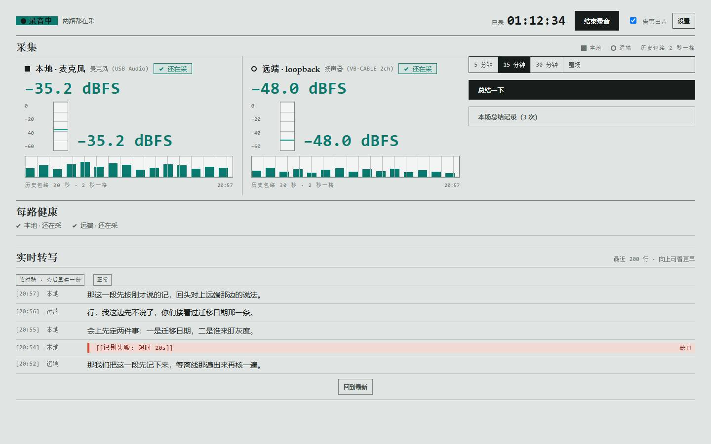

# meeting · 会中与会后界面设计

> 这份文档是 `meeting` V2 界面设计的**唯一说明权威**。设计稿（`docs/ui/`）只是它的渲染载体。
>
> 上游依据：`docs/requirements.md`（需求锚 R1–R17）、`.work/craft/meeting-form/design.md`（产品形态）、`.work/craft/meeting-form/v2-architecture.md`（架构与客户端）。
>
> **本节点是纯设计节点**：产物是设计稿、状态截图、这份文档，**不写任何应用代码**。真正的界面由后续节点用 React 实现；`docs/ui/` 不进任何构建、不被服务引用、不引入任何依赖。
>
> 读者有两种：睡一觉醒来复核的用户（他不写代码，要判断"要不要推翻重来"），和拿这份文档去定事件契约的下游工程师（章节里的字段名与操作含义要能直接照着写契约）。

## 章节目录

| 章 | 标题 | 本轮状态 |
|---|---|---|
| 0 | 结论速览 | **已写实** |
| 1 | 需求对应表 | **已写实** |
| 2 | 信息架构·会中视图 | **已写实** |
| 3 | 信息架构·会后视图 | **已写实** |
| 4 | 状态机与迁移 | **已写实** |
| 5 | 交互清单 | **已写实** |
| 6 | 多开·关闭·刷新时的行为 | **已写实** |
| 7 | 设计 token | **已写实** |
| 8 | 视觉与可读性硬门槛 | **已写实** |
| 9 | 自评 | **已写实** |
| 10 | 证据台账 | **已写实** |

---

## 0. 结论速览

这一章写给睡醒复核的人：**只读这一章，就能决定"要不要推翻重来"**。全套证据在章 10（15 张截图逐行台账 + 已知缺口清单），取舍理由与自评在章 9。

### 0.1 做成了是什么样（三句话）

1. **开会时那个网页一直开着，他瞄一眼就知道两路还在采**：状态、时长、两路电平、每路健康都在 1440×900 的第一屏里，录音中的圆点在走、时长在走、两根电平在动——采集是唯一不可再生的东西，所以主视图的主位只留给它。
2. **真有一路死了，他不用去找**：出事那一路的电平塌成直线、床面压上斜纹、徽标打叉、整行写着"远端 · 采不到了，从 20:57 起"，而另一路还在同一屏里照常跑，告警横幅插在两块表之外。
3. **会后他把机器放在那儿去睡觉，醒来先看到"能不能关机"，再看到"达成了什么共识"**：会中说清"收尾中"还是"已完成"，会后说清跑到哪一步，纪要主位只写共识 / 未达成 / 争议，谁说的不进这三格。

**一句话结论**：这套稿子在 1440×900 下站得住，在 390 宽下也站得住——1440 下主位那六样（状态 / 时长 / 两路电平 / 每路健康 / 告警 / 总结入口）在 20 个状态里全部落在第一屏（底边最远 791，是收尾失败那一档的收尾带；`heartbeat-lost` 的每路健康 634 排第二），窄屏把告警带排到了采集带之前，"远端这一路采不到了 · 从 20:57 起 · 已丢 13 分钟"落在第一屏 378 像素处，"一眼能看出哪一路死了"这句话在两种宽度下都有界面上的答案。窄屏还欠着的一半是"出事那条通道的图形"，要往下滚一段才看得全，这正是下面第 3 条可推翻点的由来。

### 0.2 五张关键截图

按"没出事 / 出事了 / 去色 / 能不能关机 / 结果对不对"各取一张：



**`live-recording-1440.png` · 正常的样子。** 两路包络的形状不一样（本地底噪铺得又高又密，远端矮而稀），峰值保持线压在柱子上方——"刚才有声音"画在静态形状里，不靠动画中间帧。


**`live-lost-one-1440.png` · 出事的样子。** 同一屏里：远端 `−96.0 dBFS`、15 根柱全落到零位线、床面压斜纹、徽标 ✘、整行 `远端 · 采不到了，从 20:57 起`；本地照旧 `−35.2 dBFS`、包络照旧、时长还在走。**告警横幅插在采集带之外，没盖住任何一块表。**


**`live-lost-one-gray-1440.png` · 去色。** 全套证据里最要紧的一张：颜色全部拿掉之后，"哪一路死了"与"另一路还在跑"仍然读得出来。颜色在这套界面里始终是一条冗余通道。


**`live-ended-1440.png` · 能不能关机。** 时长冻在 `02:19:23`，落盘 / 转码 / log / 启动会后四项各自带状态，横幅只说"正在落盘，先别关机"。V1 的收尾最长 300 秒，这段时间里说成"已完成"，人就会去关机、丢掉这场会。


**`post-done-1440.png` · 最后交出来的东西。** 纪要三格（共识 / 未达成 / 争议）占住可读排版的主位；附录里 `mic-1` / `mic-2` / `loop-1` / `loop-2` 四个编号都带着名字，两路的"1 号"不撞车；两条转写各占一块，离线那条标"权威"；名字都确认过，那一区收成一行。

剩下 10 张，以及每一个状态的复核入口，在章 10：`ui/index.html` 给每个 `?state=` 一条可点链接，15 张图逐行写着"这张图证明什么"。

### 0.3 三个可推翻点

与章 9.12 是同一批，口径一致。每处标明改起来动到哪一层：

| # | 推翻什么 | 推翻之后长什么样 | 改动层级 |
|---|---|---|---|
| 1 | **会中主视图一屏装下换来的是"看不到转写正文"** | 章 2.2 与 8.5 把 1440×900 的第一屏整屏留给了六样主位元素，实时转写排在它们下面——`recording` 那一档转写区从 y 499 起，第一屏里看不到一行正文。要它同屏，就得把页面改成"左边主位、右边转写"的两栏，或把转写折成一行"最近一句"，或把 30 秒历史包络压矮一档腾出高度，三条路都要动版式 | **动布局**（信息架构不动："主位六样 / 转写次位"这条分工归章 2.2 管，改的是它们怎么摆） |
| 2 | **签名元素的取值：15 根柱 / 2 秒一格** | 若判断"2 秒太粗、要看见更细的起伏"，就把一格缩到 1 秒、柱子翻到 30 根（横向宽度翻倍，或把 30 秒历史缩到 15 秒）；若反过来判断"历史包络太占地方"，就退成一条峰值保持指针——那等于放弃"底噪 vs 真在说话"的区分能力 | **动 token + 动布局**（`--size-envelope-bar` / `--size-envelope-bar-stride` / `--size-grid` 三个值连带改） |
| 3 | **390 下两块表仍要滚一段才看得全这件事** | 窄屏第一屏给的是"哪一路死了"那句话（告警带已排到采集带之前）；若要求 390 也首屏看到两路电平的图形加每路健康加总结入口，就得把两块竖直表压成共用一条刻度尺的横条，或把一块表换成水平条 | **动布局**（信息架构不动：还是"两路同屏同级、告警不侵入表"） |

**第 1 条是最该被复核的一条**：它直接决定"会中界面到底要不要让人看见转写正文"。复核时点 `ui/index.html` 上 `live.html?state=recording` 那条链接，看 1440×900 的第一屏里有没有转写正文。

---

## 1. 需求对应表

这张表只列**有界面落点**的需求。每条 R 都指出它落在界面上的哪一处——下游照着这一列去定字段和端点，不会漏。

| R | 界面上的哪一处 |
|---|---|
| **R1** 主体是采集加会后处理 | 会中视图以"状态 + 两路电平 + 每路健康"为骨，占主视图绝大部分位置；实时转写排在它下面的次级区，且不带任何"正式记录"的字样。会后视图里转写也是可展开的原始材料，不占主位 |
| **R2** 采集完整、不静默出事 | 三处合力：① 每路健康显式成文（不靠电平表猜）；② 致命级告警横幅写明哪一路、从何时起；③ 已结束·收尾中的子状态——收尾没走完就不说"已完成"，人会因此不敢关机 |
| **R3** 录音状态一眼可见 | 状态区（四态，字 + 图形，不靠颜色单独承载）＋ 两路电平表（本地一块、远端一块，各自带 dBFS 刻度、峰值保持、历史包络）＋ 时长（分秒可见）。三样都在主视图第一屏 |
| **R4** 采不到就要响 | 致命级告警横幅（占满宽度、插在状态区与电平区之间）＋ 出声（告警开关打开时，单次短促一声）＋ 横幅上的"本次会不再出声"仅静音本场 |
| **R5** 存活判断走心跳 | 心跳迟到（弱提示，一行字）与心跳失联（全局横幅 + 出声）两级；心跳频率在设置抽屉里可配；界面按服务应答里的服务侧时间戳判迟到，不看"HTTP 通不通" |
| **R6** 实时转写是临时稿 | 转写区顶部的固定标注"临时稿 · 会后重建一份"，区里不出现保存/导出字样；总结按钮的可用性依赖转写健康位 |
| **R7** 会中一键总结 | 总结区四件套：主按钮 ＋ 四个窗口档位 ＋ 进行中表现 ＋ 结果面板，另加"本场总结记录"回看入口 |
| **R10** 说话人靠会后聚类 | 会后视图的"名字待确认"显式待办 ＋ 说话人附录（编号带路径前缀，两路的"1 号"分成 `mic-1` 与 `loop-1`） |
| **R11** 两条转写都留 | 会后视图里两条转写各占一个可展开区块，离线那条标签写"权威"，会中那条标签写"会中临时稿" |
| **R13** 纪要关心共识与分歧 | 会后视图主位就是纪要，固定三格：已达成的共识 / 未达成的共识 / 有争议的地方。姓名与身份都不进这三格 |
| **R14** 三种场景都要成立 | 空闲态写"这场录哪几路"（两路 / 仅本地 / 仅远端）；会后视图的场次元信息写"实际录到了哪几路" |
| **R15** 命令行只要两个词 | 界面上不出现"重跑"按钮；会后失败态里给一段可复制的命令（`meeting post <场次目录>`），把重跑留在命令行 |
| **R16** 服务挂了必须留 log | 结束录音的失败格、会后失败态的下一步格，都写明**发生了什么** + **log 文件路径**（可复制），并给 `meeting post <场次目录>` |
| **R17** 同一时刻只录一场 | 主视图不出现第二个"开始"入口；开始录音的失败格专门写明"已经有一场在录"这条拒绝理由与去处 |
| 「做成功是什么样」 | 章 0 的结论速览用它的口气回答"做成了是什么样" |

**R8（会后时间宽裕）、R9（离线重跑）、R12（两条转写一起喂）不单独占行**：它们落在会后管线自己的行为上，界面通过"进度走到哪一步"与"哪条转写是权威"体现出来，各自占一行没有意义。

**这张表同时是 Stage 1 的验收判据**：表里每条 R 都对到界面上的一处，R16、R17 不得漏。

---

## 2. 信息架构·会中视图

### 2.1 这个视图的活儿

让人**随时瞄一眼就能安心**，出事了第一眼知道是哪一路。采集是唯一不可再生的东西，所以界面的第一职责是把"采不到"这件事变得不可能被忽略。

### 2.2 界面上的区块，按优先级

| 序 | 区块 | 优先 | 理由 |
|---|---|---|---|
| 1 | 状态区 | 主 | 四态之一，字 + 图形双通道 |
| 2 | 两路电平区 | 主 | 采集还活着的直接证据 |
| 3 | 每路健康区 | 主 | 不用从电平表上猜 |
| 4 | 告警区 | 主（有告警时才显示） | 出事了第一眼要知道是哪一路 |
| 5 | 总结入口 | 主 | 用户偶尔跟丢时的救命稻草 |
| 6 | 时长 | 主 | "录音在推进"的第二个证据 |
| 7 | 实时转写区 | 次（可滚动） | 给人偶尔瞄一眼，不是产物 |
| 8 | 设置抽屉 | 次（默认收起） | 改一次就不再碰 |

**主视图一屏装下**：1440×900 不滚动就能看到状态、时长、两路电平、每路健康、告警区、总结入口。转写与设置各自占一个可滚动/可展开的区域。

### 2.3 每个区块长什么样

**状态区**（第一行左侧）

- 一个状态胶囊：图形标记 + 状态名。四态固定文案：`空闲` / `录音中` / `告警` / `已结束·收尾中` / `已结束·已完成`（后两个是同一顶层状态的两副面孔，见章 4）。
- 图形标记承担"不靠颜色"那一半：空闲＝空心方框、录音中＝实心圆点、告警＝实心三角形、已结束·收尾中＝半实心方框、已结束·已完成＝实心方框打勾。
- 状态胶囊右侧跟一句**状态说明**，随状态变：空闲态"尚未开始"，录音中"两路都在采"，告警态"一路仍在采，另一路采不到了"，收尾中"正在落盘，先别关机"，已完成"可以关机"。

**时长区**（第一行右侧，与结束录音按钮同组）

- 录音中/告警：`已录 01:12:34`，秒在走。
- 收尾中/已完成：标签改成 `本场时长 02:19:23`，数字冻结。
- 空闲：`已录 00:00:00`，灰。
- 时长旁边是**结束录音**（主操作，录音中/告警态才出现）与**开始录音**（空闲态才出现）。同一位置只出现一个主按钮，界面永远不给第二个"开始"入口（R17）。

**两路电平区**（第二行，本地一块、远端一块，左右并列）

每块电平表的组成部分，从上到下：

| 部位 | 内容 |
|---|---|
| 路名 | `本地 · 麦克风` / `远端 · loopback`。路名前的图形标记：本地＝实心方框、远端＝空心圆圈——灰度下这两块靠它分辨 |
| 设备名 | 当前实际打开的设备名，一行小字，可截断 |
| 健康徽标 | `还在采` / `采不到了`。字 + 图形（勾 / 叉），不靠颜色 |
| 电平表 | 竖直或水平均可，但必须带 **dBFS 刻度**（标出 0 / −20 / −40 / −60 四条）与一根**峰值保持**指针 |
| 历史包络 | 最近约 30 秒的波形包络，从左向右推进。用 **2 秒一格** 的方块/竖条表示——所有归档素材的时间粒度只有分钟级，秒级的细腻曲线会给一个素材支撑不了的精度感 |
| 当前值 | 右侧一行 `-35.2 dBFS`，随信号变 |

- 设置抽屉里也有一个"告警开关"，它与主视图上的那个是**同一个设置**。主视图上保留它，是因为"采不到的时候界面要响"这件事要能在出事那一刻就地开关。

**每路健康区**（与电平区同一行的右上角，或紧贴电平区下方）

- 两块，分别对应本地与远端，每块一句话：`本地 · 还在采` / `远端 · 采不到了，从 20:57 起`。
- 这一区是**文字保证**：即使有人看不出电平图，读这一行也有答案。它永远与电平区同时可见，任何宽度下都不折叠（见 2.6）。

**告警区**（有告警时才出现，整行横幅）

- 致命级横幅：`远端这一路采不到了 · 从 20:57 起 · 已丢 13 分钟` + 右侧三个操作：`本次会不再出声` / `看日志` / `结束录音`。
- 提示级提示条（细，不占横幅位）：`实时转写落后了 · 约 2 分钟`。
- 条数上限与排序：提示级最多显示 3 条，同类的合成一条；致命级一次只显示一条（R17 决定了同一时刻只会有一场、每条路只有一种致命故障）。

**总结区**（右侧，与告警区同一行域）

- 主按钮 `总结一下`；同组四个档位：`5 分钟` / `15 分钟`（默认）/ `30 分钟` / `整场`；缺省窗口 = 15 分钟。
- 进行中：按钮位换成 `正在总结刚才的 15 分钟…`，带一个不限时的进度指示（R7 说的是十到十五秒，界面不显示倒计时，也不提前宣布失败）。
- 结果面板：三小段——`刚才在讲什么` / `讲到哪儿了` / `丢掉了什么`；只有几条，右上角一个 `关闭`，**关掉即消失，不落文件**。
- 总结区底部一行入口 `本场总结记录（3 次）`，点开列出本场按过的每一次（时间 + 窗口 + 那几条），存在内存里，会话结束即失。

**实时转写区**（主视图下方，可滚动）

- 顶部固定标注：`临时稿 · 会后重建一份`。
- 行格式：`[HH:MM] 路径标签 · 正文`。路径标签取值 `本地` / `远端`（V1 归档里用的就是这两个词），**不带粗体人名**。
- 窗口内保留最近约 200 行，向上滚动可看更早；滚动时不自动跳回底部，底部给一个"回到最新"的钮。
- 识别失败的缺口按 B12 的占位符显示成缺口样式（`[[识别失败: 超时 20s]]` 单行着色 + "缺口"角标），**不让它看起来像正常文本**。
- 区里不出现"保存 / 导出 / 正式记录 / 生成纪要"这类字样。

**设置抽屉**（默认收起，右上角一个齿轮）

| 分组 | 内容 |
|---|---|
| 设备 | 本地（麦克风）设备、远端（loopback）设备，各一行"当前设备名 + 换一个" |
| 告警 | 告警开关（与主视图同一个）、心跳频率（默认 10 秒，范围 1–60 秒） |
| ASR 参数 | 段长 / 单段超时 / 生成 token 上限 / 周期上限 / 覆盖率。默认值沿用 V1 标定：10s / 20s / 400 / 40 / 0.5 |

设备选择与 ASR 参数的**取值范围以对应节点为准**（`dca4539b` 管设备，`5e3ac8df` 管 ASR 参数），本设计只管它们摆在哪、外显到什么程度。

### 2.4 会中视图**不承载**什么

| 不承载 | 为什么 |
|---|---|
| 待转写队列深度、识别失败次数的**数值** | 它们是提示级告警的输入，界面从它们身上只读出一件事——转写落后了。摆一个"待转写 N 段"的计数器，就是把 V1 TUI 的信息面板搬回来，与"会中界面保持薄"相反。数值留在服务日志里（R16） |
| 暂停 | 需求锚里没有任何一条要暂停，而"暂停"恰好就是 R2/R4 要消灭的那种"看起来在录、实际没录"的状态 |
| 会中的音频源切换 | 要录哪几路在开始前定 |
| 无标签段落、聚类编号、说话人身份 | 会中那一层不做说话人，聚类编号是会后的事（R10） |
| 总结结果之外的任何"产物" | 会中不产生产物，唯一的产物在会后（R1） |
| 模型名、显存、RTF、延迟曲线 | 界面不摆工程指标 |
| 房间类型选择器 | 录哪几路由设备选择自然决定，不额外造一个开关 |

### 2.5 什么状态显示什么

| 元素 | 空闲 | 录音中 | 告警 | 已结束·收尾中 | 已结束·已完成 |
|---|---|---|---|---|---|
| 状态胶囊 | `空闲` | `录音中` | `告警` | `已结束 · 收尾中` | `已结束 · 已完成` |
| 主按钮 | `开始录音` | `结束录音` | `结束录音` | 无（等收尾） | 无 |
| 时长 | 00:00:00 灰 | 走秒 | 走秒 | 冻结，改标签"本场时长" | 冻结 |
| 两路电平 | 未探测时显示占位刻度；就绪后停在静默底噪 | 实时 | 出事那一路的历史包络**塌成直线**并打叉；另一路照常实时 | 冻结在最后一帧 | 冻结 |
| 每路健康 | `未探测` / `已就绪` / `探测失败` | `还在采` | 出事那一路 `采不到了，从 HH:MM 起`；另一路 `还在采` | `已停止` | `已停止` |
| 告警区 | 不出现 | 仅在提示级时出现 | 致命级横幅 | 若之前有告警，保留"已恢复/结束时的状态" | 不出现 |
| 总结区 | 禁用，旁注"开始录音后才能总结" | 可用 | 可用（转写健康位为"停"时禁用并旁注原因） | 禁用 | 禁用 |
| 转写区 | 空态文案 | 实时追加 | 照常（转写不因某一路死掉而停） | 停 | 停 |
| 设置抽屉 | 可开 | 可开 | 可开 | 可开 | 可开（改心跳频率仍生效） |

**这张表之上还有一层：心跳失联（章 4.5）。** 它盖在任何状态之上，因为它说的是"界面看不见服务了"。压住的时候，上面这张表里跟"服务现在还在采"有关的部分全部作废——两路电平冻结压灰、健康位写 `数据已停`、读数退成 `—`、包络时间戳停在最后一次应答，告警区那一块整块收掉（那条"某一路采不到了"的横幅在这个时刻属于另一件事，不能同屏）。剩下的骨架一格不动，屏幕顶端那条全屏横幅是唯一在说"出事了"的地方。

### 2.6 两套竞争方向 A / B

这一节是本轮给下游 `live-a.html` / `live-b.html` / `live.html` 的输入。两套方向**出自同一个 brief**：区块清单、状态机、交互清单、token 都由这套文档统一规定；分歧只在**会中主视图怎么摆**。下面把两套各写一遍，写到一个没读过 spec 的执行者能照着渲染出两套不同的界面。

#### 方向 A：仪表盘式（两路并列在一条采集带上）

**一句话**：两路电平像调音台的两条通道条一样左右并列在顶部一条采集带上，每路的电平、健康、设备名都在自己那一块里纵向排开，采集之外的东西一律排在下面。

**布局（1440×900）**

```
┌───────────────────────────────────────────────────────────────────────┐
│ ■ 录音中 · 两路都在采            已录 01:12:34        [ 结束录音 ]     │  ← 第一行：状态 + 时长 + 主按钮
├──────────────────────────────┬──────────────────────────────┬─────────┤
│ ■ 本地 · 麦克风              │ ○ 远端 · loopback            │ 总结    │  ← 第二行左三分之二：采集带
│   麦克风 (USB Audio)         │   扬声器 (VB-CABLE 2ch)      │ [总结一下]│
│   ✔ 还在采                   │   ✘ 采不到了，从 20:57 起    │ 窗口:   │
│   ┌──┐ 0 dBFS                │   ┌──┐ 0 dBFS                │ (5)(15) │
│   │▁▃│                      │   │  │                       │ (30)(整场)│
│   │▂▅│ ← 峰值保持            │   │  │ ← 保持后塌平          │         │
│   │▃▇│                      │   │▁ │                       │ 本场记录 │
│   └──┘ −60                  │   └──┘ −60                   │ （3 次） │
│   历史包络 30s  ▂▃▅▆▅▃▂      │   历史包络 30s  ▆▅▃▁______   │         │
│   −35.2 dBFS                 │   −96.0 dBFS（直线）         │         │
├──────────────────────────────┴──────────────────────────────┴─────────┤
│ ⚠ 远端这一路采不到了 · 从 20:57 起 · 已丢 13 分钟                      │  ← 告警横幅：整行插入
│   [本次会不再出声] [看日志] [结束录音]                                  │
├───────────────────────────────────────────────────────────────────────┤
│ 实时转写 · 临时稿 · 会后重建一份                                       │  ← 次级：可滚动
│ [20:57] 本地 · 那我们把这一段先记下来……                                 │
└───────────────────────────────────────────────────────────────────────┘
```

**特点**

- 两路永远同屏同级：告警横幅插在采集带与转写区之间，**不会盖住任何一块电平表**。
- 每块电平表自带路名、设备名、健康徽标、刻度、峰值保持、历史包络、当前 dBFS——**一块即一条完整通道**，眼睛不用在两处之间来回跳。
- 告警横幅是"插进来的一条横带"，其余各行位置不变，界面不重排。这一条直接决定了截图 5/6 的样子：出事的那块塌成直线、另一块照常动、横幅说清哪一路从何时起。
- 窄屏（390）自然退化：两块上下堆叠（本地在上、远端在下），健康徽标跟着各自那块走；采集带之后依次是告警条、总结区、一行"最近一句"、设置抽屉。

**代价**

- 横向空间紧：1440 下采集带占左三分之二，右侧三分之一给总结区，转写区被压到下方一条。要让人一眼看到"最近在说什么"，得往下看一点。
- 两块的内部结构必须严格一致，任何不对称（比如远端多出一行恢复记录）都会破坏"两条通道"的整齐感。

#### 方向 B：通道条式（每条路一条全宽横条，纵向堆叠）

**一句话**：每一路音频占一条**整宽横条**，电平、健康、设备、包络都摊在横条里横向展开；两路上下堆叠，其余内容夹在中间，界面像一台多轨录音机。

**布局（1440×900）**

```
┌───────────────────────────────────────────────────────────────────────┐
│ ■ 录音中 · 两路都在采            已录 01:12:34        [ 结束录音 ]     │
├───────────────────────────────────────────────────────────────────────┤
│ 通道 1 · 本地 · 麦克风 · USB Audio · ✔ 还在采        −35.2 dBFS         │  ← 整宽横条
│ 0 ──────────────────────────●───────────────────────────── −60        │
│ 历史包络 ▂▃▅▆▇▆▅▃▂▂▃▅▆▅▃▂▂▃▅▆▇▅▃▂▂▃▅▆▅▃▂▂▃▅▆▇▆▅▃▂▂▃▅▆▅▃▂▂▃▅▆▇▅▃▂▂▃▅▆   │
├───────────────────────────────────────────────────────────────────────┤
│ 通道 2 · 远端 · loopback · VB-CABLE 2ch · ✘ 采不到了，从 20:57 起       │  ← 出事的那一条
│ 0 ─────────────────────────────────────────────────────── −60         │
│ 历史包络 ▆▅▃▂▁＿＿＿＿＿＿＿＿＿＿＿＿＿＿＿＿＿＿＿＿＿＿＿＿＿＿＿＿     │
├───────────────────────────────────────────────────────────────────────┤
│ ⚠ 远端这一路采不到了 · 从 20:57 起 · 已丢 13 分钟  [不再出声][看日志][结束]│
├──────────────┬──────────────────────────────┬─────────────────────────┤
│ 总结          │ 最近在说                      │ 设置（收起）            │
│ [总结一下]    │ [20:57] 本地 · 那我们把这一段 │                         │
│ 窗口 (5)(15)  │ [20:56] 远端 · 这个方案我同意 │                         │
│ (30)(整场)    │ [20:55] 本地 · 那我们先过一下 │                         │
└──────────────┴──────────────────────────────┴─────────────────────────┘
```

**特点**

- 每条路有整行宽度，历史包络可以拉得很长，"刚才有声音"这件事看得更清楚。
- 转写区被抬到主视图内（第三行的一格），因为它占了原本闲置的下半屏；代价是它和采集带之间隔了一条通道条与一条告警横幅。
- 界面读起来是"设备面板"的语气：通道 1、通道 2 各自独立成条。

**代价**

- 两路被纵向拆开：一条在屏上半、一条在屏下半，中间隔着别的东西。**"另一路还在不在"要多看一眼**。
- 告警横幅**排在采集带之后**，不在两条通道之间：实测 `#alert-band` 与两条通道并不相邻——`#ch-local` / `#ch-remote` 同属 `#m-chans` 纵向叠放，`#alert-band` 是采集带之后的另一个 `<section>`，与 A 的位置相同（1440 下 B 的横幅 y 794–889）。后果照实说：读告警的人得先定位到是哪一条。窄屏（390）下更明显——两条通道占满高度后，非出事那条会被推到首屏之下，而"哪一路还在跑"正是这个界面最不能藏起来的信息。

#### 根本分歧

**两路是"同一台仪器上的两条并列通道"（A），还是"两台各自独立的录音机、上下叠放"（B）。**

这条分歧往下推出三个可见后果：

| | A | B |
|---|---|---|
| 两路的关系 | 并列，永远同屏同级 | 纵向，各成一条 |
| 告警横幅的位置 | 采集带**之外**（不侵入任何一块表） | 也排在采集带**之后**，位置与 A 相同 |
| 转写的位置 | 下方一条，可滚动 | 抬进主视图第三行的一格 |
| 390 下的风险 | 堆叠即可，两路都在首屏 | 非出事那路可能落到首屏之下 |

#### 本轮选择：A

**理由**（章 9 会再写一遍取舍，这里给出结论）：本设计的骨头是"**一眼能看出哪一路死了，同时一眼能看出另一路还活着**"。A 里两路天然并列在一条带上，告警横幅插在带子之外——两块电平表同时保持可见，这正是"告警期间录音仍在继续"这条澄清在界面上的唯一正确形状。B 做不到这一点：两路被纵向拆开之后，"另一路还在跑"要么靠滚动、要么靠粘性定位补救，而补救就意味着信息架构里多一层约定。

`live.html`（选中版）**就是 A 的另存**，两文件内容逐字一致。

`live-a.html` / `live-b.html` 都必须渲染得出来，`?state=` 支持的状态与参数以章 4.5 为准，两版**用同一套状态表、同一套 token**。

---

## 3. 信息架构·会后视图

### 3.1 这个视图的活儿

会后是漫长的（几小时、挂机到第二天都行），所以这个视图要能被反复打开，也要能说明"它跑到哪了"。它要回答三个问题：**这是哪场会**、**跑到哪一步了**、**结果是什么**。

### 3.2 界面上的区块，按优先级

| 序 | 区块 | 优先 | 理由 |
|---|---|---|---|
| 1 | 场次元信息 | 主 | 先知道在看哪一场 |
| 2 | 进度 | 主 | "能不能去睡觉"的答案 |
| 3 | 纪要（共识 / 未达成 / 争议） | 主 | 唯一权威产物 |
| 4 | 名字待确认 | 主 | 唯一需要用户动手的地方 |
| 5 | 说话人附录 | 次 | 纪要之后才看 |
| 6 | 两条转写 | 次（可展开） | 追溯用的原始材料，不抢主位 |

**为什么只有三样在主位**：纪要是唯一权威产物，进度决定今晚能不能睡，待确认名单是唯一要动手的地方。转写是追溯材料。

### 3.3 每个区块长什么样

**顶部：会议选择器 + 场次元信息**

- 会议选择器：列出输出目录里已有的场次，默认选中最近一场。每项排两行——场次号一行，`时长 · 哪几路录到了` 一行；选中那一项带实心底，另有 `aria-pressed="true"`。演示数据里默认选中的是 `250906`，它那一项的两行是 `250906` / `2:19:23 · 两路都录到了`；后面两项是 `250919`（`1:02:41 · 仅远端`）与 `250912`（`0:48:10 · 仅本地`），演示数据里排在最前面的一项就是最近的那一场。
- 元信息一行：`250906 · 2025-09-06 · 音频总时长 2:19:23 · 录到了：本地 + 远端`（对齐 R14 三种场景：`两路` / `仅本地` / `仅远端`）。这一行始终跟着选择器里选中的那一场走，章 4.5 会后状态表里的 `running` / `done` / `empty` / `failed` 四档说的都是这一场。
- 右上角一个 `刷新`，重新向服务取这一场的状态。
- 没有任何场次时给空态：`这个目录里还没有会。先敲 meeting web 录一场。`

**进度区**

固定五个步骤，顺序即流程顺序，不可跳步展示：

| 步 | 名称 | 展示内容 |
|---|---|---|
| 1 | 离线转写 | 等待 / 进行中 / 已完成（含耗时）/ 失败 + 原因 |
| 2 | 说话人聚类 | 同上，已完成时写"聚出 4 个编号" |
| 3 | 纪要生成 | 同上 |
| 4 | 名字确认 | 有名字没确认时是"待你处理"，全确认后是"已完成" |
| 5 | 收尾 | 同上 |

- 每步四种状态，各有字与图形：`等待`（空心方框）、`进行中`（旋转方框 + 已跑时长）、`已完成`（勾 + 耗时）、`失败`（叉 + 原因）。
- **起点态**：服务还在收尾、会后这一套还没启动时，整个进度区给一个明确的起点态——五个步骤全部停在 `等待`，进度区标题写 `会后还没开始 · 等这场会收尾`。它与会中视图的"已结束·收尾中"对得上，让人看得出"这场会刚结束、后面还没开始"。
- 进度区右侧一行 `已跑 1 小时 12 分`（整场会后累计），刷新页面后与刷新前一致（状态在服务那边）。
- 进行中的步骤给一个"可以关掉这个页面"的旁注：`关掉页面不影响，服务照跑。`

**纪要（主位）**

固定三格，不可为空、不可合并、顺序固定：

| 格 | 标题写法 | 为空时 |
|---|---|---|
| 1 | `已达成的共识` | `这一场没有记下明确的共识。` |
| 2 | `未达成的共识` | `没有悬而未决的议题。` |
| 3 | `有争议的地方` | `没有出现分歧。` |

- 每格标题带自己的图形标记（实心圆 / 半环 / 叉），颜色不是唯一通道。
- 每条一段短句，**不写是谁说的**（R13：纪要跟人没有关系）。
- 主位是"可读排版"：宽行距、单栏、字号明显大于其它区块。

**名字待确认**（紧接纪要，在附录之前）

- 一份显式待办清单，一行一个编号 + 首次出现的时间 + 一句上下文摘录 + 一个输入框 + `确认`。
- 每行右边一个 `跳过`，跳过之后仍留在清单里。
- 全部确认后这一区收成一行：`名字都确认过了（4 个）。`，点开仍可改。
- 它出现在进度步骤 4 里，也就是**写完纪要之后**才轮到这里（R10：名字放到会后推，名字是附录）。

**说话人附录**

- 按路径分块，标题就是路径名：`本地 · 麦克风` / `远端 · loopback`。
- 每条：编号 + 已确认的名字（没确认就只写编号 + `待确认`）+ 出现次数。
- 编号带路径前缀，**两路的"1 号"不撞在一起**：`mic-1` / `mic-2` / `loop-1` / `loop-2`。

**两条转写**

- 两个可展开区块，各带标签：
  - `离线转写 · 权威`（会后离线模型整段重跑那条）
  - `会中转写 · 临时稿`（会里边录边写那条）
- 默认都收起，展开后给行数、时间跨度、字数与正文（分钟级 `[HH:MM]` 时间戳）。
- 权威标签用**字 + 图形**（实心圆 + "权威"），不靠颜色。

**空态**

- 真实存在：空态样本那一场（**250919**）的 `meeting_notes.md` 只有 **39 字节**（`docs/legacy-assets.md` 第四章 4.1.4 的实测值），会中总结根本没产出。这一场也是**仅远端**那一路的样本——它会出现在两处：选择器里排第二项（`1:02:41 · 仅远端`），以及这一条空态说明里。
- **空态样本与默认选中那一场分属两场会**，稿子把这条关系摆明了：选择器默认选中最近一场 `250906`，`250919` 是选择器里可以点过去的另一场。`post.html?state=empty` 切的就是 `250919` 那一副样子（场次有音频、会中总结为空），而 `?state=done` 这一档（`post-done-1440.png` 拍的）在看 `250906` 时，会中转写那一格照样摆着这条 39 字节的空态说明——一样东西在两场里的两张脸，点一下选择器就能看到另一场。
- 会中总结为空时，纪要与附录的位置上写：`这场没有会中总结。会后纪要不依赖它——两条转写都在下面。`
- 整场都没有产物时（会中断了、音频也没落全）写：`这场没有留下能出纪要的东西。音频在 <路径>，日志在 <log 路径>。`

**失败态**

- 写明**哪一步失败、什么原因、下一步怎么办**，下一步给一段可复制的命令：`meeting post 250906`。
- 一步失败不影响已完成的步骤：`离线转写` 失败时，进度条上它打叉，后面的步骤全部停在 `等待` 并注明"上一步失败，先修它"。

### 3.4 会后视图**不承载**什么

| 不承载 | 为什么 |
|---|---|
| 重跑按钮 | 重跑是命令行那条路的事（`meeting post`）。界面上多一个"重跑"按钮就多一条要维护的服务端点，也把 R15 的"只要两个词"冲淡。失败态给可复制的命令就够 |
| 模型名、显存、耗时曲线 | 界面不摆工程指标 |
| 编辑纪要 | 纪要由模型产出，改它等于改产物；不满意就重跑命令行 |
| 秒级 / 词级时间戳排版 | 全批归档只有分钟级 `[HH:MM]`，排版不为它留位 |
| 跨路的说话人身份合并 | R10 明确不做 |
| 会中的实时状态 | 会后视图不看正在录的那一场的实时电平，那是会中视图的事 |

### 3.5 什么状态显示什么

| 元素 | 会后还没开始 | 进行中 | 已完成 | 空态 | 失败态 |
|---|---|---|---|---|---|
| 进度区 | 五步全 `等待` + `会后还没开始 · 等这场会收尾` | 当前步骤 `进行中` + 已跑时长 | 五步全勾 + 各步耗时 | 与"进行中"一致（有人手动清了产物时会重跑） | 失败那一步打叉 + 原因，后续步骤停 `等待` |
| 纪要 | 位置留给进度，显示 `纪要还没生成` | 同上 | 三格齐 | 三格都在，各自给空文案 | 没到这一步就写 `纪要还没生成`；走到了才写失败 |
| 名字待确认 | 不出现 | 步骤 3 完成后出现 | 收成一行 `名字都确认过了（4 个）` | 有编号就出现，没有就不出现 | 没到这一步就不出现 |
| 附录 | 不出现 | 聚类完成后出现 | 完整 | 有编号就出，没有则 `这场没有分出说话人编号` | — |
| 两条转写 | 可展开（音频与实时稿在收尾后就已落盘） | 可展开 | 可展开 | 会中那条给 39 字节那类空态 | 可展开 |
| 失败提示 | 不出现 | 不出现 | 不出现 | 不出现 | 失败块 + 可复制命令 + log 路径 |

### 3.6 宽度

- 1440：单栏可读排版，纪要正文宽度收在约 68 个汉字，其余区块与它对齐。
- 390：同一顺序，不砍任何区块；纪要三格各占整宽；附录与两条转写默认收起；会议选择器占整宽、可滚动。

---

## 4. 状态机与迁移

**顶层状态就是四个**：`空闲` / `录音中` / `告警` / `已结束`。其余全部挂在它们下面，不新开顶层状态。

### 4.1 四态与迁移

| 状态 | 界面表现 | 进入条件 | 离开条件 |
|---|---|---|---|
| **空闲** | 开始前的准备态 | 服务起来了、这场还没开始 | 按下"开始录音" → 录音中 |
| **录音中** | 正常录制 | 录音已启动 | 一路或多路出事 → 告警；用户结束 → 已结束 |
| **告警** | 录音**仍在继续**，但某一路出事了 | 服务侧判定某一路采不到了，或报出其他采集异常 | 出事的那一路恢复 → 回录音中；用户结束 → 已结束 |
| **已结束** | 这场录完了 | 用户结束 / `Ctrl+C` | 子状态走完 → 已完成（终态） |

### 4.2 三条澄清（每条都是下游实现会踩的）

**一、进入"告警"时录音还在继续。**

没出事的那一路照常录，界面得**同时**说清"哪一路还在、哪一路没了"。把这套界面做成"整场进入告警页、正常的那一路看不见了"，就是本设计最严重的失败。落地要求：告警横幅是**插进来的一条带**，两路电平表、两路健康、时长、总结入口全部原地不动。

**二、"已结束"有两副面孔，用子状态区分。**

| 子状态 | 含义 | 界面说人话 |
|---|---|---|
| `收尾中` | 转码、落盘、启动会后 | `正在落盘，先别关机` |
| `已完成` | 可以关机 | `可以关机` |

这条分法的理由：V1 的收尾最长能跑到 300 秒的 join 预算（`docs/legacy-assets.md` B14），这段时间里"录音已经停了、东西还没落好"。界面上说成"已完成"就会让人直接关机丢掉这场会。它比新开一个顶层状态更贴用户真正要问的那句话：**我现在能不能关机。**

- 收尾中 → 已完成的判据（三条全满足）：本场所有音频已落盘；log 已写完这一场的会话段；会后那一套已经启动（启动即可，不等它跑完）。
- 收尾中**内部失败**（转码失败、落盘失败、log 写不下）时，界面给一个失败块：原因 + 可复制的命令 + log 路径。这不是第五个顶层状态——它是"收尾中"里出事了，界面照实说，并且绝不说"可以关机"。
- **收尾失败这一档（`ended-drain-failed`）只留一条横幅**：收尾横幅 + 它下面的失败块。这时候录音早就结束了，两条通道写着"已停止"，再挂一条"某一路采不到了"的通道失效横幅，屏幕上就出现两处说"出事了"的横幅、两段几乎重复的明细（一处说"远端这条音频转不出来"，另一处说"远端这一路采不到了"）。那一档的答案由收尾横幅 + 四项明细给：明细里 `转码` 那一步打着叉，失败块把原因、可复制的命令与 log 路径写全。通道失效横幅只在"录音还在跑、某一路没了"的告警态出现（章 4.5 会中状态表）。

**三、心跳失联归界面自己管，不进状态机。**

它可以盖在任何状态之上（包括空闲），因为它描述的是"界面看不见服务了"，跟服务自己在干什么无关。心跳**恢复后自动消失**，并留一条短记录（`已恢复，中断 42 秒`）。

### 4.3 挂在四态下面的子状态与字段

**顶层：空闲**

| 名字 | 取值 |
|---|---|
| `设备就绪`（每路一个，共两个） | `未探测` / `已就绪（挑到了端点）` / `探测失败（一个能打开的端点都没有）` |
| `场次路径` | 本场输出目录，一行小字 |

三个取值的界面文案：`未探测` / `已就绪 · 麦克风 (USB Audio)` / `探测失败 · 没有能打开的端点`。C2/C3/C4/C6 那批设备坑按「能不能打开」分两档落：**C2（COM 没初始化，试开当场抛）与 C3（同名候选一条都开不起来）开不了——这一路一个能打开的端点都没有，落"探测失败"**（C2 拖到运行期才发作的那一档落"采不到了"，不在这里），所以"探测失败"必须与"未探测"分开说；C4（虚拟声卡端点选错）与 C6（两路抓到同一路）能打开，"能打开但试开那零点几秒读回全零"仍算"已就绪"（房间当时安静、远端当时没在出声时读到的就是零，所选端点与峰值写在 `detail` 里）。

**顶层：录音中**

| 名字 | 取值 |
|---|---|
| `转写健康` | `正常` / `落后` / `停` |

**实时转写挂在"录音中"下面，是一个字段**——实时转写的健康位。理由是实时转写不会改变界面该让人做什么：它停了，录音照录、电平照动、告警照响，**变的只有"总结入口现在按不了"**。把这个字段做成一层状态页，会让人误以为"转写停了这场就完了"——那是 R6 明确否掉的立场。

| 取值 | 界面表现 | 对总结入口的影响 |
|---|---|---|
| `正常` | 转写区照常追加，无提示 | 可用 |
| `落后` | 提示级告警条：`实时转写落后了 · 约 2 分钟` | 可用（窗口可以取小一点） |
| `停` | 转写区顶部标注追加一句 `转写已停` + 最后一行时间 | **禁用**，按钮旁写原因：`转写停了，总结没有材料可读` |

**每路健康**（录音中 / 告警共用，每路一个）

| 取值 | 界面表现 |
|---|---|
| `还在采` | 勾 + `还在采`，电平实时 |
| `采不到了` | 叉 + `采不到了，从 HH:MM 起`，该路历史包络塌成直线并冻结 |
| `已恢复`（本场发生过又恢复） | 环形箭头 + `已恢复（20:57–21:10 丢过 13 分钟）`，电平恢复实时 |

**顶层：告警**

| 名字 | 取值 |
|---|---|
| `告警级别` | `提示级` / `致命级` |
| `哪一路` | `本地` / `远端` / `心跳`（心跳失联的横幅也走告警区，但状态归界面本地态，见 4.4） |
| `起始时刻` | 墙钟 `HH:MM` |
| `持续时长` | `已丢 13 分钟`，分钟级 |

**顶层：已结束**

| 名字 | 取值 |
|---|---|
| `收尾进度` | `收尾中` / `已完成` |
| `收尾明细` | 落盘 / 转码 / log / 启动会后，四项各自的 等待/完成/失败 |

### 4.4 告警分级、出声规则与门槛

**分级**（要写进文档，不能留给实现即兴）

| 级别 | 内容 | 界面 | 出声 |
|---|---|---|---|
| **提示级** | 队列积压、识别失败计数上涨、实时转写落后 | 细提示条，最多 3 条，同类合并 | **不出声** |
| **致命级** | 某一路采不到了、心跳失联 | 整行横幅 + 全局横幅 | 出声（告警开关打开时） |

**静默门槛的输入——为什么是这个量级**

250906 的正常句间停顿里散着一批 **31–56 秒**的连续全零段（实测：20–70 秒那一档共 36 段，最长 56 秒），所以"一路没声音"**不能**当告警判据；判据必须是**连续性**——那两场真实事故是 **13.4 分钟**与 **30.5 分钟**（250906 的 loop 轨，逐样本全零，墙钟 20:57:00–21:10:23 与 21:56:55–22:27:21）。

**本设计给出的口径**（数值的最终定档由服务侧做，但界面的说法与量级依据归这里）：

- 静默门限：低于 −60 dBFS 视为"这一路在静默"。
- 连续性判据：一路**连续静默 ≥ 3 分钟**（180 秒）才报致命级告警。180 秒对 56 秒的实测停顿留了 3.2 倍余量；对 13.4 分钟的真实事故只延后 3 分钟就报出来——那时事故才走了 22%，还来得及救。
- **服务侧可用更大的值，不得用更小的值。**
- 恢复判据：该路**连续有信号 ≥ 10 秒**才算恢复（避免抖动式反复告警）。
- 复制"设备能打开但采到全零"这一类静默失败（C2/C3/C4）：判据一样走连续性，所以它在 3 分钟后同样会被报出来。这是**把全零与底噪分开看**的直接收益——mic 一路永远有底噪（250906 实测有信号秒均方根 −35.2 dBFS、逐样本零只占 0.4%），而 loopback 无人说话时写下的是一串精确的数字零（逐样本零占 79.4%）。

**出声规则**

- **形态**：单次短促一声，非连续、非循环。致命级事件**首发响一声**。
- **抑制窗口**：同一事件 **60 秒**内不重复出声。事件的身份 = 哪一路 + 故障类型；恢复后再次发生算新事件，重新响一声。（"一有风吹草动就响"的告警会让人关掉开关，那比没有告警更糟。）
- **用户控制有两层**：`告警开关` 是持久化设置（跨场次记住），`本次会不再出声` 是会话级（不改持久化开关）。
- **前端只触发声音，不判断告警**：响不响由服务推的字段决定，界面只负责"响一声"这个动作与抑制窗口。

### 4.5 界面本地态

心跳由**界面**按固定频率（默认 10 秒，可配 1–60 秒）向服务要一次应答。应答必须**带服务侧时间戳与录音存活字段**——只看"HTTP 通不通"会漏掉"服务还活着、录音线程已卡死"这一类。

| 名字 | 取值 | 判据 |
|---|---|---|
| `心跳状态` | `正常` / `迟到` / `失联` / `已恢复` | 按应答里的服务侧时间戳与本地时钟的时间差 |

- `正常`：时间差 < 1 个周期。不显示任何东西。
- `迟到`：时间差 ≥ 1 个周期且 < 2 个周期。弱提示，一行字：`心跳迟到 · 8 秒没收到应答`。不出声。
- `失联`：时间差 ≥ 2 个周期。全局横幅 + 出声（若开关打开）。

**心跳失联的横幅文案**（必须写清发生了什么与怎么办）

> **录音已中断**
> 10 秒一次的应答，连续 2 次没收到（最后一次应答 20:57:31）。
> 先别关这台机器，也别关这个页面。到服务那边看一眼：`Ctrl+C` 停掉再敲一次 `meeting web`；日志在 `~/.config/meeting/logs/meeting.log`。

- 失联时两路电平**冻结 + 压灰**，健康位写 `数据已停`，读数退成 `—`（估出来的那个数字不再顶着），包络时间戳停在服务最后一次应答的时刻 `20:57:31`，时长标签改 `最后读数`。**不把估出来的数据继续画成在动**——录音已经死掉时界面还在忽悠人，是本项目最不能犯的错。
- 失联横幅说的是"界面看不见服务、整场录音已经中断"，而 `远端这一路采不到了` 那条致命横幅说的是"服务还在、某一路没了"。两句话描述的是两件互相排斥的事，**不得同屏**：心跳失联下整块告警区（含那条致命横幅与它上面的三个按钮）不出现，屏幕上关于"出事了"的话只有全屏横幅这一处。心跳恢复后两条都不留残影。
- `已恢复`：横幅自动消失，状态区旁留一条短记录 30 秒：`已恢复，中断 42 秒`；两路读数与服务时间戳回到实时，转写区在中断那一格留一条 `[20:57–20:58] 数据已停` 的断口。

**心跳优先级**：失联横幅盖在任何状态之上，包括空闲与已结束。

**服务重启后状态自洽**：服务重启后，界面重新打开时向服务取状态；服务侧**没有**正在进行的会话，界面就停在 `空闲`。若上一场没走完收尾就被打断（日志里有未收尾记录），空闲态顶部给一行提示：`服务重启过。上一场的收尾没走完，音频在 <路径>，日志在 <log 路径>。` 界面不自己记状态、不从浏览器本地存储里恢复任何东西——客户端只持有服务推出来的状态。没有未收尾记录时，这一行不出现。

**这一节定义的名字就是 `?state=` 能切出来的东西**。`live.html` 与 `post.html` 的 `?state=` 支持下面这张表的全部取值；`index.html` 给每个状态一个可点链接。

**底部那条复核用的导航条另有一个开关**（第四轮加）：`.viewswitch`（`?state=` 切换器 + 跳另一版 + 跳会后）默认不显示，地址后面加 `?nav=1` 才出现，与 `?state=` 并存。它是给逐状态复核的人用的旁路，会中界面本身的区块清单（章 2.2）里没有它；默认收起来，门槛 5 的"1440×900 不滚动"才在事实上成立（8.5 末段与 9.11 第四轮表第 2 条）。

#### 会中视图（`live.html` / `live-a.html` / `live-b.html`）

| `?state=` | 顶层状态 | 关键参数 |
|---|---|---|
| `idle` | 空闲 | 设备就绪：本地 `已就绪`、远端 `已就绪`；时长 00:00:00 |
| `idle-untouched` | 空闲 | 设备就绪：两路都 `未探测` |
| `idle-device-fail` | 空闲 | 设备就绪：远端 `探测失败 · 没有能打开的端点` |
| `idle-restarted` | 空闲 | 服务重启过、日志里有未收尾记录：顶栏之上多一行 `服务重启过。上一场的收尾没走完，音频在 C:\会议\out\250906\，日志在 C:\Users\<user>\.config\meeting\logs\meeting.log。`；两路设备 `已就绪`、时长 00:00:00。没有未收尾记录时这一行不出现 |
| `recording` | 录音中 | 两路都在采；本地 −35.2 dBFS、远端 −48.0 dBFS；时长 01:12:34；转写健康 `正常` |
| `recording-transcript-behind` | 录音中 | 同上 + 提示级条 `实时转写落后了 · 约 2 分钟`；转写健康 `落后` |
| `lost-one` | 告警 | 远端 `采不到了，从 20:57 起`、历史包络塌成直线、−96.0 dBFS；本地照常 **−35.2 dBFS**；已丢 13 分钟；致命级横幅 |
| `lost-one-restored` | 录音中 | 远端 `已恢复（20:57–21:10 丢过 13 分钟）`；横幅收起，健康徽标保留倒查记录 |
| `heartbeat-late` | 录音中 | 心跳状态 `迟到`，一行字；**不出声、无横幅** |
| `heartbeat-lost` | 录音中 | 心跳状态 `失联`，全局横幅；两路电平冻结压灰、读数退成 `—`、健康位 `数据已停`；整块告警区不出现（见下） |
| `heartbeat-recovered` | 录音中 | 全局横幅已消失，状态区旁短记录 `已恢复，中断 42 秒`；两路读数与服务时间戳都回到实时 |
| `ended-draining` | 已结束·收尾中 | 时长冻结 02:19:23；收尾明细四项在跑；`正在落盘，先别关机` |
| `ended-done` | 已结束·已完成 | 收尾明细四项全勾；`可以关机` |
| `ended-drain-failed` | 已结束·收尾中 | 转码失败块：原因 + log 路径 + 可复制命令；**不说"可以关机"**；**通道失效横幅这一档不出现**（屏幕上说"出事了"的横幅只有收尾那一条，理由见 4.2 二） |
| `summary-running` | 录音中 | 总结区 `正在总结刚才的 15 分钟…`；其余照常 |
| `summary-result` | 录音中 | 结果面板展开：刚才在讲什么 / 讲到哪儿了 / 丢掉了什么；可关即消失 |
| `summary-log` | 录音中 | 本场总结记录展开：3 次（20:41 / 21:03 / 21:40），各带窗口与那几条——这一档展开的是**记录那一份**；两块内容共用一块面板，脚本按状态换标题与正文 |
| `settings-open` | 录音中 | 设置抽屉展开：设备 / 告警 / 心跳频率 / ASR 参数 |
| `start-failed` | 空闲 | 开始失败块：`远端这一路起不来：设备被别的程序占着` + log 路径 |
| `start-rejected` | 空闲 | 开始被拒块：`已经有一场在录（250906，已录 41 分钟）。同一时刻只录一场。打开那一场 →` |

#### 会后视图（`post.html`）

| `?state=` | 关键参数 |
|---|---|
| `running` | 步骤 1 `已完成（38 分）`、步骤 2 `已完成（聚出 4 个编号）`、步骤 3 `进行中 · 已跑 1 小时 12 分`、步骤 4/5 `等待`；整场已跑 1 小时 50 分 |
| `not-started` | 五步全 `等待` + `会后还没开始 · 等这场会收尾` |
| `done` | 五步全勾；纪要三格齐；附录 `mic-1`/`mic-2`/`loop-1`/`loop-2` 四个编号都带上名字；名字那一区收成一行 `名字都确认过了（4 个）。`；两条转写各可展开；含一格会中总结空态示例 |
| `empty` | 切到的就是空态样本那一场 **`250919`**（`1:02:41 · 仅远端`，只有 loopback 一路）：选择器的实心底、`aria-pressed` 与场次元信息行四段都跟着切到这一场；场次有音频但会中总结为空（39 字节那类）；纪要三格给空文案；待确认名单的编号是 `loop-1` / `loop-2`（这一场没有 mic 那一路）；附录空态与它上面那句说明同口径。**其余五档看的是 `250906`**——选择器默认选中最近一场，元信息行、进度、纪要、附录、两条转写跟着它走 |
| `failed` | 步骤 1 `失败`：`meeting_audio_loop.mp3 读不出来（文件被截断）`；后面全部 `等待` + `上一步失败，先修它`；可复制命令 `meeting post 250906`；log 路径 |
| `no-meetings` | 目录里没有场次：`这个目录里还没有会。先敲 meeting web 录一场。` |

窄屏一档统一定为 **390 宽**，常规一档统一定为 **1440×900**；两档都要对同一状态各截一张（截图清单见章 10）。

### 4.6 窄屏（390）取舍

**原则：砍"读的"、不砍"看的"。** 390 宽下保留状态、时长、两路电平（上下堆叠）、每路健康、告警、总结入口；采集相关的信息在任何宽度下都不砍。

| 区块 | 1440 | 390 |
|---|---|---|
| 状态 + 时长 + 主按钮 | 一行 | 三行堆叠，状态在最上 |
| 两路电平 | 左右并列 | 上下堆叠（本地在上、远端在下），每块保留刻度、峰值保持、包络 |
| 每路健康 | 贴电平表 | 保留，跟各自那块走 |
| 告警横幅 | 整行 | 整行，操作按钮竖排 |
| 总结区 | 右侧三分之一 | 整宽，档位折成一行四个小档 |
| 实时转写 | 多行可滚动 | **折成一行"最近一句"**，点一下展开成整屏可滚动 |
| 本场总结记录 | 就地一行 | 收进抽屉 |
| 设置 | 抽屉 | 抽屉（整屏） |

---

## 5. 交互清单

每个可点的东西都有三格：**按下后（界面）** / **服务侧含义** / **失败时显示**。中间那格是给 `c62dec56` 定契约用的——"这一下要让服务做什么"。

**清单里没有"暂停"**：需求锚里没有任何一条要暂停，而"暂停"恰好就是 R2/R4 要消灭的那种"看起来在录、实际没录"的状态。**也不做会中的音频源切换**：要录哪几路在开始前定。

### 5.1 会中

| 操作 | 触发方式 | 按下后（界面） | 服务侧含义 | 失败时显示 |
|---|---|---|---|---|
| **开始录音** | 空闲态主按钮 | 进入录音中；时长从 0 起走；两路电平立刻开始出数据 | 请求启动采集（要录哪几路已在开始前定好） | 起不来就说清哪一路起不来、为什么：`远端这一路起不来：设备被别的程序占着`；服务侧发现**已经有一场在录**时把这件事说出来：`已经有一场在录（250906，已录 41 分钟）。同一时刻只录一场。` 并给"打开那一场"的去处。**不得停在"没反应"** |
| **结束录音** | 录音中/告警态主按钮 | 进入已结束·收尾中；时长冻结并改标签"本场时长" | 停止采集、触发落盘与会后 | 落盘失败写明：`远端这条音频没写进盘：磁盘只剩 120 MB` + log 路径 + 磁盘还剩多少。**绝不显示"可以关机"** |
| **触发手动总结** | 总结区按钮 | 进"进行中"（十到十五秒），出结果面板 | 请求一次窗口总结 | 转写健康位是 `停` 时**禁用**，原因写在按钮旁边：`转写停了，总结没有材料可读`；超时写明超了多久：`超时了，等了 28 秒还没有结果。再按一次。` |
| **选总结窗口** | 与按钮同组的四个档位 | 改变本次总结覆盖范围 | 随总结请求带上窗口长度（分钟数；`整场` 传"到目前整场"） | — （档位本身不会失败；请求失败走上一行的失败格） |
| **回看本场总结记录** | 总结区底部入口 | 展开列出本场按过的几次总结（时间 + 窗口 + 那几条） | 从服务取本场记录 | 没有记录时给空态：`这一场还没总结过。` |
| **告警开关**（主视图 / 设置抽屉） | 勾选 | 改变是否出声，立即生效 | 持久化该设置 | 写入失败时回到原状态并给一行字：`开关没存住，下次打开还是原来的样子。` |
| **本次会不再出声** | 告警横幅上的选项 | 本场静音，**不改**持久化开关；横幅上这一项变成 `本场已静音` | 会话级设置（与会话同生共死） | — （会话级设置不落盘，不存在写失败） |
| **选设备** | 设置抽屉（空闲态） | 显示两路各自选中的设备；改变后重新探测 | 持久化设备名 | 打不开时当场说：`这个设备打不开：被别的程序占着`；这一路一个能打开的端点都没有时按"探测失败"报：`探测失败：没有能打开的端点`。**能打开但试开那零点几秒读回全零不算失败**（`ready`，峰值写在 `detail` 里）—— 远端没在出声时本来就是一串零，报成故障会变成每次安静都亮灯 |
| **改心跳频率** | 设置抽屉 | 改变界面发心跳的周期 | 无需服务参与（界面侧） | 输入超出 1–60 秒时当场说：`只能填 1 到 60 秒。` |
| **改 ASR 参数** | 设置抽屉（收起） | 改段长 / 超时 / token / 周期上限 / 覆盖率 | 热生效范围由服务定 | 校验失败当场说，例如：`超时必须大于段长。` |
| **看日志** | 告警横幅 / 失败块上的入口 | 显示 log 路径并给一个可复制的框 | 无需服务参与（路径由服务给） | — |
| **关闭总结结果面板** | 面板右上角 `关闭` | 面板消失；**记录仍在**本场总结记录里 | 无需服务参与（记录在会话内存里，会话结束即失，不落文件） | — |
| **摇/点开设置抽屉** | 右上角齿轮 | 展开设置 | 无需服务参与 | — |
| **展开实时转写**（390 下从"最近一句"） | 点那一行 | 展开成整屏可滚动 | 无需服务参与（数据已在推流里） | — |

### 5.2 会后

| 操作 | 触发方式 | 按下后（界面） | 服务侧含义 | 失败时显示 |
|---|---|---|---|---|
| **选会议** | 会议选择器 | 切到某一场的会后结果 | 请求场次列表 / 某一场的状态 | 目录里没有场次时给空态：`这个目录里还没有会。先敲 meeting web 录一场。` |
| **刷新这一场** | 进度区右上角 | 重新取一次这一场的状态与进度 | 请求该场次状态 | 取不到时保留上一次看到的内容，顶部加一行：`取不到这一场的最新状态，下面是 <HH:MM> 看到的样子。` |
| **填 / 确认说话人名字** | 待确认名单 | 名字写进附录，那一行从待办里消失 | 把用户给的名字落进产物 | 猜错的要能改：确认后这一行收进"已确认（可改）"；改名撞上另一个编号时当场说：`本地这一路已经有一个人叫这个名，编号是分开的，可以重名。` |
| **跳过某个编号** | 待确认名单 | 那一行标 `跳过`，仍留在清单里 | 记下"这个编号用户不认领" | — |
| **展开某一条转写** | 两条转写区块 | 展开正文（分钟级时间戳） | 请求该条转写的原文 | 读不到时写：`这条转写的文件读不出来，路径 <路径>。` |
| **复制重跑命令** | 失败态里的命令块 | 复制到剪贴板 | 无需服务参与（**界面上没有"重跑"按钮**，重跑在命令行） | 剪贴板不可用时把命令全选选中，让用户自己复制 |
| **复制 log 路径** | 失败态 / 空态 | 复制到剪贴板 | 无需服务参与 | 同上 |

---

## 6. 多开·关闭·刷新时的行为

服务是本体，界面只是它的一个窗口。下面五条是这个模型在界面上的可验证后果。

| # | 行为 | 服务侧的事实 | 界面上看到什么 | 怎么核 |
|---|---|---|---|---|
| 1 | **关闭页面，录音继续跑** | 采集在服务进程里；界面断开不触发任何停止 | 关掉标签页不影响录音。重新打开后落在当前状态，时长接着走 | 录音中关掉页面等 1 分钟，重新打开：时长比关之前多约 1 分钟，两路电平继续 |
| 2 | **刷新后从服务重新取状态** | 状态在服务那边，界面不持有副本 | 刷新后看到的时长、电平、告警、转写与刷新前一致（不是从 0 起） | 刷新前后对同一场比时长与告警起始时刻；两次数值相同 |
| 3 | **多开看到同一份状态** | 多个连接订阅同一条状态流 | 两个窗口的状态、时长、告警、总结记录完全一致；在 A 窗口按"本地静音"，B 窗口的横幅上那一项也变成"本场已静音" | 开两个窗口并排，逐项对照；在一侧操作，看另一侧是否跟着变 |
| 4 | **新开的页面直接显示当前状态** | 状态流对新的订阅者先给一份当前快照 | 新开的窗口不会先闪一个"空闲"，而是直接显示当前状态 | 录音中（并已触发远端告警）新开一个窗口：它第一帧就是告警态，不经过空闲 |
| 5 | **告警横幅在每个窗口都出现** | 告警由服务推出来，每个窗口都从同一条状态流上读到它 | 所有窗口同时在**同一秒**出现同一条横幅；在一侧点了"本次会不再出声"，所有窗口的横幅都变成"本场已静音"，且都不再出声 | 开两个窗口，等告警出现，看两边是否同时出现；点静音，看两边是否同时静音 |

**这五条的反面就是禁止事项**：任何"只在第一个窗口显示"的元素、任何存在浏览器本地存储里的状态副本，都破了"客户端只持有服务推出来的状态"这条线。V1 的 Rich TUI 恰恰是单窗口独占 alt-screen，是必须抛弃的那一侧。

**本设计不做的东西**（会被误加进来的两条）：

- 不用原生 `alert` / `confirm` 承载告警——它挡不住"被忽略"，没法定制视觉，也没法在多个窗口里保持一致。
- 不在前端造一份"看起来在动"的动画——录音已经死掉时界面还在忽悠人，是本项目最不能犯的错。电平块、包络、峰值保持，全部是服务推出来的真实数据。

---

## 7. 设计 token

这一章是 **token 计划**，也是 `docs/ui/tokens.css` 的名单。规矩只有一条：**本章列出的自定义属性名，与 `docs/ui/tokens.css` 里的名字逐字一致**；`docs/ui/tokens.css` 是设计 token 的**唯一定义处**，别的文件（`ui.css`、5 个 HTML）只准引用，不准再定义一遍。

### 7.1 视觉命题（一句话）

**这是一台给人盯一晚上的电平仪器：浅色的仪器面板、黑色的数字、一条左侧贯穿的刻度尺；唯一的两抹颜色留给"信号"与"故障"，其余全是灰阶与线。** 采集是唯一不可再生的东西，所以这套界面把"亮度"当作第一资源——最亮的一处永远该是出事的那个通道，而"活着"由一格一格往前推进的历史包络说，不由颜色说。

### 7.2 具名色板（6 个具名 hex + 中性阶梯）

六个具名色各有分工：

| 具名色 | hex | 在界面上是谁 |
|---|---|---|
| **Panel 面板灰** | `#E0E4E2` | 整页最外层的底色。绿蓝分量各多 2/4，是一层冷调的哑光仪器面板 |
| **Slot 槽底** | `#F2F5F3` | 面板上挖出来的凹槽：电平床、通道槽、输入框、命令块。凹槽比面板**亮**，用明度差把"凹进去"这件事说清楚 |
| **Graphite 石墨黑** | `#161D1B` | 正文、数字、标题。比纯黑退了一点点，带一点冷，配等宽字像印在仪器面板上的刻度字 |
| **Rule 结构线** | `#7C8681` | 分隔线、刻度、边框。线是这套界面的结构本身，所以它是一条实打实的中灰，看得见、压得住 |
| **Signal 信号青** | `#0B7A6E` | **只表示"活着"**：录音中、还在采、电平填充、包络柱、健康勾。灰阶里落在中间调 |
| **Fault 故障红** | `#BC2C22` | **只表示"出事了"**：致命级告警横幅、采不到了、失败块 |

**为什么是这六个**：底色与结构线占掉两个，正文一个，剩三个名额给语义。语义只有两种状态值得用颜色（活着 / 出事了），所以颜色名额给两个，最后一个是"死通道"的灰。**第三个语义颜色这里没有**——提示级告警走的是线、字与一格的位移，它要让开位置，好让致命级一眼被看见。

**灰阶自检（门槛 1–3）**：把六个色换算成相对亮度（WCAG 口径），排序得到 面板灰 `#E0E4E2` **0.768** > 死通道灰 `#7C8A86` **0.242** > 结构线 `#7C8681` **0.229** > 故障最亮 `--color-alert-bright` `#E04A2F` **0.210** > Signal `#0B7A6E` **0.151** > Fault `#BC2C22` **0.126** > 石墨黑 `#161D1B` **0.011**（面板灰是整页大面积的底，不参与"谁冒出来"的比较）。

两条结论：① Signal `0.151` 与 Fault `0.126` 只差 **0.025**，去色后靠亮度分不开这两件事——**所以"哪一路死了"另有 ✘ 图形、`采不到了，从 20:57 起` 的整行文案、以及历史包络塌成的一条直线三条通道同时说**（章 2.3、章 4.3）。② 去色之后最抓眼的一处是那条致命级横幅：`--color-alert-bright` 的 `#E04A2F`（亮度 0.210）画的左沿色条 + 一次性出声标记，加上 `#BC2C22` 的整行实底，是页面上唯一一处**实心色块**——满屏都是线与字的时候，一块实底自己就跳出来了（章 8 门槛 3）。颜色在这套界面里始终是一条冗余通道。

**这七个亮度值逐条对过用途**（去色之后还成不成立，见 9.6 末尾那张核对表）：面板灰与结构线靠 0.539 的亮度差撑住"线与底"，用途成立；死通道灰与结构线只差 0.013、Signal 与 Fault 只差 0.025，这两对**靠亮度分不开**，所以它们各自另有形状通道（斜纹 + 读数退成「—」，✘ 徽标 + 塌成直线的包络）。

**颜色定义只有一处**：这六个 hex 只写在 `docs/ui/tokens.css` 里。`ui.css` 与 5 个 HTML 里出现任何裸 hex 都算违规（`ui.css` 正文零裸 hex、零裸 `font-family`，见 7.9 自查）。

### 7.3 颜色 token

`docs/ui/tokens.css` 的颜色部分。**亮面是唯一方向**：截图台账、灰度复核、硬门槛都按亮面这一版核。

| token | 值 | 用途 |
|---|---|---|
| `--color-surface` | `#E0E4E2` | 整页底（Panel 面板灰） |
| `--color-sunk` | `#F2F5F3` | 凹槽底：电平床、通道槽、输入框、命令块（Slot 槽底） |
| `--color-surface-raised` | `#D4DAD7` | 抬起来的一层：设置抽屉、结果面板、总结记录 |
| `--color-ink` | `#161D1B` | 正文与数字（Graphite 石墨黑） |
| `--color-ink-mid` | `#48524E` | 次要正文、行内小字 |
| `--color-ink-quiet` | `#66706C` | 说明文字、单位、刻度数字 |
| `--color-ink-faint` | `#808A86` | 占位符、已停止的通道 |
| `--color-ink-inverse` | `#F2F5F3` | 反白字（用在状态胶囊实心块上） |
| `--color-rule` | `#7C8681` | 结构线：分隔线、刻度、边框 |
| `--color-rule-hairline` | `#B8C1BD` | 最细一级的线：格线、轨道、虚线 |
| `--color-rule-strong` | `#2B3331` | 加重的线：状态胶囊边、表头下沿、主按钮边 |
| `--color-signal` | `#0B7A6E` | 活着：录音中、还在采、包络柱、电平填充（Signal 信号青） |
| `--color-signal-bright` | `#0FA18F` | 活着的高亮一格：峰值保持、当前值、录音中的圆点 |
| `--color-signal-wash` | `#D3E4DF` | 活着的浅底：健康徽标底、录音中的状态胶囊底 |
| `--color-alert` | `#BC2C22` | 出事了：致命级横幅、采不到了（Fault 故障红） |
| `--color-alert-ink` | `#8E1F17` | 故障文字（比横幅底更深，保证在浅底上的对比） |
| `--color-alert-bright` | `#E04A2F` | 故障最亮的一抹：横幅左侧色条、出声标记 |
| `--color-alert-wash` | `#F2DAD4` | 故障浅底：致命级横幅底、失败块底 |
| `--color-dead` | `#7C8A86` | 数据已停：塌成直线的通道、冻结压灰的电平 |
| `--color-focus` | `#0B5FB0` | 键盘焦点环（章 8 门槛 8）。它属于可达性一档，不占具名色板的名额 |

**焦点色为什么另开一个**：焦点环要在任何底上都看得见，因此它必须与"信号青/故障红"都不同色相；把它塞进具名色板会让"颜色=状态"这条对应关系变得含糊。

### 7.4 字体 token（3 个角色）

数据要能一眼比大小，说明文字要能念出来，状态要一眼记住——三种活儿，三套字。

| token | 值 | 角色 |
|---|---|---|
| `--font-data` | `ui-monospace, "SFMono-Regular", "Menlo", "Consolas", "Liberation Mono", "DejaVu Sans Mono", monospace` | **数据面**：电平数值、时长、时间戳、设备名、通道名、编号、命令块。都用 `font-variant-numeric: tabular-nums` 让数字成列 |
| `--font-display` | `"Iowan Old Style", "Palatino Linotype", "Palatino", "Songti SC", "SimSun", "Noto Serif SC", "Source Han Serif SC", serif` | **显示面**：四态胶囊里的状态名、区块标题。带衬线的一笔给仪器面板加一点"印刷刻度盘"的手感，中文落到宋体 |
| `--font-body` | `"Segoe UI", system-ui, -apple-system, "PingFang SC", "Hiragino Sans GB", "Microsoft YaHei", "Noto Sans SC", sans-serif` | **正文面**：纪要、转写、告警解释、按钮。中文落到苹方/雅黑 |

三个角色之间是**层级关系**：一眼看的是 `font-display` 的状态名，动手碰的是 `font-body` 的按钮与输入，逐格核的是 `font-data` 的数字。

**全部是系统字体栈**：不下载字体、不引任何外部资源（章 8 门槛 7：断网打开与联网一致）。字体文件一个都不带。

| token | 值 | 用途 |
|---|---|---|
| `--size-micro` | `11px` | 微标签（全大写、宽字距的路名/刻度标） |
| `--size-caption` | `12px` | 说明、脚注、刻度数字 |
| `--size-small` | `13px` | 次要正文、表格、徽标 |
| `--size-base` | `14px` | 正文基准 |
| `--size-body` | `15px` | 转写行 |
| `--size-lead` | `17px` | 强调正文、纪要条目 |
| `--size-title` | `21px` | 区块标题 |
| `--size-display` | `28px` | 状态名 |
| `--size-readout` | `34px` | 当前 dBFS 读数 |
| `--size-clock` | `26px` | 时长 |
| `--line-solid` | `1` | 单行块：胶囊、徽标、按钮 |
| `--line-tight` | `1.15` | 大字号块：状态名、读数 |
| `--line-snug` | `1.3` | 密集行：转写、进度 |
| `--line-normal` | `1.55` | 常规正文 |
| `--line-loose` | `1.75` | 纪要主位（章 3.3 的"宽行距"） |
| `--weight-regular` | `400` | 正文 |
| `--weight-medium` | `500` | 徽标、标签 |
| `--weight-semibold` | `600` | 按钮、区块标题 |
| `--weight-bold` | `700` | 状态名、读数 |
| `--weight-mono-bold` | `650` | 数字加粗（等宽字在这一档最实，不用 700 免得糊） |
| `--track-tight` | `-0.01em` | 大字号（`--size-display` 往上）收紧 |
| `--track-none` | `0` | 正文 |
| `--track-label` | `0.06em` | 标签 |
| `--track-caps` | `0.14em` | 微标签（全大写、宽字距） |
| `--track-data` | `0.02em` | 数字 |

### 7.5 间距 token

4px 基准。例外只有四个（`--space-1` `--space-2` `--space-3` `--space-4` 是 2/6/10/14，给最紧凑的徽标与胶囊用）——其余全是 4 的倍数。

| token | 值 | | token | 值 |
|---|---|---|---|---|
| `--space-0` | `0` | | `--space-7` | `28px` |
| `--space-1` | `2px` | | `--space-8` | `32px` |
| `--space-2` | `6px` | | `--space-9` | `40px` |
| `--space-3` | `10px` | | `--space-10` | `48px` |
| `--space-4` | `14px` | | `--space-11` | `56px` |
| `--space-5` | `18px` | | `--space-12` | `64px` |
| `--space-6` | `22px` | | | |

### 7.6 尺寸 token

| token | 值 | 用途 |
|---|---|---|
| `--size-shell` | `1440px` | 页面最大宽度 |
| `--size-gutter` | `--space-8` | 页面左右留白 |
| `--size-gutter-narrow` | `--space-5` | 窄屏左右留白 |
| `--size-header` | `56px` | 顶栏最小高度 |
| `--size-rail` | `--space-11` 的 4 倍 = `224px` | 区块左侧刻度尺的宽度（0 / −20 / −40 / −60 那一列） |
| `--size-rule` | `4px` | 区块左侧的主刻度线：它同时也是区块的边框 |
| `--size-content-prose` | `44rem` | 纪要正文单栏宽度（约 68 个汉字，章 3.6） |
| `--size-control` | `40px` | 主按钮高度 |
| `--size-control-small` | `32px` | 次级按钮、档位、齿轮 |
| `--size-chip` | `24px` | 状态胶囊高度 |
| `--size-badge` | `22px` | 健康徽标高度 |
| `--size-focus` | `2px` | 焦点环宽度 |
| `--size-focus-offset` | `2px` | 焦点环外扩 |
| `--size-meter` | `30px` | 竖直电平表宽度 |
| `--size-meter-tall` | `200px` | 竖直电平表高度 |
| `--size-meter-bar` | `10px` | 水平电平条粗细（方向 B 的通道条用） |
| `--size-rail-meter` | `48px` | 水平电平条左侧的刻度列宽 |
| `--size-grid` | `24px` | 信号床的横向格线间距（2 秒一格，见下） |
| `--size-envelope-bar` | `19px` | 历史包络单根柱宽（一根 = 2 秒） |
| `--size-envelope-bar-stride` | `24px` | 一根柱前进的一格：与床面格线同节奏，柱子之间因此留出 5px 缝 |
| `--size-envelope-tall` | `44px` | 历史包络高度 |
| `--size-dot` | `11px` | 状态胶囊里的图形标记外框边长 |
| `--size-divider` | `1px` | 分隔线粗细 |

**`--size-grid: 24px` 是签名元素的一半**：它是刻度尺上的单位格，也是历史包络里"一根柱 = 2 秒"的间距。30 秒历史 = 15 根柱 = 一格一柱地往前推。**2 秒一格是刻意的**——全批归档的时间粒度只有分钟级，秒级细腻曲线会给出一个素材支撑不了的精度感（章 2.3 已定）。

### 7.7 圆角、动效、层叠

| token | 值 | 用途 |
|---|---|---|
| `--radius-square` | `0` | **本设计只有这一个圆角值**。仪器面板不做圆角：胶囊、按钮、徽标、凹槽、面板全部是直角，靠线与明度差表达层级 |
| `--duration-instant` | `90ms` | 按下反馈 |
| `--duration-quick` | `160ms` | 悬停、焦点、展开 |
| `--duration-slow` | `600ms` | 状态切换时的淡入 |
| `--ease-standard` | `cubic-bezier(0.2, 0, 0, 1)` | 默认缓动 |
| `--ease-out` | `cubic-bezier(0, 0, 0.2, 1)` | 出现用 |
| `--ease-linear` | `linear` | 进度条等速推进 |
| `--z-base` | `0` | 正文层 |
| `--z-sticky` | `20` | 时间轴刻度、表格头 |
| `--z-drawer` | `60` | 设置抽屉 |
| `--z-banner` | `80` | 告警横幅 |
| `--z-heartbeat` | `90` | 心跳失联全屏横幅（它盖在任何状态之上，章 4.5） |

**动效的硬约束（章 8 门槛 9）**：`--duration-*` 全部在 `prefers-reduced-motion: reduce` 下被 `tokens.css` 改写成 `1ms`，一个 `@media` 块解决，不需要每个组件各写一遍。**关掉动效之后"活着"仍然要读得出来**——"刚才有声音"这件事全程画在历史包络那 15 根柱子的静态高度里，跳与不跳都读得出同一件事（章 2.3、章 4.5）。

**三个部件级自定义属性**（`--level` / `--hold` / `--h`）：它们是**写在 HTML 元素上的数据**，每一个都在 `ui.css` 里给了缺省值，所以没有它们页面照样成立。（另有一个 `--hb-h` 由 JS 写到根节点上，用来给失联全屏横幅让位，写在本节末尾。信号床那些柱子的横向摆位由 `ui.css` 的 `nth-child` 规则定，页面不在元素上写位置变量。）

| 属性 | 写在哪 | 缺省 | 含义 |
|---|---|---|---|
| `--level` | 那条通道的电平表 | `0%` | 当前电平：竖直表从下往上长，水平表从左往右长 |
| `--hold` | 同上 | `0%` | 峰值保持指针停在哪一格 |
| `--h` | 信号床的一根柱 | `0%` | 那一格（2 秒）的高度 |

它们的取值全部来自服务推的真实数据，界面自己一根柱都不造（章 6 禁止事项）。**裸数值不进 `tokens.css`**：tokens 是尺度，`--level: 62%` 是这一刻的读数，两者不同一层，所以 `tokens.css` 只留缺省与量纲。

### 7.8 布局概念与两套方向

**布局概念：一条左尺，横带分层，槽是亮的。**

1. **左尺**：每个主区块左侧留一条 `--size-rail` 宽的刻度尺，用 `--font-data` 在 `--size-micro` 上竖排刻度字（`0` / `−20` / `−40` / `−60`），尺子左沿是 `--size-rule` 宽的主刻度线——它既是最粗的一道刻度，也是区块的分界。整页因此有一条从上贯到下的尺，每个区块都在它身上量掉自己那一段。
2. **横带分层**：区块一律是整宽横带，上下用 `--color-rule` 的 1px 线分开；页面只有线与字两种笔画，`--radius-square` 的 `0` 是唯一的圆角值。层级用"线的粗细"和"底的明度"两种手段叠出来，卡片与阴影在这套界面里没有位置。
3. **槽是亮的**：凹进去的地方（电平床、通道槽、输入框、命令块）用 `--color-sunk`，比面板灰**亮**。这是反着做的：不走"阴影=凹"的老路，而是把凹槽做成面板上开的一扇亮窗——它让电平与包络天然成为页面上最亮的地方，而那正是要盯的地方。

两套竞争方向（内容、状态机、交互、token 全部共用；分歧只在会中主视图怎么摆）：

| | **方向 A · 仪表盘式**（选中） | **方向 B · 通道条式** |
|---|---|---|
| 一句话 | 两路电平像调音台的两条通道条，**左右并列**在顶部一条采集带上；采集之外的一律排在带子下面 | 每一路占一条**整宽横条**，电平、健康、设备、包络在横条里横向展开，两路上下叠放 |
| 布局类 | `m-band m-band--split`（`grid-template-columns: 1fr 1fr`） | `m-band`（单列，每路一整行） |
| 电平表 | `m-meter m-meter--v`（竖直，左尺是 dBFS 刻度） | `m-meter m-meter--h`（水平，左尺是 0→−60 的横向刻度） |
| 历史包络 | 自己的电平床里，30 秒 = 15 根柱 | 铺满整条通道的宽度，30 秒 = 15 根柱，柱子更宽、看得更清 |
| 告警横幅的位置 | 采集带**之外**，插在带子与转写区之间，**不侵入任何一块表** | 与 A 同一个位置：排在采集带之后（不插在两条通道之间） |
| 390 下 | 两块上下堆叠（本地在上、远端在下），两路都在首屏 | 两条通道各占一整条，非出事那路容易被推到首屏之下 |
| 代价 | 横向紧：采集带占左三分之二，右侧三分之一给总结区 | "另一路还在不在"要多看一眼 |

**为什么选 A**：本设计的骨头是"一眼能看出哪一路死了，**同时**一眼能看出另一路还活着"。A 里两路天然并列，告警横幅插在带子之外——两块表始终同屏，"告警期间录音仍在继续"这条澄清（章 4.2 一）在界面上就只有这一个正确形状。B 里两路被纵向拆开，"另一路还在跑"要靠滚动或粘性定位补救，补救就意味着信息架构里多一层约定，而这一层约定正是下一次返工的入口。

**两套共用同一份 token 与同一份 `ui.css`**：`live-a.html` 与 `live-b.html` 的差别只有页面根节点上的 `data-layout` 属性和通道容器的类。`live.html` 是 `live-a.html` 的另存，两文件逐字一致。

### 7.9 签名元素：信号床（signal bed）

**整页只有一个被记住的东西：每路电平下面那条"信号床"。**

它是一条横向的刻度床：底上是 `--color-sunk` 的亮槽，床面上有每 `--size-grid`（24px）一格的竖格线（`--color-rule-hairline`），左边与 `--font-data` 的刻度尺对齐，中间一条 `--color-rule-hairline` 的零位横线；槽里从左往右排 15 根 `--color-signal` 的柱（`--size-envelope-bar` 宽，一根 = 2 秒 = 一格），最右一根是当下。**峰值保持**是床面上一条 2px 的 `--color-signal-bright` 横线，**当前值**是床右边一个 `--font-data` 的 `--size-readout` 数字。

- 一路死掉时：柱子全部落到零位线上、颜色转 `--color-dead`，床面被 `--color-rule-hairline` 的斜线（解像度 8px 一格的斜纹）压住，右边数字打叉（章 2.5、章 4.3）。
- **关掉动效之后它照样说话**：形状（柱子高度、塌成直线的样子）与文字就是全部证据，CSS 里没有任何"让电平看起来在动"的假动画（章 6 禁止事项）。
- 它为什么是签名：**"刚才有声音"与"一直没声音"是这套界面唯一真正要回答的问题**，而这条床把这个问题的答案画成了一个可以横向比对的形状——两路并排，谁在说话、谁塌了，余光一扫就有答案。

### 7.10 类名契约（给写 `live-a` / `live-b` / `live.html` / `post.html` / `index.html` 的人）

同一套 `ui.css` 必须能同时渲染 A（会中）、B（会中）、post（会后）三个页面，以及 1440 与 390 两个宽度。契约如下。

**页面骨架（三个页面完全一致）**

| 类名 | 是什么 |
|---|---|
| `ui` | 挂 `<html>` 上：字体回退、`color-scheme`、`text-rendering` |
| `shell` | 整页容器（最大 `--size-shell`、左右 `--size-gutter`） |
| `topbar` / `topbar__left` / `topbar__main` / `topbar__right` | 顶栏三段：状态胶囊 / 时长 + 主按钮 / 次级操作（齿轮、刷新） |
| `band` / `band__head` / `band__title` / `band__note` / `band__body` / `band__foot` | 一条横带区块：表头 / 标题 / 旁注 / 主体 / 页脚 |
| `band--quiet` / `band--alert` / `band--sticky` | 横带修饰：次级（无底线）、故障（红底）、吸顶 |
| `rail` / `rail__tick` / `rail__label` / `rail__zero` | 左尺：刻度列 / 刻度线 / 刻度字 / 零位线 |
| `list` / `list__row` | 会后视图用的纵向列表 |
| `drawer` / `drawer--open` / `scrim` | 设置抽屉与遮罩（390 下整屏） |
| `sr-only` | 只给读屏的文字 |
| `hint` | **排版小字**（正文里那些说明句：会议选择器每项的"时长 · 哪几路录到了"、附录与待确认名单的说明、离线转写那行的行数/跨度/字数）。它跟"由状态开关的块"无关，页面上随时可见 |
| `restart-note` | 空闲态顶部那一行"服务重启过"（章 4.5）。它带 `hint` 的字号，只在 `?state=idle-restarted` 出现 |
| `sumbar__why` | 总结按钮禁用时旁边那句原因（章 2.5）。它由 `hidden` 属性控制显隐，不参与排版小字那一族 |

**会中（`live.html` / `live-a.html` / `live-b.html`）**

| 类名 | 是什么 |
|---|---|
| `page--live` | 挂在 `<body>`：这一页是会中 |
| `[data-layout="a"]` / `[data-layout="b"]` | 挂在 `<html>` 上（三份会中稿都写在 `<html>` 这一层）：**两套方向唯一的开关**。缺省按 A 渲染 |
| `m-band` / `m-band--tools` | 采集带容器；`m-band--tools` 是它在 1440 下把右侧三分之一让给总结区的写法（`grid-template-columns: minmax(0,2fr) minmax(0,1fr)`，两列 = 通道区 + `live-tools`）。**A**：通道左右并列。**B**：通道整宽上下叠放 |
| `m-band--split` | 采集带的"两列"写法。三份会中稿的采集带都带它（`live-b.html` 也带，靠 `<html data-layout="b">` 收成一列），列数由 `data-layout` 决定，不由这个类决定 |
| `m-ch` | 一条通道（本地一块、远端一块）。**A 与 B 都用它**，是两个方向的共同部件 |
| `m-ch--dead` / `m-ch--restored` / `m-ch--frozen` | 通道修饰：采不到了 / 已恢复 / 数据冻结压灰 |
| `m-ch__head` / `m-ch__mark` / `m-ch__name` / `m-ch__device` / `m-ch__readout` | 通道头：路名 + 形状标记 / 标记 / 路名 / 设备名 / 当前值 |
| `m-grid` | 通道主体网格（电平 + 读数并排，包络占整宽） |
| `m-meter` + `m-meter--v` / `m-meter--h` | 电平表：**竖直（A）/ 水平（B）** |
| `m-meter__track` / `m-meter__fill` / `m-meter__ticks` / `m-meter__peak` / `m-meter__scale` | 电平表的轨道 / 填充 / 刻度线 / 峰值保持线 / 刻度字。竖直用 `--level`（底部起高度）、水平用 `--level`（左侧起宽度） |
| `m-env` / `m-env__bar` / `m-env__zero` / `m-env__stamp` | 信号床（签名元素）/ 一根柱（高度写 `--h`）/ 零位线 / 床右的时间戳（分钟级） |
| `m-health` / `m-health--ok` / `m-health--dead` / `m-health--restored` / `m-health--ready` / `m-health--untouched` / `m-health--fail` | 每路健康徽标（字 + 图形，永远与电平同时可见，任何宽度都不折叠） |
| `m-chips` / `m-chip` | 每路健康区（会中的两条文字保证） |
| `alert` / `alert--hint` / `alert--fatal` | 告警横幅：提示级（细条、不出声）/ 致命级（整行红底 + 出声） |
| `alert__head` / `alert__where` / `alert__since` / `alert__elapsed` / `alert__glyph` / `alert__acts` | 横幅：正文 / 哪一路 / 从何时起 / 已丢多久 / 图形 / 右侧操作组 |
| `heartbeat` / `heartbeat--inline` | 心跳：失联全屏横幅 / 迟到的一行字 |
| `recovered-note` | 心跳已恢复后留的那条短记录（`心跳已恢复，中断 42 秒`）。它按一行小字就地显示，跟着状态区走 |
| `meter-legend` | "两路一眼分得开"的图例（本地＝实心方框、远端＝空心圆圈） |
| `live-tools` | 采集带右侧那一段（总结区入口与告警开关的落位） |
| `transcript` / `transcript__line` / `transcript__time` / `transcript__route` / `transcript__text` / `transcript__gap` / `transcript__jump` | 转写区：区 / 一行 / `[HH:MM]` / 路径标签 / 正文 / 识别失败缺口 / "回到最新" |
| `sumbar` / `sumbar__note` / `sumbar__why` | 底部条：容器 / 旁注（`正在总结刚才的 15 分钟…`）/ 总结按钮禁用时旁边那句原因 |
| `statusline` / `statusline__glyph` / `statusline__caps` / `statusline__name` / `statusline__note` | 四态的状态胶囊：标记 / 实心块字形面 / 状态名 / 状态说明 |
| `clock` / `clock__label` / `clock__value` | 时长：标签 / 数字 |

**会后（`post.html`）**

| 类名 | 是什么 |
|---|---|
| `page--post` | 挂在 `<body>`：这一页是会后 |
| `picker` / `picker__item` / `picker__item--on` | 会议选择器与一项（默认选中最近一场） |
| `meta` / `meta__row` / `meta__sep` / `meta--top` | 场次元信息一行（点号分隔的几段）；`meta--top` 是紧跟在选择器下面的那一行 |
| `steps` / `step` / `step__name` / `step__state` / `step__time` | 进度五步：列表 / 一步 / 名 / 状态（等待/进行中/已完成/失败）/ 耗时 |
| `step--wait` / `step--run` / `step--done` / `step--fail` / `step--todo` | 四态 + "待你处理" |
| `minutes` / `minute` | 纪要三格：格 / 每一条 |
| `mark-consensus` / `mark-open` / `mark-dispute` | 三格的图形标记（实心圆 / 半环 / 叉），颜色不是唯一通道 |
| `names` / `names__row` / `names__id` / `names__ctx` / `names__acts` | 名字待确认：清单 / 一行 / 编号 / 那一句上下文摘录 / 确认与跳过两个动作 |
| `appendix` / `appendix__row` / `appendix__id` / `appendix__count` | 说话人附录：分块 / 一行 / 编号（`mic-1`、`loop-1`）/ 出现次数 |
| `srcs` / `src` / `src__tag` / `src__tag--auth` / `src__body` | 两条转写：区 / 一条 / 标签 / "权威"标签 / 正文 |
| `empty` | 空态块（章 3.3 那两段文案的家） |
| `fail` / `fail__why` / `fail__next` / `fail__log` | 失败块：原因 / 下一步 / log 行。命令与 log 路径都用 `codeblock` 装（见"共用控件"）。**这里没有"重跑"按钮**（章 3.4） |

**共用控件**

| 类名 | 是什么 |
|---|---|
| `btn` / `btn--primary` / `btn--ghost` / `btn--danger` / `btn--small` / `btn--block` | 按钮 |
| `field` / `field__label` / `field__input` / `field__unit` / `field__hint` / `field__error` | 设置项与校验失败。`field__input` 也是 `post.html` 待确认名单那一行用的输入框 |
| `seg` / `seg__item` / `seg__item--on` | 档位组（总结窗口 5 / 15 / 30 / 整场） |
| `readout` / `readout--great` / `readout--bad` / `readout--dead` | 读数：默认 / 正常 / 异常 / 已停 |
| `tag` | 标签（`临时稿 · 会后重建一份` 这类） |
| `kv` / `kv__k` / `kv__v` | 键值对（设备名、log 路径、耗时） |
| `rule-h` / `rule-v` | 横线 / 竖线 |
| `codeblock` | 可复制块（命令、log 路径），失败块与空态里都用它 |
| `glyph` + `glyph--idle` / `glyph--rec` / `glyph--alert` / `glyph--draining` / `glyph--done` | 四态图形标记：空心方框 / 实心圆 / 实心三角 / 半实心方框 / 实心方框打勾。**形状是"不靠颜色"的那一半**，用 `clip-path` 画，不引任何图片、SVG 资源或图标字体 |
| `spinner` | 不限时的进度指示（总结进行中、会后进行中） |

**状态怎么切**：`?state=` 的全部取值以章 4.5 的两张表为准（会中 20 个、会后 6 个）。取值写在页面根节点 `<html>` 的 `data-state` 上，同时给根节点加一个状态类 `is-<state>`（例：`is-lost-one`、`is-ended-draining`、`is-running`）；`?state=` 只负责把这两样放上去。**5 个页面都照这一条来**：三份会中稿与 `post.html` 都是 `<html>` 上同时挂 `data-state` 与状态类，`post.html` 另在 `<body>` 上挂同一组类名（`ui.css` 与它自带那块 `<style>` 的放行规则都按 `.is-<state>` 写，两层类名一致，改的人不必猜是哪一层）。（`live-a.html` / `live-b.html` 认的取值与本表逐字相同，A 与 B 的差别只在布局那几处。）

**不带 `?state=` 时落在哪一档**（本轮实测，三份会中稿一致）：会中页不带参数落在 **`idle`**（空闲态），会后页落在 **`done`**。带了参数但取值不在表里，两边也各自退回同一个缺省档（会中退回 `idle`）。所以 `live.html` 与 `live-a.html` 直接用浏览器打开时看到的是空闲态，`post.html` 打开时看到的是已完成那一档——两个页面**从缺省档开始看**，复核时想切哪一档就加 `?state=`，`index.html` 给每个取值都备了一条可点链接。15 张截图逐张都带 `?state=`，不受这条缺省规则影响。

**显隐靠逐条列举的选择器**：`ui.css` 里是一条一条写出来的，一边收起一边放行——`.alert--fatal` / `.alert--hint` / `.fail` / `.heartbeat` / `.summary-card` 先 `display: none` 收着，再由 `.is-lost-one .alert--fatal { display: block }`、`.is-heartbeat-lost .heartbeat { display: block }` 这类规则按状态点名放出来（`ui.css` 的这一段从第 1538 行起）；`.viewswitch`（底部那条复核用的导航条）同样先收着，由根节点上的 `.is-nav-shown` 放行，而那个类只在地址带 `?nav=1` 时才挂上去。`post.html` 自己那一小块 `<style>` 用同一套写法管会后 6 个状态（`.is-done .state-block--done { display: block }`）。另有几条由 JS 按状态直接置 `hidden`（总结结果面板与总结记录、心跳那条判据说明、恢复记录、收尾四步的明细、空闲态的转写空态文案）。全库搜 `class*=` 与 `--state` 都是零命中，这套显隐里只有上面这些点名规则。JS 唯一写到根节点上的是 `--hb-h`（失联全屏横幅占了多高，顶栏据此让位），见 7.7 末尾那张表。

**收尾带里那条横幅的放行规则要写全三档**（章 4.2 二、章 4.5 会中状态表）：它管的是"我现在能不能关机"这句话，已结束的两副面孔（`ended-draining` / `ended-done`）与收尾失败（`ended-drain-failed`）都要现身，所以 `ui.css` 里是三档并列的一条规则（原文贴在 8.3 末段）；通道失效横幅（`.is-lost-one .alert--fatal`）只归"录音还在跑、某一路没了"的告警态，收尾失败那一档由 `.is-ended-drain-failed #alert-band { display: none }` 把告警带整块收掉（同一屏上只留收尾横幅 + 明细 + 失败块）。漏掉中间两档的后果见 8.3 末段——那一档屏幕上只剩一条空的红带子。

**宽度断点（只有两个）**

| 断点 | 怎么来的 | 这一档下 |
|---|---|---|
| `@media (max-width: 720px)` | 390 是必须支持的窄档；720 是"两列装不下"的实际拐点 | **方向 A 的两列在这里收成一列**（通道上下堆叠、本地在上），采集带与总结区全部整宽；告警按钮竖排；转写折成一行"最近一句"；设置与总结记录的抽屉整屏；顶栏三段堆叠。**采集相关的信息一个都不砍**（章 4.6：砍"读的"、不砍"看的"） |
| `@media (max-width: 400px)` | 390 那一档的收口 | 页面留白降到 `--size-gutter-narrow`；微标签字距放宽以保住可读；读数从 `--size-readout` 降到 `--size-title`，避免横向溢出 |

390 的截图就是第一个断点生效后的样子。**两个宽度共用同一份 `ui.css`，不写第二份样式表。**

**行内样式只用于少量布局性微调**，这里有两套口径，各数各的、分开写：

- **口径 ① 源码里 `style="…"` 这个属性出现几次**：5 个文件一共 **78 处**——`index.html` **52 处**最多（缩略图网格与图例的 `display: flex` / `grid`、`gap`、`margin-top` 这类），`post.html` **8 处**，三份会中稿各 **6 处**（各是一根包络柱的 `--h`、一块电平表的 `--level` / `--hold`、四根刻度柱的 `left`）。
- **口径 ② 渲染后 DOM 里带 `style` 属性的元素个数**：`index.html` **52 个**、`post.html` **8 个**、三份会中稿各 **42 个**，合计 **186 个**。比口径 ① 每页多出来的那 36 个，是 JS 在运行期写上去的——15 根包络柱各一个 `--h`、两块电平表各一个 `--level` / `--hold`、四根刻度柱各一个 `left`、遮罩的 `display`、根节点的 `--hb-h`。

所以"78"数的是源码里的属性、"42"数的是运行时身上带样式的元素，两个数都真，量的是两样东西。颜色与字体一律走 token——**两套口径下都没有一处裸 hex、没有一处裸 `font-family`**（口径 ① 的 78 处里 57 处直接用 `var(--space-…)` / `var(--color-…)` / `var(--size-…)`，另外 21 处是没有 token 可用的布局值与数据值：`index.html` 两处 `white-space`、`post.html` 一处 `display: flex`、三份会中稿那 18 处 `--h` / `--level` / `--hold` / `left`）。JS 写上去的数据自定义属性：`--level` / `--hold`（通道的电平表）、`--h`（信号床的一根柱）、`--hb-h`（失联横幅的高度），它们带的是服务推来的真实读数，见 7.7 那张表。

### 7.11 本章与 `tokens.css` 的对齐自查

- **核法**：写完 `docs/ui/tokens.css` 后，用脚本把本章正文里出现的、形如 `--color-…` / `--font-…` / `--size-…` / `--space-…` / `--line-…` / `--weight-…` / `--track-…` / `--radius-…` / `--duration-…` / `--ease-…` / `--z-…` 的名字全部抓出来，与 `tokens.css` 里的 `--x: value;` 定义做**双向差集**：文档里有而 CSS 里没有的、CSS 里有而文档里没列的，都必须为空。结果记在章 9（Stage 2 收口时补）。
- **反向也核一遍**：`ui.css` 的**正文里**不出现裸 hex（`#RRGGBB` / `#RGB`），不出现裸 `font-family` —— 所有颜色与字体都只能经 `var(--…)` 引用。这条由脚本对 `docs/ui/ui.css` 搜索确认（结果记在章 9）。
- **一条例外**：`docs/ui/tokens.css` 是唯一定义处，hex 与字体栈**只准**出现在它里面；它自己当然有裸 hex。

---

## 8. 视觉与可读性硬门槛

这一章是**验收时的核查清单**：11 条门槛逐条写三样东西——**门槛要的是什么**、**这一轮怎么满足它**、**拿什么核**（点到具体哪一档 `?state=`、哪一张图、哪个 token、哪个数值）。没满足的照实写不满足和原因，不粉饰。

**这些数字是怎么来的**：本机 `chrome.exe` 无头模式加 CDP，把 `docs/ui/` 的页面按 `?state=` 逐档打开，视口分别固定成 1440×900（常规档）与 390×844（窄档），量元素的实际位置、算页面有没有横向溢出、读计算样式、读页面上的实际文案。**量法一律是 `getBoundingClientRect` 与 `getComputedStyle`，不靠读代码推。**这一轮把章 8 / 9 / 10 里写着"实测"的数字重新过了一遍：**大部分对得上，改掉的是下面这几处**——门槛 1 的两块表 x 区间（8.1 / 8.12）、门槛 8 的 Tab 停点口径（8.8 / 9.11）、门槛 9 里会后页的过渡处数（8.9）、整页高度的两处区间（8.5 / 10.2 第二类第 3 条）、门槛 7 的资源条数（8.7 / 9.11），另有 7.10 结尾那句显隐机制的写法。逐条改动写在 9.11 末尾的核对记录里。

**这一轮的重量（第四轮复核抓到 1 个阻断项 + 5 个问题项之后）**：本章里凡出现在 1440 / 390 两档的坐标、整页高、可聚焦元素个数，以及 9.7 / 9.11 / 10.1 / 10.2 里跟着图走的数字，**全部按这一轮的实测重写了一遍**。这一轮动过的地方有两处会连带改数字：① 底部那条复核用的导航条 `.viewswitch` 改成默认不显示（加 `?nav=1` 才出来，8.5 末段写了理由），整页高因此在会中 20 档、会后 6 档上各降了一截；② 总结结果面板从页面最底下搬到每路健康之后、告警带之前（主位第 5 项的位置，章 2.2），面板与告警带/收尾带的坐标跟着换。新旧对照逐条列在 9.11 末尾那张表里。

**这一轮修掉的阻断项**：`?state=ended-draining` 与 `?state=ended-done` 两档的收尾横幅整条不渲染——`ui.css` 里 `.alert--fatal` 默认 `display: none`，放行规则原先只写了收尾失败那一档（`.is-ended-drain-failed #drain-band …`），已结束的两副面孔都漏在规则之外。于是那两档屏幕上只剩一条 14px 高的粉色空横带，标题"正在落盘，先别关机"与四项明细都在 DOM 里、一个字都不显示。第三轮复核就是从这里放过去的，因为当时只看"DOM 里有没有"，没看计算样式与高度。这一轮把三档并列写全，并把这套检查固定成"读 `getComputedStyle` 的 `display` 与矩形高度"，不再看 DOM 里有没有。


**本轮（第五轮复核之后）又重量了一遍，动过的是这几处**：① 门槛 10 从"部分满足"改成"满足"，写清作用域（8.10 重写，8.12 汇总表与 9.11 跟着改）；② `live-lost-one` 那一档的整页高 1085→**1061**（两张图重截，8.1 / 8.5 / 10.2 第二类第 2 条的数字跟着改）；③ 门槛 1 的灰度图逐像素核数（8.1）；④ 方向 B 的告警横幅坐标 766–875→**794–889**（2.6）；⑤ 7.10 的行内样式处数 77→**78**、`index.html` 51→**52**（7.10 本体与 9.11 第四轮表第 6 条两处）；⑥ 会后视图 `?state=empty` 切到的场次——章 3.3 的设计意图原先在稿子上没落实，这一轮让稿子跟文档走（选择器实心底、元信息行、待确认名单都切到 `250919`）。逐条改动写在 9.11 末尾的核对记录里。

**汇总结论**：11 条**全部满足**，**每一条都核过、都有下文**。门槛 10 上留着的那三处秒级是这条门槛写明的允许范围——**归档转抄一律分钟级、三个本地时钟读数允许秒级**，边界与理由写在 8.10 那张表里。核完的结果表在 **9.11**，15 张图逐行的"这张图证明什么"在 **章 10**。

### 8.1 两路一眼分得开，且不靠颜色单独区分（门槛 1）

**门槛要什么**：拿灰度截图核——去色之后仍能指出哪块是本地、哪块是远端。

**这一轮怎么满足**：两路各占一块完整的表，各有自己的标题行（`本地 · 麦克风 (USB Audio)` / `远端 · loopback (扬声器 (VB-CABLE 2ch))`）、自己的 ✔ / ✘ 徽标、自己的读数、自己的一列 dBFS 刻度。本地在左、远端在右，各占半宽：1440 下实测本地块 `#ch-local` x 32–491、远端块 `#ch-remote` x 491–949（两块各 459px 宽），两块并排，交界处就是远端那块左侧的刻度尺。

**怎么核**：看 `docs/ui/shots/live-lost-one-gray-1440.png`——这张图是**像素级去色**（本轮把整张 `1440×1061` 逐像素过了一遍，1 527 840 个像素的 RGB 三通道最大差**全是 0**），再对着彩色的 `live-lost-one-1440.png` 看一遍。去色后两块表靠标题、徽标、读数、刻度这四处仍然分得开。

**结论**：满足。

### 8.2 "某一路死了"在灰度下也可读（门槛 2）

**这一轮怎么满足**：出事那一路同时改五样，五样都落在字形、字与形状上，颜色排在最后：徽标换成 ✘（另一路是 ✔，两者由 `.glyph--cross::after` 与 `.glyph--check::after` 画出来）、健康位整行写 `采不到了，从 20:57 起`、15 根历史柱全落到零位线（本轮实测远端那 15 根的高度逐个都是 0）、床面压上斜纹（`background-image: repeating-linear-gradient(-45deg, …)`）、读数退成 `−96.0 dBFS`。

**怎么核**：`live-lost-one-gray-1440.png` 一张图说完：远端 `−96.0 dBFS`、15 根柱平在零位线、床面带斜纹、徽标 ✘、整行 `远端 · 采不到了，从 20:57 起`；同一屏里本地 `−35.2 dBFS`、包络照旧（15 根柱高 15–30px）、时长还在走。

**结论**：满足。

### 8.3 告警不靠颜色单独承载（门槛 3）

**这一轮怎么满足**：致命级横幅一次给三条通道——① 条头一个 `▲` 字形（`.alert__glyph`）；② 整行字写明是哪一路、从何时起、丢了多久（`远端这一路采不到了 · 从 20:57 起 · 已丢 13 分钟`）；③ 整条横幅带一块底色（实测 `--color-alert-wash` `#F2DAD4`），上下各一条 1px 的 `--color-alert` `#BC2C22` 边线，左沿一条 4px 的 `--color-alert-bright` `#E04A2F` 实色条（`ui.css` 里这条色条的注释写着，它是整页唯一一处实心色块）。

**怎么核**：还是那张灰度图 `live-lost-one-gray-1440.png`；再核"告警不侵入表"这一条——1440 下整块告警区 y 499–609、里面那条致命横幅自己 y 506–602，两块电平表 y 114–396、每路健康 y 447–467，横幅排在它们下面一条挨着一条、没有压住任何一块（本轮实测各元素 `getBoundingClientRect`）。

**收尾失败那一档不再重复说一遍"出事了"**（第三轮修）：`live.html?state=ended-drain-failed` 原先会同时出现两处横幅——通道失效横幅（`远端这一路采不到了`）与收尾横幅（`收尾出事了，先别关机`），两段明细说的还是同一件事。收尾失败那一档只留收尾横幅 + 四项明细 + 失败块：`ui.css` 里放行的选择器带 `#drain-band` 作用域（`.is-ended-drain-failed #drain-band .alert--fatal` 与 `.is-ended-drain-failed #drain-band .fail`），告警带那一块由 `.is-ended-drain-failed #alert-band { display: none }` 整块收掉。实测这一档（第四轮重量）：收尾带 y 499–791，里面横幅 y 506–615（标题 521–546、正文 552–573、四项明细 583–600），失败明细 y 615–784；告警带整块收掉，屏幕上说"出事了"的横幅只剩收尾那一条。依据是章 4.2 第二条：这段录音早就结束了，两条通道写着"已停止"，用户要问的是"能不能关机、东西落没落好"。

**放行规则必须把已结束的两副面孔一起写上**（这一轮修的阻断项）：`ui.css` 里那条放行规则现在是三档并列——

```
.is-lost-one .alert--fatal,
.is-ended-draining #drain-band .alert--fatal,
.is-ended-done #drain-band .alert--fatal,
.is-ended-drain-failed #drain-band .alert--fatal { display: block; }
```

漏掉中间两条的后果是实测出来的，照实写在这里：`?state=ended-draining` 那一档，收尾带整块还有 14px 高（`.band--alert` 自己的上下内边距），里面那条横幅 `display: none`、矩形高度 0，标题"正在落盘，先别关机"与落盘 / 转码 / log / 启动会后四项明细一个字都不显示。这一档正是"说成已完成就会让人关机丢掉这场会"的那道防线。**怎么核（这一轮的固定核法）**：读 `getComputedStyle` 的 `display` 与实际矩形高度，不看 DOM 里有没有——两档的横幅都必须是 `display: block` 且高度 109px（`live.html?state=ended-draining` 与 `?state=ended-done` 逐档量；390 下同一条横幅高 211px），标题高 24px、四项明细一行高 17px（390 下四项竖排、明细块高 98px）。

**结论**：满足。

### 8.4 电平表可读"活着"（门槛 4）

**门槛要什么**：带 dBFS 刻度 + 峰值保持 + 一小段历史包络；静态截图里就能看出"刚才有声音"；一路死掉时该路历史塌成直线。

**这一轮怎么满足**：读数带单位 `dBFS`；左边一列 4 条刻度（实测文本 `0 / −20 / −40 / −60`）；柱顶一条峰值保持线（`.m-meter__peak`）；柱子 15 根 = 30 秒历史（一根 2 秒 = 一格 `--size-grid` 24px）。这些全是静态像素，不靠动画——关掉动效后柱高逐个不变（见 8.9）。

**怎么核**：`live-recording-1440.png` 里两路的形状不一样——本地 15 根柱高 `18/23/16/25/30/20/28/24/15/19/26/23/17/21/18`，远端 `13/18/11/16/8/14/18/10/15/12/17/9/13/11/8`（本轮实测像素高）；`live-lost-one-1440.png` 里远端那 15 根全是 0（塌成直线）、本地照旧。底噪与"真在说话"、塌成直线与正常停顿，靠这几样分得开。

**结论**：满足。**留给实现节点的**：柱子高度必须来自服务推的真实数据，前端一根都不许自己造；接上真数据流后要重量一次。

> **【实测回写 · `070b31e0` phase3 · 真服务 + dev 替身真数据】**上面留给实现节点的那一笔已经重量：从 `/api/events` 流里抓出服务真正推的 `levels` 帧，页面读数与其中某帧的 dbfs 逐字对得上（两轮 × 两路，±0.2 dB，覆盖读数 0.1 位取整）；读数 → 线性换算 → `--level`（差 ≤ 0.5）、`--level` → 填充像素（border-box 校准，差 ≤ 1.5）逐段精确。柱高全部来自 `levels` 帧，前端没有造任何动画。证据：`.work/070b31e0-phase3/evidence/p3-gates-results.json` 的 `no_fake_data`（帧序列与全部读数都在里面）。

### 8.5 主视图一屏装下（门槛 5）

**门槛要什么**：1440×900 不滚动看到状态、时长、两路电平、每路健康、告警区、总结入口。

**这一轮先把事实补齐，再报结果。** 前几轮的判据是降级的：交付物量的是"六样元素的底边 ≤ 900"（这一条成立），可**整页高**并不在 900 以内——`idle` 914px、`recording` 946px、`lost-one` 1140px，"不滚动"这四个字站不住。差别出在页面最底下那条 `.viewswitch`：它是给逐状态复核的人用的导航条（`?state=` 切换器 + 跳另一版 + 跳会后），章 2.2 那份会中区块清单里没有它，它是复核工具、不是界面的一块。它排在页面底部，把整页顶出 900 之外，成了唯一一处"界面之外的成分"。

**改法（这一轮选的这条）**：`.viewswitch` 默认不显示，地址后面加 `?nav=1` 才出现（`ui.css` §16.1 的 `.is-nav-shown` 钩子 + 三份会中稿子末尾那段脚本读 `nav` 参数）。复核的人要看导航条时加一个参数；不带参数的稿子就是会中界面本身。这样"不滚动"这件事在事实层面成立，判据也从"六样元素 ≤ 900"回到门槛原来的那四个字。

**怎么核**：用 CDP 把视口**固定成 1440×900**（不是窗口大小），把会中 20 个 `?state=` 逐个打开，量两件事——六样元素的上下边，以及整页高。

**六样元素**：20 档全量过。口径是 `getBoundingClientRect` **逐档、对六个选择器各取全部匹配**，量它们的 `bottom`——`#summary-btn`（总结入口）、两块通道 `#ch-local` / `#ch-remote`、`.m-chips`（每路健康）、`.band--alert`（告警区）、`.clock`（时长）。最靠下的一处是 **791**：`ended-drain-failed` 的收尾带 `#drain-band`——它同样带 `.band--alert` 类，所以算在这六样里（这一档的告警带 `#alert-band` 由 `.is-ended-drain-failed #alert-band { display: none }` 整块收掉了，同一个选择器在这一档匹配到两个元素，另一个高度是 0）。排第二的是 **634**：`heartbeat-lost` 的每路健康（全屏横幅盖在顶上，顶栏按它的高度让位，整条正文跟着下移）。再往下排是 `ended-draining` / `ended-done` 的收尾带各 622、`lost-one` 的告警区 609、`start-failed` 的告警区 598、`start-rejected` 的告警区 580、`recording-transcript-behind` 的告警区 542、`heartbeat-late` 的告警区 513；平时的 `recording` 一类，两块电平的底边是 396、每路健康 467。

**634 这个旧数是怎么来的（本轮核出来的）**：这个数量得没错，它落在 `heartbeat-lost` 的每路健康上——**只取每个选择器的第一个匹配**（`querySelector`）就会得到它，因为 `.band--alert` 的第一个匹配是 `#alert-band`，而这一档 `#alert-band` 收着、高度 0，收尾带 `#drain-band` 就被漏在统计之外。本轮按"每个选择器取全部匹配"（`querySelectorAll`）重量，最靠下一处因此变成收尾带的 **791**。两处口径都写在这里，重量的脚本可以照着重跑。（第三轮那次量的最靠下一处是 770；第四轮记的是 634。总结结果面板从页面底部搬到每路健康之后、告警带之前这件事，是在第四轮做的——它跟着主位第 5 项的总结入口走，章 2.2 与 2.3 的位置关系因此也对上了。）

**整页高**：会中 20 档现在落在 **900–1159px**，比第三轮的 914–1238px 各降了一截。**11 档的整页高是 900px**——`idle` / `idle-untouched` / `idle-device-fail` / `idle-restarted` / `recording` / `lost-one-restored` / `heartbeat-late` / `summary-running` / `settings-open` / `start-failed` / `start-rejected`：它们的内容比一屏短，页面按视口高度收口，出图也就是 900px 高的一屏。另有 9 档超过 900：`recording-transcript-behind` 910、`heartbeat-recovered` 917、`ended-draining` 990、`ended-done` 990、`lost-one` 1061、`summary-log` 1074、`heartbeat-lost` 1079、`summary-result` 1108、`ended-drain-failed` 1159。**会中 20 档 + 会后 6 档，逐档的 `scrollHeight` 与 `docs/ui/shots/` 里那 15 张 PNG 的画布高一一对应**（对不上的那一档本轮改掉了：`lost-one` 原先出图 1085、实测 1061，两张 1440 图重截成 1061）。超出一屏的部分全是**实时转写、结果面板、收尾失败明细与失联的判据说明**——按章 2.2 的分工，转写与设置本来就排在次级区（"转写与设置各自占一个可滚动/可展开的区域"），收尾明细与失联说明是出事时才出现的一段，它们往下排是这个设计要的样子。会后 6 档是 **1358–1977px**（`not-started` 最低、`empty` 最高）。

**照实留一句**：门槛 5 问的那六样，20 档全部在 1440×900 的第一屏里（最远 791，是收尾失败那一档的收尾带；`heartbeat-lost` 的每路健康 634 排第二）；整页高在 9 档上仍超过 900，超出的是次级区与出事时的明细区。这两件事一起写在这里，不拿"六样 ≤ 900"那一个口径把后一件盖过去。

**结论**：满足（六样元素 20 档全部 ≤ 791，整页高 900–1159px 的分档情况如上）。**留给实现节点的**：接上真实数据后要重量一次，真实文案比 mockup 长。

> **【实测回写 · `070b31e0` phase3 · 真数据告警态】**上面留给实现节点的那一笔已经重量：1440×900 视口、真实告警态（远端断流、横幅带真实文案与真实时刻）下，六样主元素全部可见，底边逐个量得——状态 54 / 时长 62 / 两路电平各 347 / 每路健康 418 / 告警区 538 / 总结入口 347，**最靠下的一处 bottom = 538**（告警区），全部在 900 之内；整页高实测 1006px（真实转写文案在场时）。与上面 mockup 记的 791/435 是两套口径：那两笔量的是 `docs/ui/` 的稿子，这一笔量的是接上真数据流的产品页。量值表与截图：`.work/070b31e0-phase3/evidence/p3-gates-results.json` 的 `gate5`（截图 `evidence/shots/p3-gate5-alert-1440.png`）。


### 8.6 窄屏不塌（门槛 6）

**门槛要什么**：390 宽下关键元素仍可见、不重叠、不横向溢出。

**怎么核**：CDP 把视口固定成 390×844，逐档量 `document.documentElement.scrollWidth`，并逐个元素看右边缘有没有越过 390。

**这一轮怎么满足**：告警带在窄屏下排到采集带**之前**。390 下两路电平从左右并列改成上下堆叠，采集带加每路健康一共一千多像素高；告警带要是照 1440 的顺序排在它们后面，"哪一路死了"那句话会被顶到首屏 459px 之下。所以窄屏只动顺序（`ui.css` §16：`main.shell` 改成单列 flex，`.band--alert` 与失联那条判据说明 `order` 提前，顶栏跟着提到最前）；1440 的版式一格没动。

**结果**（390×844，`lost-one` 等 20 档逐个量）：

- **"哪一路死了"这句话落在首屏里**：`lost-one` 的致命横幅 y 172–378（告警带本身 153–397，底边 397 ≤ 844）；提示级那一条 172–220；心跳迟到那一行 153–191；`start-rejected` 172–290；`start-failed` 172–329；`ended-drain-failed` 的告警带收掉了，屏幕上只有收尾带 146–624（横幅 165–376、失败明细 376–605）；全屏心跳横幅 0–264，紧跟着的判据说明 y 431–492。**没有一个告警落在 844 之外。**
- **不重叠、不横向溢出：满足。** 20 个会中档 + 6 个会后档，`document.documentElement.scrollWidth` 与 `clientWidth` 都是 390（`post.html?state=no-meetings` 那一档内容更短，也没有横向溢出）；没有一个元素的右边缘越过视口（逐档扫 `body *` 的右边缘，越界的 0 个）；告警带的矩形逐档与两块通道、与每路健康都对过，**20 档全不相交**（收尾失败那一档屏幕下面还有一条收尾横带，它与通道在版面上一条挨着一条，矩形会相邻相接）。
- **采集相关的信息一样都没砍**：状态、时长、两路电平（上下堆叠）、每路健康、告警全部保留。远端电平那一块在 `lost-one` 下 y 862–1269，仍要往下滚一段才看得全——这是窄屏堆叠的固有代价，9.7 与 9.12 的可推翻点 3 记着它。

**结论**：满足。

> **【实测回写 · `070b31e0` phase3 · 真数据告警态】**390×844、真实告警态下重量：横向溢出 0（`scrollWidth = clientWidth = 390`）；两路电平上下堆叠（本地 y 442–818，远端从 818 起）；告警横幅的三个操作按钮竖排（top 235 / 277 / 319）；每路健康两块文字都在（`本地 · 还在采` / `远端 · 采不到了，从 HH:MM 起`）；致命横幅整条在首屏 844 之内（底边 366）。证据：`.work/070b31e0-phase3/evidence/p3-gates-results.json` 的 `gate6`（截图 `evidence/shots/p3-lost-one-390.png`）。

### 8.7 离线可用、无任何外链（门槛 7）

**怎么核（两条，第二条比第一条硬）**：

1. 对 7 个文件（`tokens.css`、`ui.css` 与 5 个 HTML）搜 `http://`、`https://`、`@import`、`@font-face`、CDN 域名：**0 命中**。
2. 数每一页真正要去取的东西：**每一页只引 `tokens.css` 与 `ui.css` 这两份样式**（5 个 HTML 各两条 `<link rel="stylesheet">`，没有第三条），会中三份稿与会后稿另各带一个就地 `<script>`，`index.html` 带 20 个 ``（全部指向 `shots/` 下的本地 PNG），别的页面一个图片都不引。这些地址全是相对路径，落在本地文件系统上——没有一条 `http` / `https`，没有一个字体文件。

**这一轮怎么满足**：三套字体栈（`--font-display` / `--font-body` / `--font-data`）全部是系统自带字体，字体文件一个都不带；样式只有 `tokens.css` 与 `ui.css` 两份；图片只有 `shots/` 下的本地 PNG。所以断网打开与联网打开长得一样。

**一处口径说清**：headless 里 CDP 的 Network 域拿不到 `file:` 页面的请求（这一轮实测 `performance.getEntriesByType('resource')` 在本地页面上是空数组），所以这一条按**页面上的引用逐条数**来核——谁被引、引到哪去、有没有一个地址出网，都能逐条点开看。

**内联 SVG 里那一串 `http%3A//www.w3.org/2000/svg` 要说清**：`ui.css` 第 526 行给"叉"这个徽标画的背景是一段内联 SVG（`data:image/svg+xml,…`），它开头那个 `xmlns='http%3A//www.w3.org/2000/svg'` 是 **XML 命名空间占位符**，冒号写成百分号编码的 `%3A` 之后它连一个 URL 都构不成——浏览器把它当命名空间字符串收下，**不会为它发任何请求**。所以上面的"搜 `http://` 零命中"与这一处并不冲突：把 `%3A` 还原成冒号，那串地址是 W3C 的命名空间标识，规范里就规定它只当标识用、不做网络解析。这套稿子里唯一的内联资源就是它，`data:` 协议自带内容，一个字节都不出网。

**结论**：满足。

### 8.8 键盘焦点可见（门槛 8）

**怎么核**：焦点环只有一条规则，在 `ui.css` 第 58 行：`:focus-visible { outline: var(--size-focus) solid var(--color-focus); outline-offset: var(--size-focus-offset); }`。核法两步——① 用 CDP 读样式表，确认 `:focus-visible` 在 `ui.css` 里**只有这一条**、且它只管这两项（`outline` 与 `outline-offset`），全文件没有任何一处 `outline: none` 把它吃掉；② 逐档数页面上**可聚焦元素**（`a[href]` / `button` / `input` / `select` / `textarea` / `[tabindex]`，排除 `disabled`、`tabindex="-1"` 与藏在 `[hidden]`、`display:none` 里的），这些元素命中同一条规则。

**结果**：`:focus-visible` 只有第 58 行这一条，取值 `--size-focus: 2px` + `solid` + `--color-focus: #0B5FB0` + `--size-focus-offset: 2px`，`ui.css` 里零处 `outline: none`。

**口径一 · 可聚焦元素的个数**（静态数一遍，不问 Tab 键走到哪）：口径是 `a[href]` / `button` / `input` / `select` / `textarea` / `[tabindex]`，排除 `disabled`、`tabindex="-1"` 与落在 `[hidden]`、`display:none` 里的。**会中页 8–22 个**——`idle` / `idle-untouched` / `idle-device-fail` / `idle-restarted` / `start-failed` / `ended-draining` / `ended-done` / `ended-drain-failed` 各 **8** 个，`heartbeat-lost` / `start-rejected` 各 **9** 个，`recording` / `recording-transcript-behind` / `lost-one-restored` / `heartbeat-late` / `heartbeat-recovered` / `summary-running` 各 **10** 个，`summary-result` / `summary-log` 各 **11** 个，`lost-one` **13** 个，`settings-open` **22** 个（抽屉一开，设备、心跳与 ASR 的输入框与按钮全放出来）。**入口页 `index.html` 62 个**；**会后页** `post.html?state=running` 与 `state=empty` 各 **11** 个（`failed` 6 个、`done` 与 `not-started` 各 5 个、`no-meetings` 1 个）。这些数字比第三轮那次小了一档，差在底部那条复核导航条默认收起来了——它自己带着一个 `select` 与两条链接（8.5 末段）。

**口径二 · Tab 停点**（发真实的 Tab 键走一圈数出来的）：**Tab 停点个数 = 一圈里 Tab 真正落到的可聚焦元素个数 + 1**，那个 "+1" 是最后一下回到 `body`。走法：用 CDP 的 `Input.dispatchKeyEvent` 发 `rawKeyDown` + `keyUp` 的真实 Tab 键（`windowsVirtualKeyCode: 9`），每档先把焦点置回 `body`，再连按到焦点回到 `body` 为止，每个停点上读 `document.activeElement` 与其计算样式，同一个视口尺寸下重复走。**两个口径的数逐个对得上**（停点 = 上面那组元素个数 + 1），这正是可以把它们分开标注的底气。

**结果（1440×900，本轮重量）**：`live.html?state=idle` **9 个停点**（8 + `body`）、`state=recording` **11 个**（10 + 1）、`state=lost-one` **14 个**（13 + 1）、`state=settings-open` **23 个**（22 + 1）、`state=ended-draining` **9 个**（8 + 1）；会后 `post.html?state=done` **6 个**（5 + 1）、`state=running` **12 个**（11 + 1）；入口页 `index.html` **63 个**（62 + 1）；390×844 下的 `recording` **12 个**（11 + 1）。每个停点的 `outline` 都是 `solid` / `2px` / `rgb(11, 95, 176)`（就是 `--color-focus` `#0B5FB0`），一个漏网的都没有。

**能重跑到什么程度，照实写**：每档连走 8 遍，**7 遍落到的元素个数与该档的可聚焦元素个数逐个相等，而且最后一下回到 `body`**（也就是上面报的"元素个数 + 1"）；剩下 1 遍会少落一个元素、最后也没回到 `body`（那一遍的停点就是元素个数本身）。所以能照着重跑、每次一样的是**一圈里 Tab 落到了哪些元素**（元素集合与个数），会晃的是**最后那一下回不回 `body`**——报停点个数时按"元素个数 + 1"报，并把那个 +1 的来历写明。Tab 键间隔从 60ms 压到 25ms 会晃得更勤，那是 headless 里按键事件与读 `activeElement` 抢跑，页面上并没有第二个答案。

**这里换过一套数，交代清楚**：第三轮记的是 `idle` 13 / `recording` 14 / `lost-one` 17 / 390 的 `recording` 15，那批数是**底部导航条还显示着**的时候量的。导航条现在默认收起（8.5 末段），它自己带的一个 `select` 与两条链接不再参与 Tab，所以按同一个走法重量会各少若干——上面那一组就是收起之后的现值。`post.html?state=done` 的 6 个两轮一样，因为会后稿本来就没有那条导航条。

**结论**：满足。

### 8.9 动效可关（门槛 9）

**怎么核**：CDP 模拟 `prefers-reduced-motion: reduce`，量两件事——页面上**有名字的 animation 有几处、它的时长是多少**，以及两路包络 15 根柱的像素高度是多少。

**结果**：动效开着时，会中页有 **17 个元素**带 `0.16s` 的按钮过渡，会后页 **6 个**。这里要分清两个口径：**元素个数**数的是"身上挂着过渡的元素"，**属性条数**数的是"过渡声明里属性 × 时长的条数"。会中页那 17 个元素的过渡都写成 `background, border-color` 两条属性，所以**按属性条数是 34 条**；会后页 6 个元素各两条，是 **12 条**。另有 **1 处** `0.6s` 的旋转指示（`.spinner`，会中与会后各一处）。reduce 下：**animation 一处都不剩**（`tokens.css` 那个 `@media` 块把 `--duration-*` 压到 1ms，`ui.css` 里再给 `.spinner` 一条 `animation: none` 直接摘掉这条动画——它的时长就是那个变量、又带 `infinite`，只改变量等于每秒转一千圈，比开着动效还晃）；剩下的按钮过渡**还是那 17 个元素 / 34 条属性**（会后页 6 / 12），时长是 `0.001s`，是"值还是非零、但一帧都跑不满"的那一档，肉眼就是不播。同一时刻，15 根柱的像素高度与开启动效时**逐个相同**（本地 `18/23/16/25/30/20/28/24/15/19/26/23/17/21/18`，远端 `13/18/11/16/8/14/18/10/15/12/17/9/13/11/8`）——"刚才有声音"确实画在形状里，不靠跳动。

**结论**：满足。

> **【实测回写 · `070b31e0` phase3 · 产品页真数据】** 上面这一节的量值出自 `docs/ui/` 的稿子；接上真数据流的产品页重量一次，只补量值、口径一格没动：两路读数冻结档（摆出「采集已停」之后）下 `getAnimations()` 返回的表里**一个有名字的 animation 都没有**，reduce 下同样为空；按钮过渡仍是 `0.001s`（一帧都跑不满）；15 根包络柱的像素高在开动效与 reduce 两次采样里逐根相同。上面那句「会中页有 1 处 `.spinner` 的 `0.6s` 旋转」记的是**稿子**上的事实：产品页这一轮只落了总结入口的位置与禁用态，动画那一处还没有对应物，所以产品页量到的是它本来就没有、也就没有可关的东西。证据：`.work/070b31e0-phase3/evidence/p3-gates-extra-results.json` 的 `gate9_animation`（`motion_on` / `reduced` 两张原始表都在）。

### 8.10 时间轴不假设秒级（门槛 10）

**门槛要什么（作用域口径）**：这一条约束的是**归档数据**——全批归档只有分钟级 `[HH:MM]`（`docs/legacy-assets.md` 第四章），**凡是转抄归档内容的地方，排版里不得出现秒级时间戳，也不得为它留位**。它不约束**界面自己掌握精度的那几个本地读数**：界面对服务发心跳、自己读自己的时钟，这两个时刻的精度是界面自己的，与归档无关，秒级不但允许，而且"连续两个周期没收到"这条判据**只能**用秒级说清楚（章 4.5 心跳那一行）。把这条门槛读成"全页任何位置都不许出现秒"，就把"界面本地时钟的精度"与"归档数据的精度"混成了一件事。

**因此**：**① 不得出现秒级**——实时转写正文与它的 `[HH:MM]` 时间戳、两路包络床右的时间戳、包络一格 2 秒的换算、会后每一步的耗时、场次元信息里的日期与场次号。这些地方说的都是归档里的话，秒级会给出素材支撑不了的精度感（章 9.4 记着同一条推理）。**② 允许秒级，且只有这三处**——

| 允许秒级的地方 | 为什么它是本地时钟而不是归档转抄 |
|---|---|
| **已录时长**（`00:00:00` / `01:12:34` / `02:19:23`） | 它是"录音在推进"的**第二个证据**（章 2.3 明写"秒在走"）。分钟级会把"还在录"与"卡住了"糊成同一个画面——那正是 R2/R4 要消灭的那种"看起来在录" |
| **会后场次元信息里的音频总时长**（`2:19:23` / `1:02:41` / `0:48:10`） | 它来自音频文件自己的时长，媒体容器本来就带秒，不是从转写时间轴推出来的 |
| **心跳失联那一档的"最后一次应答 20:57:31"**（三处：两路包络时间戳各一处、横幅一处） | 它是界面自己记的"我最后一次收到应答是几点"，是"一个周期 10 秒、连续 2 个周期没收到"这条判据的量化结果；服务侧应答带时间戳、界面按时间差判迟到（章 4.5），秒级就是这个判据本身的读数 |

**怎么核**：逐档读页面正文，抓 `\d{1,2}:\d{2}:\d{2}` 形式的时刻，**每抓到一处都要能落到上面这张表的某一行**——落到不进去的，就是不满足。

**结果（本轮逐档实测，26 档 × 1440 / 390 两档）**：上面三条以外，**一个秒级时刻都没有**。清单如下：

- **已录时长**：会中 20 档逐档可见，`00:00:00`（空闲四档 + 两档开始失败）/ `01:12:34`（录音中的各档）/ `02:19:23`（已结束三档）。
- **音频总时长**：会后 6 档的选择器三行里各一次，`2:19:23` / `1:02:41` / `0:48:10`；元信息行里那一次跟着当前选中场次走。
- **心跳失联的"最后一次应答 20:57:31"**：只在 `live.html?state=heartbeat-lost` 这一档，屏上三处——两路包络床右的时间戳各一处、全屏横幅正文一处。其余 19 档这一句整块收着不显示（实测 `display: none`、矩形高度 0）。

**这一轮就这一条门槛动过口径**：原先写的是"11 条里 10 条满足、1 条部分满足（门槛 10 的秒级例外）"，把③当成一处"与门槛相抵、如实登记"的例外。**现在不留这个半截结论**：门槛 10 还是一条满足的门槛，作用域写清楚了——**归档转抄一律分钟级、本地时钟三个读数允许秒级**，②里那张表就是这条门槛的完整边界。

**结论**：满足（作用域＝归档数据的转抄一律分钟级；例外＝上表三处本地读数，各自写明理由）。

> **【实测回写 · `070b31e0` phase3 · 产品页真数据】** 上面清单量的是 `docs/ui/` 的稿子，产品页这一轮按同一条核法重量两档，口径一格没动：**录音档**正文里的秒级时刻抓到 1 处（`00:00:16`，就是上表第 1 行的已录时长），违规 0 处；两路包络床右的时间戳此时是 `—`（才开场，一格历史都没攒够），一条秒级都没有。**失联档**（真停掉服务）正文里抓到 2 处：横幅那一句「最后一次应答 19:58:09」（上表第 3 行）与「最后读数」的 `00:00:00`（时长那一格），违规 0 处；两路包络床右停在 `19:58 / 19:58`，仍是分钟级。也就是说，**上表那三处允许秒级的本地时钟读数里，在产品页上真正落到屏上的是两处** —— 失联横幅正文那一句「最后一次应答」与「最后读数」那一格。**第三处「两路包络床右的时间戳」在产品页结构上落不了秒**：那个位置由 `web/src/live/format.ts` 的 `formatWallClock()` 固定成分钟级 `HH:MM`（它标的是从归档转抄来的时刻），而设计稿 `docs/ui/live.html` L399/L401 在那里写的是带秒的稿子写法。这一条是**设计稿与产品页之间的差异**，按实测记在这里；门槛的作用域与「哪些位置属于归档转抄」的口径本身没有改。别处一个秒级都没有。证据：`.work/070b31e0-phase3/evidence/p3-gates-extra-results.json` 的 `gate10_recording` 与 `gate10_lost`（`found` / `allowed` / `env_stamps` / 原始横幅正文都在），包络床右两格都是 `HH:MM` 这一条也在同轮的 `gate10_lost` 断言里。

### 8.11 文案口径（门槛 11）

**门槛要什么**：告警文案必须写出**是哪一路**与**从什么时候开始**；错误文案说明发生了什么和怎么办，不含糊、不道歉。

**怎么核**：读告警横幅与每路健康的实际文本，再读收尾失败与会后失败那两档。

**结果**：

- 告警横幅实测文本是 `▲ / 远端这一路采不到了 / 从 20:57 起 / 已丢 13 分钟 / 本次会不再出声 / 看日志 / 结束录音`——哪一路、从何时起、丢了多久、现在能做什么，四样都在。
- 每路健康的实测文本是 `还在采` 与 `采不到了，从 20:57 起`——不让人从电平表上猜。
- 收尾那一档的横幅只说"正在落盘，先别关机"，四项收尾明细各自带勾或叉；收尾失败格给 log 路径，会后失败态给可复制的命令（`meeting post <场次目录>`）。
- 全页没有"抱歉""出了点问题""请稍后重试"这类含糊话。

**结论**：满足。

### 8.12 十一条的汇总

| # | 门槛 | 结论 | 一手证据 |
|---|---|---|---|
| 1 | 两路一眼分得开、不靠颜色 | 满足 | `live-lost-one-gray-1440.png`（整图逐像素查过，通道差全为 0）；两块表 x 32–491 / 491–949 |
| 2 | 某一路死了，灰度下可读 | 满足 | 同图：`−96.0 dBFS` + 15 根柱全为 0 + 斜纹床面 + ✘ + 整行 `采不到了，从 20:57 起` |
| 3 | 告警不靠颜色单独承载 | 满足 | `▲` 字形 + 整行文案 + 整块底色横带；横幅 y 506–602，不盖两块表（表 y 114–396） |
| 4 | 电平表可读"活着" | 满足 | 4 条刻度（`0 / −20 / −40 / −60`）+ 峰值保持 + 15 根柱（两路高度列表见 8.4）；死掉那路全为 0 |
| 5 | 1440×900 一屏装下 | 满足 | 20 档**全量**逐个量（每个选择器取全部匹配）：六样元素底边最远 **791**（`ended-drain-failed` 的收尾带 `#drain-band`，它同样带 `.band--alert` 类；`heartbeat-lost` 的每路健康 634 排第二），全在 900 以内；整页高 900–1159px 的分档见 8.5 |
| 6 | 390 不塌 | 满足 | 横向溢出 0、重叠 0；`lost-one` 致命横幅底边 378（告警带 397）、心跳横幅 264、判据说明 492，全在 844 以内 |
| 7 | 离线可用、无任何外链 | 满足 | 7 个文件 0 命中；每一页只引 `tokens.css` 与 `ui.css` 两份样式，`index.html` 的 20 个 `` 全指向 `shots/` 下的本地 PNG |
| 8 | 键盘焦点可见 | 满足 | `:focus-visible` 只有 `ui.css` 第 58 行一条、零处 `outline: none`；**可聚焦元素**按状态 1–62 个（`lost-one` 13 / `settings-open` 22 / 入口页 62 / 会后进行中 11 / 会后已完成 5）；**Tab 停点**（发真实 Tab 键走一圈，= 元素个数 + 1）见 8.8 |
| 9 | 动效可关 | 满足 | reduce 下 animation 一处不剩（`.spinner` 那条 `0.6s` 旋转直接 `animation: none`）；柱高逐个不变 |
| 10 | 时间轴不假设秒级 | 满足（作用域口径） | 归档转抄一律分钟级；秒级只在三处本地读数上：已录时长、音频总时长、心跳失联的 `20:57:31`（表格见 8.10）。**产品页实测**（章 8.10 的回写）：这两处落到屏上（失联横幅正文 + 时长那一格），包络床右的时间戳由 `formatWallClock()` 固定成分钟级、结构上落不了秒 |
| 11 | 文案口径 | 满足 | 横幅 `远端这一路采不到了 · 从 20:57 起`；收尾横幅 `正在落盘，先别关机` + 四项明细；失败格给 log 路径与命令 |

**门槛 10 的作用域写在 8.10**：秒级精度的边界就是那张表——**归档数据的转抄一律分钟级**（转写正文、包络时间戳、进度耗时），**界面自己掌握精度的三处本地读数允许秒级**（已录时长、音频总时长、心跳失联的最后一次应答）。其余 10 条全过，每条的核法都在上面的小节里，可以照着重跑一遍。

---

## 9. 自评

这一章回答一个问题：**在没有设计师在场的情况下，这套稿子该不该被推翻。** 所以每条都给结论和依据，并把两件事分开写——**这一轮真的做到了**，和**这一轮只是设计稿、留给实现节点的**。

### 9.1 色为什么

**结论**：语义只有两种值得用颜色，所以颜色只给两个名额，剩下的是底色、结构线、正文。

| 具名色 | hex | 为什么是它 |
|---|---|---|
| Panel 面板灰 | `#E0E4E2` | 用户过去一年盯的是 V1 的暗底（`legacy-assets.md` F6 已判定那套配色不搬）。这次翻成亮面：面板灰占满整页，"亮度"因此成了第一资源——最亮的一处才有资格是出事的那条通道 |
| Slot 槽底 | `#F2F5F3` | 凹槽比面板**亮**。反着做"阴影=凹"：电平床与包络因此天然成为页面上最亮的地方，而那正是要盯的地方 |
| Graphite 石墨黑 | `#161D1B` | 正文与数字。退一点点的黑带一点冷，配等宽字像印在仪器面板上的刻度字 |
| Rule 结构线 | `#7C8681` | 这套界面只有线与字两种笔画，线就是结构本身，所以它是一条实打实的中灰，看得见、压得住 |
| Signal 信号青 | `#0B7A6E` | **只表示"活着"**。相对亮度 0.151，大面积铺在包络柱上不刺眼 |
| Fault 故障红 | `#BC2C22` | **只表示"出事了"**。它从不单独说话，所以可以深，不必喊 |

- 第三个语义颜色（比如给"提示级"专用的黄）**有意不留**：提示级走线、字与一格的位移，把颜色名额与位置让开，才换得"致命级一眼被看见"。
- 键盘焦点另开一个 `--color-focus: #0B5FB0`，不占具名色板名额——焦点环必须在任何底上都看得见，塞进色板会把"颜色=状态"这条对应关系弄含糊。
- **这一轮真的做到了**：六个具名 hex 只写在 `docs/ui/tokens.css` 一处。**留给实现节点的**：色值本身可换，换起来只动 token。

### 9.2 字为什么

**结论**：三种活儿三套字——**一眼看**（`--font-display`，四态胶囊与区块标题，带衬线像印刷刻度盘）、**动手碰**（`--font-body`，按钮、输入、纪要）、**逐格核**（`--font-data`，读数、时长、时间戳、编号、命令块）。

- 三个角色之间是层级关系：状态名最显眼、按钮最常碰、数字必须成列（全部 `tabular-nums`）。三套字各管一段，谁都不抢谁的活。
- 中文各有落点：显示面落到宋体、正文面落到苹方/雅黑，都是系统自带。
- **这一轮真的做到了**：字体栈**全部是系统字体**，字体文件一个都不带（门槛 7 的连带结论）。**留给实现节点的**：字号阶梯（`--size-display` 28px 的状态名、`--size-readout` 34px 的读数）在真实设备上要照原样落，不能随手缩。

### 9.3 布局为什么

**结论**：**一条左尺，横带分层，槽是亮的。**

1. 每个主区块左侧一条 `--size-rail` 宽的刻度尺，尺子左沿是 `--size-rule` 的主刻度线——它既是最粗的一道刻度，也是区块的分界。整页因此有一条从上贯到下的尺。
2. 区块一律整宽横带，层级只用"线的粗细"和"底的明度"两种手段叠出来。**卡片与阴影在这套界面里没有位置。**
3. 这套布局是为会中的实际用法写的：值夜班的人不会一直盯着屏幕，他会**余光一扫**。所以两路必须同屏同级、告警必须插在采集带之外而不侵入任何一块表。

**这一轮真的做到了**：1440×900 下，状态胶囊、时长、两路电平、两路健康、告警区、总结入口这六样全部完整落在首屏 900 高度内（20 个 `?state=` 逐个量过，见 9.11）。**留给实现节点的**：接上真实数据流后要重新量一次——真实文案比 mockup 长。

### 9.4 签名元素为什么

**结论**：签名元素是**信号床**——每路电平下面那条带 15 根柱的横向刻度床（一根柱 = 2 秒 = 一格 `--size-grid` 24px）。

- 它取材自这套界面自己的世界（录音器材、调音台、电平），不是贴上去的装饰。
- **它为什么必须存在**：250906 实测里，mic 一路永远有底噪（有信号秒均方根 −35.2 dBFS），loopback 无人说话时写下的是一串**精确的数字零**（逐样本零占 79.4%）。一块只显示"当前跳动值"的电平表，在 mic 路上会一直"看起来活着"；**必须把刻度、峰值保持与一段历史画出来**，"底噪"与"真在说话"、"塌成直线"与"正常停顿"才分得开。
- 2 秒一格是刻意的：全批归档只有分钟级时间戳，更细的曲线会给出一个素材支撑不了的精度感；关掉动效之后，15 根柱子的**静态高度**照样说出"刚才有声音"。

**这一轮真的做到了**：峰值保持线、4 条 dBFS 刻度、15 根柱、塌成直线 + 斜纹压床 + 打叉的读数，全部在静态截图里可读。**留给实现节点的**：柱子高度必须来自服务推的真实数据，前端一根都不许自己造（章 6 禁止事项）。

### 9.5 逐条对照三种 AI 默认样貌

三种默认样貌指：**居中大标题 + 副标题的英雄区**、**圆角卡片 + 柔和阴影 + 灰蓝主色**、**图标 + 短标签堆成的功能宫格**。

| 默认样貌 | 这套界面 | 避开还是有意采用 |
|---|---|---|
| 英雄区（居中大标题 + 一句副标题） | **有意做成它的背面**：顶栏左端是状态胶囊、右端是时长与主按钮，三段横排，没有任何居中大标题。第一眼望过去像一台仪器的顶盖 | 避开 |
| 圆角卡片 + 柔和阴影 | **避开**：`--radius-square: 0` 是本设计**唯一**的圆角值，全页没有一处 `box-shadow`。层级靠线的粗细与底的明度 | 避开 |
| 灰蓝主色 | **避开**：主色只有"活着青"与"故障红"两种语义色，没有装饰性主色；唯一偏蓝的 `--color-focus: #0B5FB0` 是可达性用的焦点环，不参与配色 | 避开 |
| 图标 + 短标签功能宫格 | **避开**：没有一个宫格。每个区块是一条横带，横带里有它自己的信息密度梯度 | 避开 |
| 大字报式数字（把时长做成 56px 的装饰） | **有意采用一半**：读数是大的（`--size-readout` 34px），但它是**等宽字的读数**，右边永远跟着单位与刻度——它等着被逐格核对 | 有意 |

### 9.6 灰度自检

`live-lost-one-gray-1440.png` 是实测证据。六个具名色（连派生出来的死通道灰一共七个）按 WCAG 相对亮度公式重算（换算在本轮脚本里跑过），与章 7.2 现在是同一批数：

| 色 | 相对亮度 | 说明 |
|---|---|---|
| Panel 面板灰 `#E0E4E2` | **0.768** | 整页大面积的底，不参与"谁冒出来"的比较 |
| 死通道灰 `#7C8A86` | **0.242** | 冻结压灰的通道 |
| 结构线 `#7C8681` | **0.229** | 分隔线、刻度 |
| 故障最亮 `--color-alert-bright` `#E04A2F` | **0.210** | 横幅左沿色条、出声标记 |
| Signal `#0B7A6E` | **0.151** | 包络柱 |
| Fault `#BC2C22` | **0.126** | 横幅实底 |
| Graphite `#161D1B` | **0.011** | 正文 |

**章 7.2 原来那批数字有五处偏差**（面板灰、死通道灰、结构线、故障红、alert-bright），本轮按同一个公式重算后**已把章 7.2 改齐**，这边不再各说各话；重算后的结论一致，而且更强：Signal `0.151` 与 Fault `0.126` 只差 **0.025**，去色后这两件事靠亮度**根本分不开**。所以"哪一路死了"必须另有通道，稿子里给了三条，同时成立：

1. 出事的徽标是 **✘**，另一路是 **✔**——形状这一条通道；
2. 健康区整行文案 `远端 · 采不到了，从 20:57 起`——字这一条通道；
3. 该路历史包络**塌成直线**、床面压斜纹、读数打叉——形状再把刚才那句话重复一遍。

去色后全页最抓眼的一处仍是那条致命横幅：页面上唯一一处**实心色块**——满屏都是线与字的时候，一块实底自己就跳出来了。

**这几个色各自的用途，去色之后逐条核过一遍**（对着 `live-lost-one-gray-1440.png` 与 `live-heartbeat-lost-1440.png` 两张灰度图）：

| 色 | 亮度 | 在界面上是谁 | 去色后这个用途还成立吗 |
|---|---|---|---|
| Panel 面板灰 | 0.768 | 整页底 | **成立**：它高出结构线 0.539，整页"底与线"的关系全靠这一档差 |
| 结构线 | 0.229 | 分隔线、刻度、边框 | **成立**：0.539 的差让它在灰度里仍然看得见、压得住——灰度图上那一横一竖的骨架就是它 |
| 死通道灰 | 0.242 | 冻结压灰的通道 | **成立，但一个字都不能靠它单独说**：它与结构线只差 0.013，灰度里几乎就是一条线。所以"数据已停"是**斜纹床面 + 读数退成「—」+ 健康位写「数据已停」**三条一起说的（10.1 第 8 行那张图可核） |
| 故障最亮 `#E04A2F` | 0.210 | 横幅左沿色条、出声标记 | **成立，靠形状不靠亮度**：0.210 比结构线（0.229）还略暗，它跳出来是因为它是一条 4px 的**实心色带**压在 0.906 的槽底 / 0.768 的面板灰上 |
| Fault `#BC2C22` | 0.126 | 横幅实底 | **成立**：去色后它是页面上最大的一块深色（石墨黑 0.011 只用在字上、面积小），仍然是最抓眼的一处 |
| Signal `#0B7A6E` | 0.151 | 包络柱、电平填充 | **成立，但同样不能单独说**：它与 Fault 只差 0.025，灰度里与"出事了"的实底同属一档。所以"哪一路死了"另有 ✘ 徽标、整行文案、塌成直线这三条 |
| Graphite `#161D1B` | 0.011 | 正文与数字 | **成立**：与所有底（面板灰 0.768、槽底 0.906）都差得足够远，字在灰度里照读 |

一句话：**这七个色里没有一个能单独承担一句话**，能成立的都是"色 + 形状 + 字"里的一条；两个"靠亮度分不开"的配对（死通道灰 / 结构线、Signal / Fault）各自都有形状通道兜着。

### 9.7 窄屏砍了什么

**原则：砍"读的"、不砍"看的"。** 390 下砍掉的只有三样：转写区的多行正文（折成一行"最近一句"，点开成整屏）、本场总结记录（收进抽屉）、设置（抽屉整屏）。**采集相关的信息一样都没砍**：状态、时长、两路电平（上下堆叠）、每路健康、告警、总结入口全部保留。

- **做到了**：390 下 20 个会中状态逐个量过——**零横向溢出、零元素重叠**，两块电平上下堆叠且各自保留刻度、峰值保持与 30 秒包络（`live-recording-390.png` 可直接核）；告警带排在采集带之前，`lost-one` 的"远端这一路采不到了 · 从 20:57 起 · 已丢 13 分钟"落在首屏 y 172–378（告警带本身 153–397），心跳失联的全屏横幅 0–264 加紧跟其后的判据说明 431–492（见 8.6）。
- **没做到，照实写**：390×844 这一档，**远端那块电平表仍落在首屏之外**（`lost-one` 下 `#ch-remote` 的 y 区间是 862–1269），总结入口在 y 1339–1379 更靠下；整页在 390 下高 **1667–2171px**（20 档的实际范围，最低 `idle`、最高 `ended-drain-failed`——那一档的收尾带里带着失败明细），滚动可见但不在一屏里。采集相关的信息一样都没砍，代价就是往下滚一段。这条列进 9.12 的可推翻点 3。

  **这两个数对量法很敏感，把口径写全**：视口做成 `{390, 844, deviceScaleFactor: 1, mobile: true}`，页面布局宽度是实打实的 390——`documentElement.scrollWidth` 与 `clientWidth` 都是 390，正是 8.6 报的那一对；量的是 `documentElement.scrollHeight`，它跟 `body.scrollHeight`、CDP `Page.getLayoutMetrics` 的 `cssContentSize.height` 三者逐个相等。**同一个页面如果布局宽度被经典滚动条吃掉 15px 变成 375**（`mobile: false` 的桌面式滚动条，或宽度直接设成 375），20 档会整体变高一截：7 档一点不变（`idle` / `idle-untouched` / `idle-device-fail` / `idle-restarted` / `lost-one` / `start-failed` / `start-rejected`），12 档各高 23–24px，`ended-drain-failed` 高 44px、量出来正好是 **2215**——多出来的高度全是窄了 15px 引起的折行，页面本身一个字都没动。写"2215"和写"2171"的差别就出在这里，两边按各自的口径都对得上，核的时候先把布局宽度报出来。

### 9.8 出门前摘掉的那一件

**摘掉的是"三格并排等宽的纪要卡片"。** 早期版本把纪要做成三张并排的卡片（共识 / 未达成 / 争议），像一只仪表盘。摘掉它的理由：**三格的信息量天然不等**（共识通常三条、争议常常一条），等宽并排会让最空闲的那一格占掉三分之一的位置，而纪要恰恰是会后视图唯一的主位。现在三格是**上下顺序排列的单栏可读排版**，字号明显大于其它区块，正文宽度收在约 68 个汉字。

第二件被摘掉的是**分区之间的卡片阴影**——摘掉后才逼出"线 + 明度"这套层级手段，也才有了 `--radius-square: 0` 这条硬约束。

### 9.9 最像模板的一处

**最像模板的一处，是空闲态的设备就绪行。**

它现在是：一行小字（设备名） + 一个胶囊（`✔ 已就绪`），两路各一份。这形状与"设置项列表"的通用写法高度重合。它之所以还站得住，是因为胶囊里的三个取值（`未探测` / `已就绪 · 麦克风 (USB Audio)` / `探测失败 · 没有能打开的端点`）是这套设计自己长出来的：C2/C3/C4/C6 那批设备坑（COM 没初始化、虚拟声卡端点选错、两路抓到同一路）让"这一路到底打不开"与"当时没声音"必须分开说。**换一套设计来做，这一行最可能被写成一句"设备：USB Audio ✓"**——那就是模板，因为它答不出"一个能打开的端点都没有"。

第二像模板的是总结窗口那四档 `5 / 15 / 30 / 整场`（分段控件）。留它的理由是 R7 的两头硬约束（下界 5 分钟、上界整场）必须能选到。

### 9.10 以用户口径反问自己

spec 给的评审口径是：**"这是一眼能看出哪一路死了的界面吗"**。我拿这套稿子真的问了一遍。

**答：1440×900 下站得住，390 下也站得住。**

- **"是"的部分**有据：告警横幅占满整行。1440 下它插在采集带与转写区之间，两块电平表同时保持可见；390 下两路电平上下堆叠、采集带本身就要一千多像素，"哪一路死了"这句话要是跟在它后面就会被顶到首屏之外，所以窄屏把告警带排到了采集带**之前**——`lost-one` 的告警带落在 y 153–397、里面那条横幅 172–378，第一屏先给答案、再给图形。出事那一路塌成直线、压斜纹、读数打叉，整行文案写明"远端 · 采不到了，从 20:57 起"。灰度版（`live-lost-one-gray-1440.png`）去掉全部颜色后，"哪一路死了"与"另一路还在跑"这两句话仍然读得出来。
- **窄屏上还欠着的那一半照实写**：两块电平表仍在同一页里，390 下却挤不进同一屏。第一屏看到的是"远端这一路采不到了"的整行字与三个处置按钮，出事那一路塌成直线的图形要往下滚一段（远端那块表的 y 区间是 862–1269）。所以图形这一半的承诺在 390 上兑现到"同一页、不用找"，离"同一屏"还差一次滚动。
- **这条路保证的分寸**："两路同屏同级、告警不侵入表"在 1440 与 390 上都成立；**"两块表都在首屏"目前只有 1440 上成立**。要它在 390 上也成立，改法见 9.12 可推翻点 3（把两块竖直表压成共用一条刻度尺的横条）。

### 9.11 三项核验的落点

章 7.11 与章 8 要求把核验结果记在这里——**核法在章 8 的 8.1–8.11，核完的结果在这一章**。核法是本轮的脚本加本机 `chrome.exe --headless=new` / CDP 实测。

| # | 核什么 | 怎么核的 | 结果 |
|---|---|---|---|
| 1 | **token 名与 `tokens.css` 逐字一致** | 抓出章 7 正文里形如 `--color-…` / `--font-…` / `--size-…` / `--space-…` / `--line-…` / `--weight-…` / `--track-…` / `--radius-…` / `--duration-…` / `--ease-…` / `--z-…` 的全部名字，与 `tokens.css` 里的 `--x:` 定义做**双向差集** | **两边各 96 个，双向差集为空**：文档里有而 CSS 里没有的 0 个，CSS 里有而文档没列的 0 个 |
| 2 | **`ui.css` 无裸 hex** | 对 `ui.css` 搜 `#[0-9a-fA-F]{3,8}` | **0 命中** |
| 3 | **`ui.css` 无裸 font-family** | 对 `ui.css` 搜 `font-family:` | 52 处命中（全文件还有 1 处是顶部注释里提到这个词，不算声明），**全部是 `var(--font-data)` / `var(--font-body)` / `var(--font-display)`**，没有一处字面字体栈。hex 与字体栈只出现在 `tokens.css`（章 7.11 的那条例外） |
| 4 | **零外部资源** | 对 `tokens.css`、`ui.css`、5 个 HTML 全文搜 `http://` / `https://` / `@import` / CDN 域名 / `@font-face` | **全为 0**。`index.html` 的 20 处 `src=` 全部指向 `shots/` 下的本地 PNG，5 个 HTML 各只引 `tokens.css` 与 `ui.css` 两份样式。唯一带 `http` 字样的是 `ui.css` 那段内联 SVG 的 XML 命名空间占位符（`http%3A//www.w3.org/2000/svg`，冒号已百分号编码、不发请求），见 8.7 |
| 5 | **`--x` 这条死引用已清掉，且没有第二处** | 对 `docs/ui/` 全文搜 `--x\b` | 第三轮修复后**零命中**：原先唯一那一处在 `ui.css` 的 `.m-env__bar { left: var(--x, var(--space-0)) }`，现在改成 `left: var(--space-0)`；柱子摆位照旧由 `.m-env__bar:nth-child(n)` 的 0% / 6.667% / … / 93.333% 给（15 根柱、一根一格，章 7.9）。章 7.7 与 7.10 里对 `--x` 的记载同步删掉 |

另外四条同时核过：

- **`live.html` 与 `live-a.html` 逐字一致**：两份的 SHA256 均为 `91690A4315BCE600224CAC1822D0967B45221E31500B96B752E41B2807AE4AA8`（各 55 495 字节），**同一个哈希**。`live-b.html` 与它们只差 8 行（标题、A/B 布局说明那几行、根节点的 `data-layout`、底部导航条里那条互链），`Compare-Object` 数出来是 16 条替换记录 = 8 行；三份都是 876 行。
- **门槛 8 键盘焦点**：焦点环是 `ui.css` 第 58 行那一条 `:focus-visible`（`outline: var(--size-focus) solid var(--color-focus)` + `outline-offset: var(--size-focus-offset)`，即 2px + `#0B5FB0` + 外扩 2px），全文件零处 `outline: none` 把它吃掉。可聚焦元素逐档数过（第四轮重量）：会中页 8–22 个——`lost-one` 13 个、`recording` 10 个、`ended-draining` 8 个、`settings-open` 22 个；入口页 62 个；会后页 `running` 与 `empty` 各 11 个、`failed` 6 个、`done` 与 `not-started` 各 5 个、`no-meetings` 1 个。个数按状态走，是因为告警横幅、失败块、设置抽屉里的按钮只在对应状态里露面；这一轮的数字比第三轮各少一档，差在底部那条复核导航条默认收起来了（它自己带一个 `select` 与两条链接，8.5 末段）。
- **门槛 9 动效可关**：CDP 模拟 `prefers-reduced-motion: reduce` 后，页面上**有名字的 animation 一处不剩**（会中页开着动效时那 1 处 `.spinner` 的 `0.6s` 无限旋转，由 `ui.css` 的 `animation: none` 直接摘掉；`tokens.css` 那个 `@media` 块同时把 `--duration-*` 压到 1ms）；按钮过渡剩 **17 个元素 / 34 条属性**，会中页的 17 个元素过渡都写着 `background, border-color` 两条属性，所以两个数说的是同一件事（会后页 6 个元素 / 12 条属性），时长 `0.001s`，一帧都跑不满。与此同时，两路包络 15 根柱的像素高度**与开启动效时逐个相同**（本地 18/23/16/25/30/20/28/24/15/19/26/23/17/21/18，远端 13/18/11/16/8/14/18/10/15/12/17/9/13/11/8）。"活着"确实画在形状里，不靠跳动。
- **门槛 10 时间轴不假设秒级**：转写正文、包络时间戳（心跳失联那一档除外）、进度耗时、`[HH:MM]` 全部是分钟级。秒级只在三处本地读数上，各自有理由：**已录时长**（章 2.3 明写"秒在走"）、**音频总时长**（来自音频文件自己的时长）、**心跳失联的"最后一次应答 20:57:31"**（"连续两个周期没收到"这条判据的量化读数）。这三处是这条门槛写明的允许范围，作用域与边界见 8.10 那张表；产品页实测落到屏上的是失联横幅正文与时长那一格两处（包络床右的时间戳在 `formatWallClock()` 那里是分钟级、结构上落不了秒），同见 8.10 的回写段。

**复核记录（这一轮重新量过、按实测改掉的地方）**：

| # | 原来写的 | 实测 | 现在怎么写 |
|---|---|---|---|
| 1 | 门槛 1：`#ch-local` x 32–486、`#ch-remote` x 486–939 | `#ch-local` x 32–491、`#ch-remote` x 491–949（两块各 459px） | 8.1 与 8.12 都改成实测值 |
| 2 | 门槛 8：会中页 16 / 入口页 60 或 62 / 会后页 10 或 11 个 **Tab 停点**，并称"用 CDP 发真实 Tab 键走一遍" | 本轮照着发真实 Tab 键重走：每一档都数得出来，而且同一档在同一视口下走两遍序列逐字相同（`recording` 14 停点 / `lost-one` 17 / `idle` 13 / `post.html?state=done` 6 / 390 下的 `recording` 15），每个停点的 `outline` 都命中 `ui.css` 第 58 行那条规则。数字与原先那批对不上，是因为原先同时混用了"可聚焦元素个数"与"Tab 停点"两套口径。**（第六轮补记：这一列里的 14 / 17 / 13 / 15 是导航条还显示着的时候量的；导航条默认收起后的现值是 11 / 14 / 9 / 12，见 8.8。）** | 两个数都报、各自写清是什么：**可聚焦元素**按状态 1–62 个（会中 8–22 / 入口页 62 / 会后 1–11）；**Tab 停点**用可复现的走法报（见 8.8），核法写明读 `ui.css` 第 58 行那条规则 |
| 3 | 门槛 9：会后页"6 处 + 1 处" | 会后页过渡 6 处 + `.spinner` 1 处 | 保留（实测一致），把说法统一成"过渡 6 处 + 旋转指示 1 处"（第四轮重量：会中 34 处 + 1 处、会后 12 处 + 1 处，见 8.9）。**这一格的 6 与 12 量的是同一件事的两个口径**：会后页有 6 个元素带过渡、每个写着 `background, border-color` 两条属性，按元素数是 6、按属性条数是 12。第六轮把两个口径在 8.9 与本节末尾的核验记录里分开写明。 |
| 4 | 门槛 7：网络请求"会中页 3 条、会后页 3 条、入口页 18 条" | headless 的 CDP Network 域在 `file:` 页面上取不到请求（`performance.getEntriesByType('resource')` 是空数组） | 改成按页面引用逐条数：每页只引两份样式、`index.html` 20 个 `` 全指向 `shots/` |
| 5 | 章 8 开头：整页高 914–1509px（只覆盖会中档） | 会中 20 档 900–1159px；会后 6 档 1358–1977px | 两个区间分开写（8.5 与 10.2 第二类第 2 条） |
| 6 | 7.10 结尾：CSS 通过 `[class*="is-"]` 配合 `--state` 变量切换显隐；HTML 里不写行内样式 | 全库搜 `class*=` 与 `--state` 零命中；显隐是逐条列举的 `.is-<状态> …` 选择器加 JS 置 `hidden`；5 个 HTML 共 78 处行内样式，但零裸 hex、零裸 `font-family` | 7.10 两处都按实际改写（行内样式只用于布局性微调，颜色与字体一律走 token）。这里的 78 是**源码里的 `style=` 属性**口径；渲染后 DOM 里带 `style` 的元素是 186 个（会中稿每页 42 个，含 JS 运行期写上去的 36 个）。两套口径见 7.10 |
| 7 | 7.10：类名表里的 `names__input`、`cmd` | 两份在 `docs/ui/` 全部文件里零命中；实际用的是 `names__id` / `names__ctx` / `names__acts` / `field__input` / `codeblock`，另有 `m-band--tools` 在三个会中稿里实际使用 | 7.10 表里删掉不存在的，补上在用的 |

**第三轮复核（独立验收）抓到的 1 个阻断项 + 8 个问题项，这一轮修完又重量了一遍**。改法与理由写在这里，三条口径变化在下表：

| # | 是什么 | 原来 | 现在 |
|---|---|---|---|
| 1 | **会后视图默认选中哪一场**（阻断项） | 稿子默认选中 `250919`（`1:02:41 · 仅远端`），而章 3.3 的示例、章 4.5 会后状态表里的各档、章 5.1 的"已经有一场在录（250906，已录 41 分钟）"与章 10.1 第 14 行说的都是 `250906`（`2:19:23 · 两路都录到了`） | 把 `250906` 挪到选择器第一项并默认选中它，元信息行、进度、纪要、附录、两条转写跟着它走；`250919` 留作第二项（空态样本与"仅远端"那一路的样本，`?state=empty` 切的就是它）。四处说法收成一条，见 3.3 与 10.1 第 14/15 行 |
| 2 | **收尾失败那一档的两条横幅** | `ended-drain-failed` 同时显示通道失效横幅与收尾横幅，两段明细几乎重复；1440 下告警区 y 478–588 里塞着两件事 | 收掉告警带（`.is-ended-drain-failed #alert-band { display: none }`），只留收尾横幅 + 四项明细 + 失败明细；实测收尾带 y 478–770（横幅 485–594、失败明细 594–763）。理由见 4.2 第二条。**修这一条时连带补上一个原有缺口**：这一档的收尾横幅与失败明细原先都没被放行（`.alert--fatal` 与 `.fail` 都收着），屏幕上只剩一条 `:has()` 判出来的空红带子；现在放行规则改成带 `#drain-band` 作用域的两条，顺带把 `#drain-fail` 里缺的 log 路径与可复制命令补齐（R15 / R16） |
| 3 | **心跳失联那一屏"出事了"只有一处** | `#hb-guidance`（判据说明）带粉底与红边，与全屏横幅同屏出现，章 4.5 却写"只有全屏横幅这一处" | 判据说明改成无底色、无边线的排版小字（`padding` 去掉了底与边），它现在只占一行小字；全屏横幅仍是那一屏唯一带色块的"出事了"。这一档整页高 1079、判据说明 y 666–712 |
| 4 | **`--x` 这条死引用** | `ui.css` 的 `.m-env__bar` 写 `left: var(--x, var(--space-0))`，而 `--x` 全库零处写入（摆位由 `nth-child` 定）；章 7.7 还把它列为"部件级自定义属性"之一 | `ui.css` 那条改成 `left: var(--space-0)`，章 7.7 的属性表从四个减到三个，`--x` 在文档里也一并去掉。柱子的落位一格没动（15 根柱的 `left` 由 `nth-child` 的 0% / 6.667% … 93.333% 给） |
| 5 | **重截的 5 张图与随之改的数字** | `post-running-1440/390`、`post-done-1440/390`、`live-heartbeat-lost-1440/390` 的输入变了 | 这 6 张全部重截：`post-done-1440` 1768→**1882**px、`post-done-390` 2290→**2475**px、`post-running-1440` 1561px、`post-running-390` 2064px、`live-heartbeat-lost-1440` 1158px、`live-heartbeat-lost-390` 2163px；跟着改的还有整页高区间、8.3 / 8.5 / 8.6 / 9.7 / 10.2 里的坐标。（这两张心跳失联的图第四轮又重出过一次：整页高按那一轮的实测是 1079px / 1967px，见下面第四轮表。） |

**第四轮复核抓到 1 个阻断项（B-1）与 5 个问题项（P-1 ～ P-5），这一轮修完把 15 张图全部重截、坐标整批重量了一遍**：

| # | 是什么 | 原来 | 现在 |
|---|---|---|---|
| 1 | **已结束两档的收尾横幅整条不渲染**（阻断项） | `ui.css` 里放行收尾横幅的选择器只有 `.is-lost-one .alert--fatal` 与 `.is-ended-drain-failed #drain-band .alert--fatal` 两条，`ended-draining` / `ended-done` 两档落在规则之外。那一档屏幕上只剩一条 14px 高的粉色空横带，标题与四项明细一个字都不显示；`live-ended-1440`（1069px）/ `live-ended-390`（2138px）两张图是 CSS 改坏之前出的，已经对不上（当时实测 974 / 1927px） | 三档并列写全（8.3 末段贴了规则原文），并把"读 `getComputedStyle` 的 `display` 与矩形高度"固定成这条门槛的核法。两张图重截：`live-ended-1440` **1440×990**（横幅 `display: block`、高 109px、标题高 24px、四项明细一行 17px）、`live-ended-390` **390×1942**（横幅高 211px、明细块高 98px） |
| 2 | **门槛 5 的判据是降级的**（P-1） | 交付物量的只有"六样元素底边 ≤ 900"（成立），整页高其实 914 / 946 / 1140，"1440×900 不滚动"这四个字站不住 | 把底部那条复核用的导航条 `.viewswitch` 改成默认不显示、加 `?nav=1` 才出来（界面的区块清单里本来就没有它）；六样元素底边最远从 770 降到 **634**，整页高从 914–1238px 降到 **900–1159px**，其中 11 档正好落在 900 以内。9 档仍超过 900 的原因照实写在 8.5（超出的是转写、结果面板、收尾明细与失联判据说明，都是次级区与出事时的明细区）。**（第六轮补记：这个 634 落在 `heartbeat-lost` 的每路健康上，每个选择器只取第一个匹配就会得到它——`.band--alert` 在 `ended-drain-failed` 那一档匹配到两个元素，第一个 `#alert-band` 已经收掉、高度 0，收尾带 `#drain-band` 因此被漏在统计之外。改成每个选择器取全部匹配后，最靠下一处是收尾带的 **791**，见 8.5。）** |
| 3 | **章 8 有几处坐标与当前渲染不符**（P-2） | 门槛 1 写"两块电平表 y 206–396"（实测 114–396）；门槛 3 写"告警区 y 478–588、里面横幅 478–581"；8.3 末段写"收尾带 y 478–770"——收尾带在 B-1 修好前根本不渲染，那几个数是按 DOM 推的 | 1440 / 390 两档的坐标与整页高全部重量重写：两块表 y 114–396（x 32–491 / 491–949）、每路健康 447–467、告警带 499–609（横幅 506–602）、收尾带 499–622（收尾失败那一档 499–791，失败明细 615–784）、总结面板 502–729（记录那一档 502–695）。390 档同样逐条重量 |
| 4 | **`?state=summary-log` 展开的不是文档说的东西**（P-3） | 章 4.5 写这一档是"本场总结记录展开：3 次（20:41 / 21:03 / 21:40），各带窗口"，实测展开的是结果面板那三小段，标题还是"刚才的 15 分钟" | 改稿子（文档描述的是设计意图）：结果面板与总结记录共用一个面板，按状态整块换标题与正文——`summary-result` 给"刚才在讲什么 / 讲到哪儿了 / 丢掉了什么"，`summary-log` 给三次记录各带窗口与时刻（`[20:41] 取的「15 分钟」` 这类）。实测这一档面板 y 502–695、标题 `本场总结记录（3 次）` |
| 5 | **空闲态仍显示录音中的转写与本场记录**（P-4） | 章 2.5 写"空闲 → 转写区给空态文案"，稿子上照旧显示 6 行录音中的转写与"本场总结记录（3 次）"；这一条此前被登记成"可推翻点 1" | 改成稿子跟文档走：空闲那几档（`idle` / `idle-untouched` / `idle-device-fail` / `idle-restarted` / `start-failed` / `start-rejected`）转写区换空态文案（`#transcript-empty`，实测 y 547–632）、总结记录入口写"本场总结记录（还没有）"。可推翻点 1 随之换成另一条真实取舍（见 9.12） |
| 6 | **dBFS 读数的正负号不统一**（P-5） | 转写区与包络时间戳那一带用 U+002D `-35.2`，电平刻度用 U+2212 `−20`，文档正文又用 `−35.2` | 全库统一到 U+2212：三份会中稿子里 11 处读数、文档正文里 2 处（章 2.3 的部位表与章 5.1 附近的引用）。`dbOf()` 解析前先把 U+2212 换回 ASCII，柱高因此不变（与 9.11 那两组高度逐个相同） |

**第五轮复核已无阻断项，收口了 7 个小问题项（Q1–Q7），改法如下**：

| # | 是什么 | 原来 | 现在 |
|---|---|---|---|
| 1 | **门槛 10 挂着"部分满足"这个半截结论** | 8.10 写"门槛要什么：界面不得出现秒级 / 词级时间戳的排版位"，把心跳失联的 `20:57:31` 当成一处"与门槛相抵、如实登记"的例外；8.12 汇总表写"**部分满足**"，章 8 开头与 10.2 第二类第 1 条各留一处同样的登记 | 回到 spec 门槛 10 的原意（"全批归档只有分钟级 `[HH:MM]`，界面不得出现秒级/词级时间戳的**排版位**"）——它约束的是**归档数据的转抄**，界面对服务发心跳、自己读自己的时钟这两个时刻的精度是界面本地的事。8.10 整节重写成作用域口径：**① 归档转抄一律分钟级**（转写正文与 `[HH:MM]`、包络时间戳、2 秒一格的换算、会后进度耗时、场次日期与场次号）；**② 三处本地读数允许秒级**，各自写明理由（已录时长＝"录音还在推进"的第二个证据、音频总时长＝音频文件自己的时长、心跳失联的最后一次应答＝"连续两个周期没收到"这条判据的量化读数）。界面一个字没改。8.12 汇总表改成"满足（作用域口径）"，章 8 开头汇总改成"11 条全部满足"，10.2 第二类把原来那一条整条删掉（第二类 5 条收到 4 条，序号往前挪），10.3 的接法那句跟着改 |
| 2 | **`live-lost-one-1440.png` 与当前渲染对不上**（1440×**1085** vs 实测 scrollHeight **1061**；文档自己也两处不一） | 8.5 写 `lost-one` 1061、10.2 第二类第 3 条写 `live-lost-one-1440` 1085px | 两张图按当前 `scrollHeight` 重截：`live-lost-one-1440.png` 与 `live-lost-one-gray-1440.png` 都是 **1440×1061**（与 1440×900 视口下逐档量出来的 `lost-one` 一致）；8.1 的逐像素核数、8.5 的分档、10.2 第二类那一处数字全部改成 1061 |
| 3 | **方向 B 的告警横幅坐标是旧值** | 2.6 方向 B 的"代价"写"1440 下 B 的横幅 y 766–875" | 用本轮实测值改成 **y 794–889**（实测那条致命横幅 `.alert--fatal` 的矩形；同一个测量里告警带 `#alert-band` 自己 y 787–896）。2.6 那一句与实测逐字对上 |
| 4 | **7.10 的行内样式处数差 1** | 7.10 写"5 个 HTML 里一共 77 处 `style=`（`index.html` 51 处最多…）"；9.11 第四轮表第 6 条同样写 77 | 逐文件数一遍：`index.html` **52**、`post.html` 8、三份会中稿各 6，合计 **78**——这是**源码里 `style="…"` 属性的处数**；渲染后 DOM 里带 `style` 属性的元素是 **186** 个（`index.html` 52、会后稿 8、三份会中稿各 42）。两个口径都写进 7.10 |
| 5 | **`post.html` 的状态机制与章 7.10 的契约不符** | 7.10 写"取值写在页面根节点 `<html>` 的 `data-state` 上，同时给根节点加一个状态类 `is-<state>`"，而 `post.html` 原先只把状态类挂在 `<body>`、`<html>` 上没有 `data-state`（`live.html` 两样都写在 `<html>` 上） | `post.html` 与契约对齐：`<html>` 上同时写 `data-state` 与状态类，脚本按状态一起更新；`<body>` 的类保留（`ui.css` 与页面自带那块 `<style>` 的放行规则都按 `.is-<state>` 写，两处类名保持一致）。改完逐档比对了 6 档的渲染 |
| 6 | **`index.html` 对方向 B 的描述与渲染相反** | `index.html` 写 B"告警横幅插在两条通道**之间**"；章 2.6 / 7.8 已按实测改成"排在采集带之后，与 A 同位置"，实测 B 的告警带确实在两条通道之后（`#ch-local` 114–328、`#ch-remote` 328–542、`#alert-band` 787–896） | `index.html` 那一句改成"告警横幅排在采集带之后，与 A 同一个位置"，与文档、与渲染三方对齐 |
| 7 | **`?state=empty` 没切到文档说的那一场** | 章 3.3 写"`post.html?state=empty` 切的就是 `250919` 那一副样子"，实测这一档的选择器实心底与元信息行仍写 `250906 · 两路都录到了`，而同屏正文写着"这场没有会中总结"——自相矛盾 | 稿子跟文档走（文档说的是设计意图）：`empty` 这一档选择器的实心底与 `aria-pressed` 切到 `250919`，元信息行四段切成 `250919 · 2025-09-19 · 音频总时长 1:02:41 · 录到了：仅远端`；待确认名单里的编号跟着这一场走（`250919` 只有 loopback 一路，名单从 `mic-1` / `loop-2` 换成 `loop-1` / `loop-2`，附录空态与选择器带上那一行的说法一起改）。`done` 那一档仍是 `250906` |

**这一轮的"状态 × 可见性"对照表也是照上面这套口径跑的**：26 个取值（会中 20 + 会后 6）× 1440 / 390 两档，逐档读 `getComputedStyle` 的 `display`、`visibility` 与实际矩形高度，看该出现的横幅 / 明细 / 名单真的可见、不该出现的确实不出现，并扫 `body *` 的右边缘与告警带对两块通道、每路健康的矩形相交。**结果：52 个"状态 × 宽度"组合、110 条"该显示 / 不该显示"断言里，"该显示却没显示"的 0 条、"不该显示却露出来"的 0 条；横向溢出 0 个、矩形重叠 0 处。**

**这一轮（第五轮）收口后又跑了一遍同一张表，顺带把 `post.html` 的 6 档逐档比对成"渲染零变化"**：改 `data-state` 与空态场次这两件事都是属性与文案层面的，逐档比对的结果是——`not-started` / `done` / `failed` / `no-meetings` 四档的可见元素集合、文本、矩形、状态块显隐**逐条相同**（元素条数与哈希都一致）；`running` 只差待确认名单那一行的时间（`20:03` → `21:03`，跟着"名字确认"这一步在跑的口径走）；`empty` 是这一轮特意改的那一档（选择器实心底、元信息四行、名单两个编号、附录空态与它上面那句说明），390 下整页高 2574→**2609**（说明句长了一行）。**6 档的状态显隐一致，`?state=` 切换与显隐行为一个字都没变。**


**第六轮复核（独立验收判达标：10 条验收标准与 11 条硬门槛全过，只剩文档里的数字与实测不符），动的是下面五处**。核法照旧是本机 `chrome.exe --headless=new` 加 CDP，视口 1440×900 与 `{390, 844, deviceScaleFactor: 1, mobile: true}`。

| # | 原来写的 | 本轮实测（怎么量的） | 现在怎么写 |
|---|---|---|---|
| 1 | 六样元素底边最远 **634**（8.5 / 8.12 / 章 0.1） | 就按 8.5 自己的口径逐档量那六个选择器的 `bottom`，**每个选择器对全部匹配取一遍**：最靠下的是 `ended-drain-failed` 的收尾带 `#drain-band` **791**——它同样带 `.band--alert` 类，所以算在这六样里；`heartbeat-lost` 的每路健康 **634** 排第二。只取每个选择器的第一个匹配就会得到 634，收尾带被漏在统计之外 | 三处都改成 **791**，"20 档逐个量"写成"20 档**全量**逐个量"；8.5 补一段写清两个口径各得到哪个数。门槛结论没变（791 ≤ 900，六样仍在首屏内） |
| 2 | 390 下整页高 **1667–2171px**（9.7） | 布局宽度真 390（`scrollWidth` = `clientWidth` = 390）下逐档量 `scrollHeight`：最低 `idle` **1667**、最高 `ended-drain-failed` **2171**，与文档现值逐字相同 | 数字保留，另起一段把口径写全：布局宽度被经典滚动条压到 375 时同一档量成 **2215**（7 档不变、12 档各高 23–24px、最高那一档高 44px）。两个数各自成立，差别全在布局宽度 |
| 3 | Tab 停点 `idle` 13 / `recording` 14 / `post done` 6（8.8） | 发真实 Tab 键（`Input.dispatchKeyEvent` 的 `rawKeyDown` + `keyUp`）走一圈，每档连走 8 遍：一圈里落到的元素个数 = 该档的可聚焦元素个数（7 遍如此，另 1 遍少落一个），最后一下回到 `body`。按"元素个数 + 1"报：`idle` **9**、`recording` **11**、`lost-one` **14**、`settings-open` **23**、`ended-draining` **9**、`post?done` **6**、`post?running` **12**、入口页 `index.html` **63**、390 下的 `recording` **12**。老那批数是导航条还显示着的时候量的 | 8.8 拆成"**口径一 · 可聚焦元素个数**"与"**口径二 · Tab 停点**（= 元素个数 + 1，那一下回到 `body`）"两段，数值各自更新，并把"能重跑到什么程度"照实写（元素集合稳定、最后回不回 `body` 会晃）；可聚焦元素那张清单补上漏掉的 `idle-restarted`（8 个）与 `start-rejected`（9 个） |
| 4 | 会中页"34 处 `0.16s` 过渡（会后页 12 处）"（8.9 / 9.11） | 逐元素读 `transitionProperty` 与 `transitionDuration`：会中页 **17 个元素**，每个都写着 `background, border-color` 两条属性，合起来 **34 条属性**；会后页 **6 个元素 / 12 条属性**。reduce 下元素个数与属性条数都不变，时长全落成 `0.001s` | 8.9 与 9.11 都把两个口径分开写：元素个数 17 / 6，属性条数 34 / 12，并说明这两个数量的是同一件事 |
| 5 | "5 个 HTML 行内样式 78 处、`index.html` 52 处"（7.10 / 9.11） | 逐文件数：**源码里的 `style="…"` 属性**是 `index.html` **52**、`live.html` / `live-a.html` / `live-b.html` 各 **6**、`post.html` **8**，合计 **78**；**渲染后 DOM 里带 `style` 属性的元素**是 `index.html` **52**、三份会中稿各 **42**、`post.html` **8**，合计 **186**——会中稿每页多出来的 36 个是 JS 运行期写上去的（`--h` / `--level` / `--hold` / `left` / `display` / `--hb-h`） | 7.10 拆成口径 ①（源码属性 78 处）与口径 ②（运行时带样式的元素 186 个）两栏分别写；9.11 里引用这两个数的地方各标上口径。"零裸 hex、零裸 `font-family`"在两套口径下都成立 |

### 9.12 两个会中布局的取舍，与三个可推翻点

**取舍理由**（章 2.6 与 7.8 已写，这里给结论）：选 **A·仪表盘式**。本设计的骨头是"一眼能看出哪一路死了，**同时**一眼能看出另一路还活着"。A 里两路天然并列在一条带上，告警横幅插在带子之外——两块表同时保持可见，"告警期间录音仍在继续"这条澄清在界面上就只有这一个形状。B 里两路被纵向拆开，"另一路还在跑"要靠滚动或粘性定位补救，而补救就是信息架构里多一层约定。**代价照实说**：A 把转写区压到主位六样之后，`recording` 那一档的第一屏里看不到一行转写正文（转写区从 y 499 起）——会中界面保持薄这条路是有意选的，这笔代价照实记在下面可推翻点 1 里。

B 也**渲染得出来**（`live-b.html` 实测 1440 下无横向溢出：两路各占整宽横条、水平电平条，横幅排在采集带之后，与 A 同一个位置），A 与 B 都是货真价实的备选。

**`live.html`（选中版）就是 `live-a.html` 的另存，两文件逐字一致**（SHA256 相同，见 9.11）。

三个可推翻点，每处标明改起来动到哪一层：

| # | 推翻什么 | 推翻之后长什么样 | 改动层级 |
|---|---|---|---|
| 1 | **会中主视图一屏装下换来的是"看不到转写正文"** | 章 2.2 与 8.5 把 1440×900 的第一屏整屏留给了六样主位元素（状态 / 时长 / 两路电平 / 每路健康 / 告警 / 总结入口），实时转写排在它们下面——`recording` 那一档转写区从 y 499 起，第一屏里看不到一行正文（章 2.2 的区块清单把它列成"次（可滚动）"，章 9.12 的取舍理由里也认了这笔代价）。要它同屏，就得把页面改成"左边主位、右边转写"的两栏，或把转写折成一行"最近一句"，或把 30 秒历史包络压矮一档腾出高度。三条路都要动版式 | **动布局**（信息架构不动：主位那六样与转写的"主 / 次"分工是章 2.2 定的，改的是它们怎么摆） |
| 2 | **签名元素的取值：15 根柱 / 2 秒一格** | 若判断"2 秒太粗、要看见更细的起伏"，就把一格缩到 1 秒、柱子翻到 30 根；代价是横向宽度翻倍，或把 30 秒历史缩到 15 秒。若反过来判断"历史包络太占地方"，就退成一条峰值保持指针——**那等于放弃"底噪 vs 真在说话"的区分能力**，门槛 4 会退化成"只能读当前值" | **动布局 + 动 token**（`--size-envelope-bar` / `--size-envelope-bar-stride` / `--size-grid` 三个值连带改） |
| 3 | **390 下两块表仍要滚一段才看得全这件事** | 窄屏的首屏现在给的是"哪一路死了"那句话（告警带已排到采集带之前，见 8.6）；若要求 390 也首屏看到两路电平的**图形**加每路健康加总结入口，就得把两块竖直电平表压成共用一条刻度尺的横条（每块约 408px 高 → 40px 上下），或把一块表换成水平条。代价是"底噪 vs 真在说话"这条区分能力在窄屏上变弱 | **动布局**（信息架构不动：还是"两路同屏同级、告警不侵入表"） |

**第 1 条是本轮最该被复核的一条**：它直接决定"会中界面到底要不要让人看见转写正文"。章 2.2 把转写列成次级区、章 8.5 把第一屏整屏给了六样主位元素，两处合起来就是这笔代价；若判断"偶尔瞄一眼转写"这件事比"一屏看到六样"更要紧，那就该改版式而不是改这两章的结论。核的时候点 `index.html` 上 `live.html?state=recording` 那条链接，看 1440×900 的第一屏里有没有转写正文。

**第 3 条是上一轮改动之后从"字与图形都够不着"收窄到"图形要滚一段"的**：原先 390 下告警横幅排在采集带与每路健康之后，y 1303–1547，连"哪一路死了"这句话都在首屏之外。窄屏把告警带排到采集带之前以后，告警带落在 y 153–397、里面那条横幅 172–378，第一屏就回答评审口径问的那一句；剩下的代价只有"塌成直线的图形要往下滚一段"（`lost-one` 下远端那块表的 y 区间 862–1269）。

（原先这里列的第 1 条是"mockup 的内容层要不要跟着状态走"——空闲态照旧显示录音中的转写与三次总结记录。**这一条这一轮修掉了**：空闲那几档换成空态文案与"本场总结记录（还没有）"，稿子跟章 2.5 走。所以可推翻点换成上面第 1 条这条真实取舍。更早还列过"禁用时把原因写在按钮旁边"：那句原因被 `.hint` 这个类的 `display: none` 压住，页面上一个字都不出现，也已经修掉——那句原因换成了单独一个 `sumbar__why` 类，只由 `hidden` 属性控制显隐，空闲 / 收尾中 / 收尾失败 / 心跳失联四档都能在按钮下面看见它。）

### 9.13 章 8 与 9.12 的接法

章 8 逐条门槛的"怎么核"与 9.11 的结果表是一对：核法在 8.1–8.11，核完的结果在 9.11。门槛 6 与门槛 9 这一轮都核过并满足（改法记在 8.6 与 8.9）；门槛 10 的作用域写在 8.10，11 条现在全部满足。

**三个可推翻点见 9.12**（章 0.3 那张表是同一批，口径一致）。

---

## 10. 证据台账

15 张截图全部来自 `docs/ui/` 的实际渲染（本机 `chrome.exe` 按 `?state=` 逐状态取），没有一张是文字描述或手绘替代，**也没有任何一张拿 CSS 动画的中间帧伪造"在动"**：包络的柱高是内联 `--h` 的静态值，关掉动效后高度逐个不变（9.11 门槛 9 已核）。

### 10.1 十五行台账

| # | 文件名 | 证明的是哪条硬门槛 | `?state=` 取值 | 这张图证明什么 |
|---|---|---|---|---|
| 1 | `live-idle-1440.png` | 5（一屏装下）＋ R14 三种场景 | `live.html?state=idle` | 开始之前"这场录哪几路"就已经定了：两路各一行设备名 + `✔ 已就绪`，旁边是开始按钮与告警出声开关。状态、时长、两路电平、两路健康、总结入口全在首屏 900 之内（六样元素底边最远 435）。总结按钮这一档灰着，**旁边那句原因（`开始录音后才能总结`）就在按钮下面看得见**——章 2.5 与章 5 要的"禁用并旁注原因"落在这里；**转写区给的是空态文案**（"还没开始录，这里暂时是空的…"，y 547–632），总结记录那一行写"本场总结记录（还没有）"，两路包络的时间戳是 `—`（这场还没开始，没有历史可画）——章 2.5 那张表要的三样在这一档上全部成立（第四轮修） |
| 2 | `live-idle-390.png` | 6（390 不塌） | `live.html?state=idle` | 390 下设备名与就绪态一个都没折起来，两块电平上下堆叠、各自带 4 条 dBFS 刻度，零横向溢出。**这张图也顺带露出弱点**：远端那块与总结入口落在首屏之外（远端表 y 618–1025、总结入口 y 1095–1135） |
| 3 | `live-recording-1440.png` | **4（电平表可读"活着"）** | `live.html?state=recording` | 两路包络的形状**不一样**：本地底噪把 15 根柱铺得又高又密（18–30px），远端矮而稀（8–18px）。峰值保持线压在柱子上方——"刚才有声音"画在静态形状里，用不着动画中间帧 |
| 4 | `live-recording-390.png` | 6 ＋ 4 | `live.html?state=recording` | 窄屏下两块表仍在同一页里，各自保住刻度、峰值保持与 30 秒包络。采集相关的信息在 390 下一个都没砍 |
| 5 | `live-lost-one-1440.png` | **1、2、3、11（灰度与文案口径的彩色底本）** | `live.html?state=lost-one` | 一张图说两句话：出事那一路 `−96.0 dBFS`、15 根柱全落到零位线、床面压斜纹、徽标 ✘、整行 `远端 · 采不到了，从 20:57 起`；**同一屏里**另一路 `−35.2 dBFS`、包络照旧、时长还在走。告警横幅插在采集带之外，没盖住任何一块表。**这一屏上的时间互相自洽**：横幅写「从 20:57 起 + 已丢 13 分钟」（也就是"现在"= 21:10），两路包络的时间戳就是 `21:10`，转写正文也写到 `21:10`（远端没了以后这 13 分钟是本地这一路在录） |
| 6 | `live-lost-one-390.png` | 6 | `live.html?state=lost-one` | 窄屏下出事那一路与没出事那一路都还在页面里，塌成直线的那块没被折叠；告警三个按钮竖排，读数不溢出 |
| 7 | `live-lost-one-gray-1440.png` | **1、2、3（灰度自检）** | `live.html?state=lost-one` | 去色之后：塌陷、斜纹床面、✘ 徽标、整行横幅靠明度差仍然最显眼；两条通道靠路名与设备名分得开。**这张是全套证据里最要紧的一张**——它说明颜色从不单独承担一个结论 |
| 8 | `live-heartbeat-lost-1440.png` | 11（文案口径）＋ 4 的"冻结即压灰" | `live.html?state=heartbeat-lost` | 全屏横幅写"录音已中断"、判据（10 秒一次连续 2 次没收到）、最后一次应答的时刻与怎么办。两路电平同时冻结压灰、读数退成 `—`、健康位写"数据已停"。**这一屏上关于"出事了"的话只有全屏横幅一处**——那条"远端这一路采不到了"属于另一个状态，两句话不同屏。这一档整页高 1079px：全屏横幅 0–202、判据说明 666–712、两块表被顶到 y 330–563 |
| 9 | `live-heartbeat-lost-390.png` | 6 ＋ 11 | `live.html?state=heartbeat-lost` | 窄屏下横幅（0–264）不横向溢出，"先别关机、到服务那边看一眼"那段处置说明整段可读，判据说明 y 431–492。心跳失联是最需要照做的文案，窄屏把它整段留住了 |
| 10 | `live-ended-1440.png` | 11 ＋ R2 的"别在落盘前关机" | `live.html?state=ended-draining` | "已结束"的第一副面孔：时长冻在 `02:19:23`，落盘 / 转码 / log / 启动会后四项各自带状态（跑 / 跑 / 勾 / 方框），横幅只说"正在落盘，先别关机"。V1 的收尾最长 300 秒，这段时间里说成"已完成"，人就会去关机丢掉这场会。**这条横幅是本轮修好的**：收尾带 y 499–622（横幅 506–615、标题 521–546、正文 552–573、四项明细 583–600），横幅 `display: block`、高 109px——修之前这一档只剩一条 14px 高的空横带，标题与明细一个字都不显示（见 8.3 末段与 9.11 第四轮表第 1 条） |
| 11 | `live-ended-390.png` | 6 | `live.html?state=ended-draining` | 四项收尾明细折到窄屏仍是一项一行、带勾与叉（收尾带 146–395、横幅 165–376、明细块 263–361 高 98px），"哪一步没走完"没有被宽度藏起来。能不能关机这件事不随屏幕宽度改变 |
| 12 | `post-running-1440.png` | 门槛 11（进度耗时分钟级）＋ R8 的"今晚能不能睡" | `post.html?state=running` | 五步里只有第三步在跑，写着"进行中 · 已跑 1 小时 12 分"，前两步带各自耗时，后两步"等待"（这一档显示的是 `state-block--running` 那份进度表；`done` 那一档的 DOM 里也躺着同样一张 running 表，靠 `display: none` 收着，页面上看不到）。手机拍下这一屏就能去睡：它回答"还值不值得守着"。名字待确认那 2 条也已经在下面摆出来——这是这一页唯一需要动手的地方 |
| 13 | `post-running-390.png` | 6 | `post.html?state=running` | 窄屏下一步折成两行（图形 + 步骤名 / 状态 + 耗时），中文没有被压成一列一个字，"跑到哪了"仍是一眼读得出 |
| 14 | `post-done-1440.png` | R13（纪要主位）＋ R10（编号带路径前缀）＋ R11（两条转写、标权威） | `post.html?state=done` | 选择的场次是默认选中那一场 `250906`（选择器第一项带实心底、元信息行同场次，两者逐字一致）：纪要三格（共识 / 未达成 / 争议）占住可读排版的主位；附录里 `mic-1` / `mic-2` / `loop-1` / `loop-2` 四个编号都带名字，两路的"1 号"不撞车；两条转写各占一块，离线那条标"权威"；名字那一区收成一行。**这一档也把空态那张脸摆在页面上**：会中转写那一格底下就是 39 字节那条空态说明（章 3.3「空态」、参见第 16 条）。（这一档的进度表整块收着不显示，见第 12 行那条注） |
| 15 | `post-done-390.png` | 6 ＋ 3.6 的"不砍任何区块" | `post.html?state=done` | 窄屏下纪要仍然占着主位，附录与转写折在下面——"砍读的、不砍看的"在会后视图上的兑现就是这一屏；场次那一带在 390 下是三个选择项各占一行（`250906` 带实心底、`2:19:23 · 两路都录到了`），元信息行跟着显示同一场 |

**这 15 张图装不下的状态，全部能切出来**：`index.html` 给每个状态一条可点链接，下面逐条写明点哪一条。

### 10.2 已知缺口清单

**第一类：没有独立截图、由 `?state=` 承载的状态。**

会中 20 个取值里，截图覆盖 6 个（`idle` / `recording` / `lost-one` / `heartbeat-lost` / `ended-draining`，`lost-one` 另有一张灰度版）；会后 6 个取值里，截图覆盖 2 个（`running` / `done`）。**没有独立截图的共 18 条**，逐条给出复核时点 `index.html` 上的哪一条链接：

| # | 状态 | 复核时点这一条 | 为什么没单独截图 |
|---|---|---|---|
| 1 | 空闲 · 设备未探测 | `index.html` → `live.html?state=idle-untouched` | 截图预算 15 张用尽；它比"已就绪"少一层探测结果，结构完全一样。三份会中稿子（`live.html` / `live-a.html` / `live-b.html`）都认这个取值，从哪一份点进去都一样 |
| 2 | 空闲 · 设备探测失败 | `index.html` → `live.html?state=idle-device-fail` | 同上；这一档只在**一个能打开的端点都没有**时出现（章 4.3 设备就绪那一行的口径）：C3 那批「同名候选一条都开不起来」与 C2「COM 没初始化、试开当场抛」都算开不了、落在它上面（C2 拖到运行期才发作的那一档落"采不到了"，不在这里），而 C4 的 16ch 端点选错、C6 的两路抓到同一路属于「能打开、读回的是静默」——那两档照旧算"已就绪"（所选端点与峰值写在 `detail` 里），**不在这一档**。仍没有独立图。这一档的包络时间戳是 `—`（还没开始录，没有历史可画），远端那一路的失败写在它自己的通道行与健康徽标里，告警区不出现 |
| 3 | 空闲 · 服务重启过 | `index.html` → `live.html?state=idle-restarted` | 空闲态顶部那一行"服务重启过。上一场的收尾没走完，音频在 `<路径>`，日志在 `<log 路径>`"（章 4.5 末段）。上一场没走完收尾就被打断时才出现，没有未收尾记录时这一行不出现；它挂在顶栏之上，不影响主视图的六样元素位置 |
| 4 | 录音中 · 转写落后 | `index.html` → `live.html?state=recording-transcript-behind` | 与 `recording` 只差一条细提示条（告警带 y 499–542、提示条自己 506–535）；提示级"不出声、无横幅"这条口径靠它核 |
| 5 | 某一路已恢复 | `index.html` → `live.html?state=lost-one-restored` | 与 `lost-one` 互为一对；恢复后徽标保留"20:57–21:10 丢过 13 分钟"这条倒查记录 |
| 6 | 心跳迟到（弱提示） | `index.html` → `live.html?state=heartbeat-late` | 与失联那一级只差一行字；两级差别靠它核 |
| 7 | 心跳已恢复 | `index.html` → `live.html?state=heartbeat-recovered` | 横幅消失后留下的那条短记录"已恢复，中断 42 秒" |
| 8 | 收尾失败 | `index.html` → `live.html?state=ended-drain-failed` | 与 `ended-draining` 差一个失败块（收尾带 499–791、失败明细 615–784）；"绝不说可以关机"这条口径靠它核 |
| 9 | 总结进行中 | `index.html` → `live.html?state=summary-running` | 十到十五秒的中间态，静态图证明不了"在跑"，只有不限时的进度指示 |
| 10 | 总结结果面板 | `index.html` → `live.html?state=summary-result` | 面板"关掉即消失、不落文件"，是一过性界面。实测面板 y 502–729（标题"刚才的 15 分钟"） |
| 11 | 本场总结记录回看 | `index.html` → `live.html?state=summary-log` | 入口一直在主视图上（"本场总结记录（3 次）"），展开态才需要单独看。实测这一档展开的是**三次记录各带窗口与时刻**（面板 y 502–695，标题"本场总结记录（3 次）"）——与结果面板共用一块面板，按状态换标题与正文（第四轮修，见 9.11 第四轮表第 4 条） |
| 12 | 设置展开 | `index.html` → `live.html?state=settings-open` | 抽屉默认收起，不占主视图；它是次级的次级 |
| 13 | 开始失败 | `index.html` → `live.html?state=start-failed` | 与空闲态差一个失败块 |
| 14 | 开始被拒（已有一场在录） | `index.html` → `live.html?state=start-rejected` | R17 的唯一界面落点，值得单看；同样受 15 张预算限制 |
| 15 | 会后 · 会后还没开始 | `index.html` → `post.html?state=not-started` | 五步全"等待" + "会后还没开始 · 等这场会收尾"，与会中"已结束 · 收尾中"对得上 |
| 16 | **会后 · 空态** | `index.html` → `post.html?state=empty` | 这一档整页的形态——纪要三格各给空文案、附录给"没聚出编号"、**待确认名单 2 条**、两条转写里"会中转写"那块给出 39 字节那条文案——**纪要+待确认名单这一整套没有独立截图**；"会中转写"那格那条 39 字节空态说明在 `post-done-1440` 上也看得见（章 3.3 已写明两档都会显示它） |
| 17 | 会后 · 失败态 | `index.html` → `post.html?state=failed` | 失败块 + 可复制命令 + log 路径。界面上没有"重跑"按钮，重跑在命令行那一条路上 |
| 18 | 会后 · 目录里没有场次 | `index.html` → `post.html?state=no-meetings` | 整页只剩一句空态文案，信息量最小的一档 |

**第二类：没做到、或这一轮没法证明的事。** 逐条给出你复核时**点哪里能亲眼看到**。

| # | 是什么 | 复核时点这里 |
|---|---|---|
| 1 | **390 下转写区折成一行"最近一句"，断口那一行在窄屏上就看不见了**：`.transcript > .transcript__line ~ .transcript__line` 在 720 以下把除第一行以外的行都隐掉（点"展开"才铺开）。`heartbeat-recovered` 那一档的断口 `[20:57–20:58] 数据已停` 排在时间轴最上面那一行，正是被折掉的那一条；想让它在窄屏也能被看见，窗口的高度与轮转规则要重定 | `docs/ui/live.html?state=heartbeat-recovered` 配 390 宽看转写区（只看得到 `[20:57]` 那一条），点"展开"或换 1440 宽才看得到断口那一行 |
| 2 | **两档截图各自的口径要说清**：390 那一档是整页长图（15 张里 1667–2609px 高），图能证明"不横向溢出、关键元素都在页面上"，**证不了"首屏看得见"**——首屏看到的是哪一段，靠章 8.6 那组逐个量出来的矩形坐标回答。1440 那一档也全是整页图（15 张里 900–1882px），**量它的视口固定成门槛 5 的 1440×900**，内容比一屏短的按 900 出图（`live-idle-1440` / `live-recording-1440` 就是 900px，画布与"一屏"同高），比 900 长的按整页出（`live-lost-one-1440` 1061px、`post-done-1440` 1882px）。"六样元素在 900 高度内"这件事是用 Chrome headless 在这个视口里逐个量出来的，`live-idle-1440` 那张图上也能直接看出来（底边最远 435） | 390：打开 `docs/ui/shots/live-recording-390.png`（1670px 高）与 `post-done-390.png`（2475px 高）看它有多长；1440：把 `docs/ui/shots/live-idle-1440.png`（900px 高，画布就是一屏）与一个 1440×900 的窗口并排比 |
| 3 | **多开、关闭、刷新这 5 条行为在 mockup 上没法证明**：稿子是静态页，没有服务、没有状态流。章 6 那张行为表是设计口径，真机实测归下游 `070b31e0` | 这一条没有链接可点，只能等实现节点。稿子上能看到的是那句话本身（`post-running-1440.png` 里的"关掉页面不影响，服务照跑。"） |
| 4 | **两路电平与告警的"冻结 / 压灰 / 塌陷"在静态图里只到形状这一层**：稿子证明的是"形状能承载这个结论"，够不着"真实数据流下它一定好看" | `docs/ui/shots/live-heartbeat-lost-1440.png`（冻结压灰）与 `docs/ui/shots/live-lost-one-1440.png`（塌陷 + 斜纹） |

### 10.3 这张台账与章 8 的接法

台账第三列直接写着每张图对应哪几条硬门槛，**章 8 逐条门槛的"怎么核"与这里的核验结果是一对**：门槛的核法在章 8（8.1–8.11），核完的结果在 9.11 与这一章。复核时把三样对着看：章 8 的核法、9.11 那张结果表、这一章的 15 行台账。

**这一轮从缺口清单里删掉了六条已经修掉的记录，又从第二类里删掉一条**：（每条都能在稿子上当场核）① 会后失败态的 `.fail` 不显示（`ui.css` 的显隐规则里补上 `.is-failed .fail`，现在 `post.html?state=failed` 底下有原因、可复制的 `meeting post 250906` 与 log 路径）；② 章 7.2 的亮度数字有五处偏差（已按重算值改齐，9.6 那张表就是同一批数）；③ `live-lost-one` 一档包络时间戳 `21:00` 与横幅"已丢 13 分钟"自相矛盾（时间戳改成 `21:10`，转写正文跟着写到 `21:10`，同一屏只剩一个"现在"）；④ `recording` 的已录时长与章 4.5 对不上（稿子改成 `01:12:34`，与章 2.3 / 2.6 / 4.5 三处文档一致）；⑤ 总结按钮旁那句原因被 `.hint` 的 `display: none` 压住（换成不被压住的 `sumbar__why`，空闲 / 收尾中 / 收尾失败 / 心跳失联四档都看得见）；⑥ **`.hint` 这个类名压住正文那句**（当时那条记在缺口清单里：`.hint` 既当排版小字用、又被并列进"默认 `display: none`"那条告警类选择器，`post.html` 里 8 处、`live.html` 的 `#hb-guidance` 一处一个字都不显示。现在 `.hint` 从那条选择器里摘了出来，`#hb-guidance` 也搬出失联时整块收起的告警带——那 9 处全部实测可见，见 8.6 与 8.9 那两节记的实测口径）。

**第二类里删掉的那一条是"秒级时间戳出现在心跳失联那一档"**：门槛 10 的作用域这一轮写清楚了（8.10），那一处秒级落在允许范围里（本地时钟读数，且就是"连续两个周期没收到"这条判据本身），不再是一条缺口。第二类因此从 5 条收到 4 条，序号跟着往前挪：断口那一条第 2→**第 1**，两档截图口径第 3→**第 2**，多开行为第 4→**第 3**，冻结压灰第 5→**第 4**。

**第四轮又从缺口清单里删掉一条**：第二类原先第 1 条"mockup 的内容层不全跟状态走"——`live.html?state=idle` 的转写区照旧显示录音中的 6 行、总结记录照旧写"3 次"。这一轮改成稿子跟文档走：空闲那几档转写区换空态文案（y 547–632）、总结记录入口写"本场总结记录（还没有）"，两处实测都可见（10.1 第 1 行、9.11 第四轮表第 5 条）。缺口清单里的条目序号跟着往前挪了一位。

**另删掉一条被实测证伪的记录**：原先第二类第 6 条写着"`live-a.html` / `live-b.html` 认不出 `idle-device-fail` 与 `idle-untouched`，这两个取值会落回默认的 `idle`，只有 `live.html` 认它们"。本轮逐份实测，**这条不成立**：三份稿子的状态表逐字相同（`live.html` 就是 `live-a.html` 的字节级副本，SHA256 相同，行为不可能不一样），`?state=idle-untouched` 与 `?state=idle-device-fail` 在三份里都切得出来、画面也对得上——两路都"未探测"那一档，以及远端"探测失败 · 没有能打开的端点"那一档，`live-a.html` / `live-b.html` / `live.html` 三份渲染一致（差别只有 A/B 那两处布局分歧：电平表形状与告警横幅的位置）。这一条记录已删掉，第一类里那两行也据此写明"三份稿子都认这个取值"。
